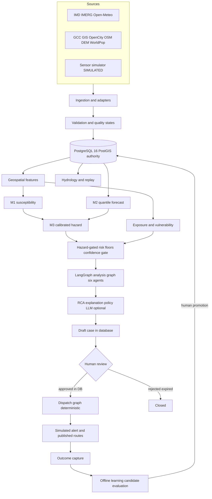
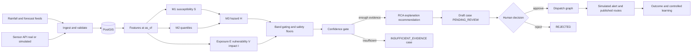
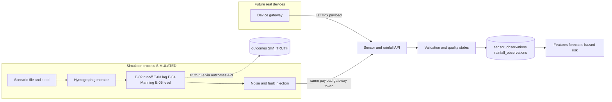
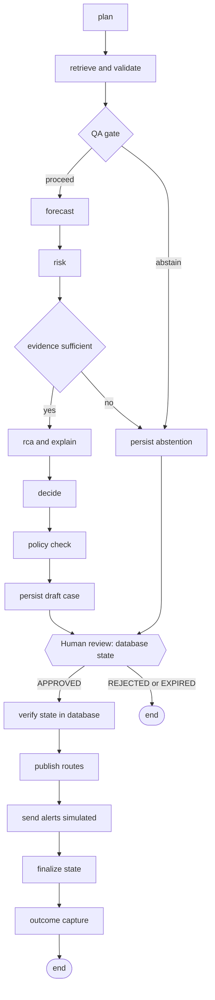
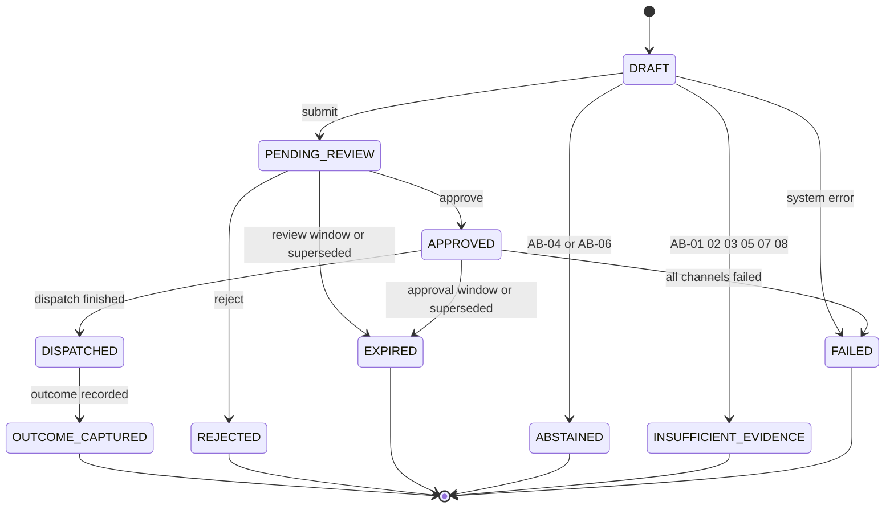
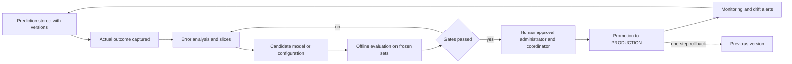
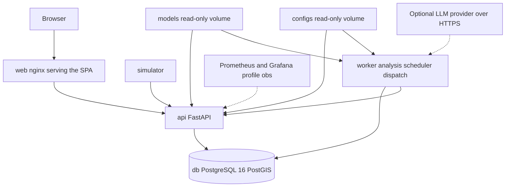

# AQUARIZZ — FINAL TECHNICAL GUIDEBOOK

Chennai Urban Flood Early Warning and Decision-Support System · single source of truth for implementation

Version 1.0 · 9 October 2026 · Status: build-ready MVP specification with a labelled production-evolution path · Operational unit: GCC ward · Analytical unit: 250 m grid

> Reading rules. (1) Every concept is defined once; other sections point to it by ID: equations E-01 to E-19, abstention rules AB-xx, safety floors F-xx, safety invariants S-xx, limitations L-xx. (2) Every value labelled PROTOTYPE or ASSUMED is a starting value chosen by this team. It is not an official threshold and not a measured result. (3) External facts marked VERIFIED were checked on 9 October 2026; anything else is UNVERIFIED. (4) Nothing in this document is a validated hydraulic model, a validated Chennai forecast, or an integration with any authority.

### Evidence labels used throughout

| Label | Meaning | Where it must appear |
| --- | --- | --- |
| OBSERVED | Measured by an instrument or recorded in an authoritative record | Data lineage, UI badge on observed series |
| SIMULATED | Produced by the prototype simulator or a scenario script | Every row (is\_simulated), API field, UI badge, exports |
| DERIVED | Deterministic transformation of observed or static inputs (HAND, ward aggregates) | Feature registry |
| MODELLED | Output of a statistical or ML model | Forecasts, hazard, susceptibility |
| ASSUMED | Engineering assumption with no supporting data | Config files, equation cards |
| PROTOTYPE | Starting value chosen by the team, not official and not validated | Config files, thresholds |
| VALIDATED | Passed evaluation on genuine held-out real-world data, evidence attached | Model cards only; never the default |
| UNVERIFIED | Claim not confirmed against a primary source | Dataset register, limitations |
| SYNTHETIC-VALIDATION | Metric computed on simulated or replayed storms | Every M2 and M3 simulation metric |

## FINAL ARCHITECTURE DECISION

AquaRizz is a **modular monolith with LangGraph orchestration**. One FastAPI backend (API, worker, simulator process) and one React single-page application run under Docker Compose on one machine. PostgreSQL 16 with PostGIS 3.4+ is the only datastore and the only authority for approval state, evidence, versions and audit. There are no microservices, brokers, caches, vector databases or Kubernetes in the MVP.

1. **Pipeline.** SENSE → PREDICT → ASSESS → EXPLAIN → DECIDE → HUMAN REVIEW → ALERT / ROUTE → OUTCOME → CONTROLLED LEARNING.
2. **Space and time.** Decisions and alerts per GCC ward; modelling on a 250 m grid; analysis CRS EPSG:32644 (WGS 84 / UTM 44N); EPSG:4326 only at the API boundary; UTC in storage, IST in display.
3. **Models.** M1 LightGBM static susceptibility (spatially validated). M2 LightGBM quantile forecast of the change in drain water level at +15, +30, +60, +120 min (P10, P50, P90; SYNTHETIC-VALIDATION until real telemetry exists). M3 calibrated logistic hazard H with INITIAL ENGINEERING PRIORS. No deep learning at runtime.
4. **Risk.** Hazard-gated policy: H fixes the permitted band, impact I (from exposure E and vulnerability V) chooses within the band, deterministic safety floors can only raise the level, confidence is a governance gate that never lowers a level and never turns missing evidence into certainty. Abstention (INSUFFICIENT\_EVIDENCE) is a first-class state.
5. **Simulation.** A prototype hydrological and sensor simulator (SCS Curve Number, linear reservoir, Manning capacity proxy) posts through the same sensor API a real device would use. It is always SIMULATED and is never described as a validated hydraulic model.
6. **Agents.** Six typed agents on one analysis graph with fixed, deterministic edges. Every number comes from a tool. The LLM is optional (LLM\_MODE off, template or llm), writes prose only, and is checked by a verifier.
7. **Governance.** The approval state machine lives in PostgreSQL (functions, triggers, privileges). A separate deterministic dispatch graph runs only when the database says APPROVED. Agents hold no dispatch credentials.
8. **Explainability.** Layered and labelled: exact grouped Shapley values on the risk index, exact linear decomposition of the M3 logit, TreeSHAP drill-downs for M1 and M2, a rule trace for the policy. Every explanation cites evidence IDs. RCA reports contributing factors, never proven causation.
9. **Routing.** OSMnx and NetworkX with risk-penalised edge costs. Candidate routes are analytical; publication follows approval.
10. **Learning.** Prediction → outcome → error analysis → candidate → offline evaluation → human approval → promotion. No autonomous retraining or deployment.
11. **Frontend.** React, TypeScript, Vite, Tailwind CSS, TanStack Query, Zustand, MapLibre GL JS, Apache ECharts.
12. **Honesty.** Every simulated, assumed or unverified element is labelled in data, API and UI. Synthetic performance is never presented as real-world accuracy.

## 1. Executive Technical Summary

### 1.1 What is being built

AquaRizz is an explainable, auditable, AI-assisted flood intelligence and decision-support platform for Chennai. It ingests rainfall, forecasts, terrain, drainage, historical flood, exposure and sensor data; estimates static susceptibility; forecasts near-term drain water levels with uncertainty; computes a calibrated flood hazard per ward; combines hazard with exposure and vulnerability into a governed risk level; explains the contributing factors with evidence; recommends monitoring, mitigation, shelter, resource and routing actions; holds every consequential action for human approval; and compares predictions with outcomes so models can be improved under controlled governance.

It is decision support. It is not an autonomous emergency system, and no language model produces a flood number.

### 1.2 Scale of the specification

| Item | Value | Status |
| --- | --- | --- |
| GCC wards | Expected 200; confirm by counting layer 6 of the GCC service at load time | VERIFIED layer exists; count UNVERIFIED |
| 250 m grid cells | About 7,000 for a city area near 426 km2 | DERIVED estimate; recompute from the loaded boundary |
| Forecast horizons | +15, +30, +60, +120 min | Canonical |
| Models | M1, M2, M3 (plus persistence and linear baselines) | Canonical |
| Agents / graphs | 6 agents; analysis graph and dispatch graph | Canonical |
| Database | 39 tables in PostgreSQL 16 + PostGIS | §30 |
| API | 22 canonical endpoints plus 6 supporting endpoints | §29 |
| Equations | E-01 to E-19, each with notation, units, range, limits | §11 to §17, §27 |

### 1.3 Real, simulated and not claimed

| Real or public data (see §8 for verification status) | Simulated (always labelled) | Not claimed |
| --- | --- | --- |
| GCC GIS layers, OpenCity flood and drainage KML, IMD gridded rainfall, GPM IMERG, Open-Meteo forecasts, Copernicus DEM, WorldCover, Open Buildings, WorldPop, OSM | Drain water-level telemetry, rain gauges in replay, sensor faults, drain capacity, notification delivery, demo storms, simulated outcome truth | Live GCC telemetry, radar QPE, validated hydraulic modelling, real SMS or IVRS or CAP transmission, any integration with NDMA, TN SDMA or GCC systems, real-world forecast accuracy |

## 2. Problem Definition

Urban pluvial flooding in Chennai develops over minutes to hours when short, intense rainfall exceeds drain capacity on flat, low-lying, heavily built terrain, sometimes compounded by high water in rivers or at the coast. Decision makers need a ward-level view that combines rainfall, drain state, terrain, history and exposure, says how confident it is, says why, and keeps a human in the loop before anything reaches the public.

The gaps this platform addresses: fragmented data without a common spatial and temporal frame; no calibrated probability that separates hazard from consequence; black-box scores without evidence; no abstention when data are missing, stale or conflicting; no auditable chain from prediction to approval to dispatch to outcome.

### 2.1 Requirement traceability

| # | Requirement | Realised by |
| --- | --- | --- |
| R1 | Ingest rainfall, weather, terrain, drainage, history, exposure, sensor data | §8, §9, §10 |
| R2 | Estimate flood susceptibility | M1, §13.1 |
| R3 | Forecast near-term water-level behaviour | M2, §13.2 |
| R4 | Estimate flood hazard | M3, §13.3 |
| R5 | Combine hazard, exposure, vulnerability into risk | §14, §15 |
| R6 | Identify evidence-supported contributing factors | §17, §18 |
| R7 | Explain why a location is risky | §17 |
| R8 | Recommend mitigation, monitoring, evacuation, resources, routes | §24, §27 |
| R9 | Require human approval for consequential actions | §25 |
| R10 | Evidence, provenance, audit and decision history | §18, §30 |
| R11 | Controlled offline learning from outcomes | §36 |
| R12 | Remain functional without the LLM | §22 |
| R13 | Abstain on insufficient, stale, conflicting or unreliable evidence | §23 |

## 3. System Goals and Non-Goals

**Goals.** G1 ward-level hazard and risk every 5 simulated or real minutes. G2 probabilistic water-level forecasts to 120 min with exceedance probability and time to impact. G3 hazard separated from exposure, vulnerability, impact and confidence. G4 deterministic safety floors on direct observations. G5 evidence-grounded explanations in English and Tamil templates. G6 database-enforced human approval and an append-only, hash-chained audit. G7 simulator interchangeable with real telemetry. G8 identical, reproducible demo. G9 honest labelling of every simulated or assumed element. G10 controlled learning loop.

**Non-goals.** NG1 live GCC telemetry. NG2 validated 1D or 2D hydraulic modelling (SWMM, HEC-RAS, MIKE). NG3 radar nowcasting. NG4 flood depth maps. NG5 autonomous emergency action. NG6 real SMS, IVRS, CAP or WhatsApp delivery. NG7 any NDMA, TN SDMA or GCC integration. NG8 deep learning in the serving path. NG9 microservices, Kafka, Redis, TimescaleDB, MinIO, vector database or Kubernetes in the MVP. NG10 online self-learning. NG11 native mobile apps. NG12 cities other than Chennai. NG13 citizen-report ingestion. NG14 LLM-steered control flow.

## 4. Design Principles

| # | Principle | Enforcement |
| --- | --- | --- |
| P1 | The LLM is not the numerical authority | Numeric fields are produced only by tools in app.forecasting, app.risk and app.geospatial. The LLM adapter returns text that must pass the verifier (§22) |
| P2 | Hazard gates risk | Level bands are chosen from H first; E and V only modulate inside the band (§15) |
| P3 | Evidence for every claim | Explanation factors reference evidence\_items by foreign key; the API refuses a risk without evidence |
| P4 | Uncertainty is explicit; abstention is allowed | Confidence components (§16); INSUFFICIENT\_EVIDENCE state (§23) |
| P5 | Human approval is a database fact | State machine functions, triggers and privileges (§25); no agent credential can dispatch |
| P6 | Provenance and reproducibility | Every assessment stores model, dataset and config versions, a feature snapshot hash and a content hash |
| P7 | Simulation honesty | is\_simulated everywhere; SIMULATED badge; SYNTHETIC-VALIDATION label |
| P8 | Geospatial correctness | One analysis CRS, explicit transformations, SRID constraints, CRS tests |
| P9 | Time correctness | Timezone-aware UTC only; one Clock; as\_of passed explicitly; leakage guards |
| P10 | Controlled learning | Candidate, offline evaluation, human approval, promotion, rollback |
| P11 | Minimum infrastructure, maximum engineering quality | §39, §40 classify everything beyond the core as post-MVP or production |
| P12 | Graceful degradation | Every dependency has a fallback, a user message and an audit entry (§46) |
| P13 | Configuration over constants | Thresholds, weights, intervals and penalties live in versioned config (§32) |
| P14 | Defined once | One canonical definition per equation, schema, state machine and threshold |

## 5. Canonical Architecture

### 5.1 Fifteen logical layers

| # | Layer | Responsibility | Inputs → outputs | Interfaces | Failure modes | Owner module | Nature |
| --- | --- | --- | --- | --- | --- | --- | --- |
| 1 | External and open data sources | Provide rainfall, forecasts, terrain, drainage, labels, exposure inputs | none → files and API responses | HTTP adapters, files | Outage, schema change, licence change | configs/datasets.yaml | External |
| 2 | Data ingestion | Fetch or receive, normalise units, time and CRS, write idempotently, dead-letter rejects | Raw payloads → normalised rows, ingestion\_runs | Adapters; POST /data/rainfall, /data/sensors | Duplicates, malformed data, late data | app/services/ingestion | Deterministic |
| 3 | Validation and quality control | Assign quality states, freshness, conflicts | Rows → quality\_state, flags | Pure validator functions | Missed faults, false flags | app/domain/quality | Deterministic |
| 4 | PostgreSQL + PostGIS | Single authority for spatial data, time series, predictions, evidence, workflow, audit, versions | All → all | Repositories; SQL functions | Outage, constraint violation | db/, app/repositories | Authority |
| 5 | Geospatial processing | Grid, terrain derivatives, zonal statistics, exposure and vulnerability components, road graph | Rasters, vectors → grid\_features, ward\_features | Offline scripts, controlled jobs | CRS error, DEM error | app/geospatial | Deterministic |
| 6 | Hydrological and sensor simulation | Synthetic sensors, scenarios, replay, outcome truth | Scenario → sensor and rain posts | Same HTTP contracts as devices | Unrealistic tuning | app/hydrology | Deterministic, seeded |
| 7 | ML forecasting | M1 susceptibility (offline), M2 quantile forecast (online) | Features → S, quantiles, exceedance | Model registry | Missing model, out-of-distribution input | app/forecasting | Probabilistic |
| 8 | Flood hazard engine | M3 calibrated logistic hazard | Features → H, variant, interval | risk.yaml hazard block | Uncalibrated priors | app/risk/hazard | Probabilistic, transparent |
| 9 | Exposure, vulnerability and risk engine | E, V, impact, band gating, floors, confidence gate | H, E, V → level, governance state | risk.yaml | Mis-set thresholds | app/risk | Deterministic |
| 10 | Agentic intelligence (LangGraph) | Orchestrate six agents; route on conditions; persist drafts | Request → assessment and case draft | Typed AnalysisState and tools | Node failure | app/agents | Agentic, fixed edges |
| 11 | Explainability, evidence and policy | Attribution, RCA, evidence registry, narrative guard, policy rules | Outputs → explanation, recommendations | Evidence IDs, templates, LLM adapter | Unsupported claim | app/explainability, app/policies, app/llm | Deterministic plus optional LLM |
| 12 | Human approval | Review queue; approve or reject; authority and freshness checks | Case → APPROVED or REJECTED | DB functions; /reviews | Stale or duplicate approval | app/services/review, db/functions | Human |
| 13 | Alerting and routing | Candidate routes; dispatch graph; simulated channel adapters | Approved case → deliveries | /alerts, /routes | Channel failure | app/routing, app/services/dispatch | Deterministic after approval |
| 14 | Outcome capture | Record actual outcomes and match them to assessments | Observations, reports → outcomes | POST /outcomes | Label scarcity | app/services/outcomes | Deterministic |
| 15 | Controlled offline learning | Error analysis, candidates, evaluation, human promotion | Outcomes → candidate model or config | Scripts, registry, /models | Leakage, drift | app/workers, scripts | Human-gated |

### 5.2 Authority and trust boundaries

| Boundary | Rule |
| --- | --- |
| Database authority | Approval state, versions, evidence and audit exist only in PostgreSQL. In-memory agent state is never trusted for a safety decision |
| Numerical authority | Only deterministic code and registered models produce numbers. The LLM sees structured JSON and returns prose |
| Approval authority | Only users with the required role, through the review functions, can move a case to APPROVED |
| Dispatch authority | Only the dispatch role (separate database credential) can execute dispatch functions, and only when the case is APPROVED, fresh and hash-matched |
| Configuration authority | Risk, policy and model changes create a new version; promotion needs an administrator and, for thresholds, an emergency coordinator |
| Simulation boundary | Simulator calls the public sensor and rainfall APIs with a gateway token; it has no database access |

### 5.3 Textual architecture

```text
DATA SOURCES (real / simulated)
   ↓ adapters, POST /data/*              [ingestion]
VALIDATION + QUALITY STATES              [deterministic]
   ↓
POSTGRESQL + POSTGIS  ← single authority [state, evidence, audit, versions]
   ↓
GEOSPATIAL FEATURES (grid, ward)         [deterministic]
HYDROLOGY / SIMULATOR (SIMULATED)        [deterministic, seeded]
   ↓
M1 susceptibility → M2 forecast → M3 hazard H      [probabilistic]
   ↓
EXPOSURE E + VULNERABILITY V → impact I [deterministic]
HAZARD-GATED RISK + SAFETY FLOORS + CONFIDENCE GATE [deterministic]
   ↓
LANGGRAPH ANALYSIS GRAPH (6 agents) ── abstain branch → INSUFFICIENT_EVIDENCE
   ↓ RCA / EXPLANATION (LLM optional, verified) → POLICY → PERSIST DRAFT
HUMAN REVIEW (PENDING_REVIEW → APPROVED / REJECTED)   [HUMAN]
   ↓ only if the database says APPROVED
DISPATCH GRAPH (deterministic) → ALERT (SIMULATED) + ROUTE PUBLICATION
   ↓
OUTCOME CAPTURE → ERROR ANALYSIS → CANDIDATE → OFFLINE EVAL → HUMAN PROMOTION
```

The LLM exists only inside the RCA and Explanation, Decision text, and optional natural-language query steps. It does not exist in ingestion, QC, features, M1, M2, M3, risk, floors, confidence, abstention, routing, state transitions or dispatch.

### 5.4 System architecture diagram



### 5.5 Module dependency rules

- One Python package tree under backend/app with one-way dependencies: config and domain → repositories → geospatial, hydrology, forecasting, risk, explainability, routing → services and policies → agents → api and workers. An import-linter contract enforces this in CI.
- app.agents may import analysis tools and repositories bound to the analysis database role. It may not import app.services.dispatch or any dispatch credential. CI fails on violation.
- API routers contain no business logic; they validate, authorise, call a service, and shape the response.
- No module reads environment variables except app.config.settings. No network call happens at import time.

### 5.6 Global conventions

| Topic | Rule |
| --- | --- |
| Time | timestamptz in UTC in storage and API (ISO 8601 with offset); display in Asia/Kolkata (UTC+05:30, no daylight saving); one Clock interface; as\_of is an explicit parameter of every pipeline call |
| CRS | Storage and analysis EPSG:32644; API geometries EPSG:4326 (ST\_Transform at the boundary); EPSG:3857 only for display tiles (§10) |
| Identifiers | Reference data use text keys (W112, SIM-S-W112-04); generated rows use uuid; every external payload carries a request id |
| Run modes | LIVE\_MONITOR (real feeds, drafts only, dispatch disabled), REPLAY (deterministic demo), BACKTEST (historical validation, no alerts) |
| Units | Rain mm and mm/h; levels cm above drain invert at the sensor; rise cm/min; areas m2 or km2; probabilities in \[0,1\] |

## 6. Architecture Decision Records

### 6.1 Consolidation of the two source specifications

Two independent technical guidebooks were reconciled against the canonical decisions. This table is the only place where the sources are compared; everything else in the document is one specification. No source decision made a canonical decision technically impossible, so nothing is flagged CANONICAL DECISION REVIEW REQUIRED. Open data decisions are flagged DECISION REQUIRED where they occur.

| # | Topic | Resolution adopted | Why |
| --- | --- | --- | --- |
| C1 | Hazard model | Calibrated logistic M3 with 12 inputs and INITIAL ENGINEERING PRIORS. The ramp-based trigger idea survives as feature scaling and as dry-day anchors | Transparent, calibratable, exactly attributable in log-odds |
| C2 | Risk level | Hazard-banded policy: H selects a band, impact I selects inside it (a hazard by impact matrix with explicit, configurable cut points) | Exposure can never create a high flood alert without hazard |
| C3 | Effect of low confidence | One source capped the level at HIGH, the other at MEDIUM. Neither is adopted: confidence never lowers a level; it gates governance and a validation cap limits the confidence level | Capping a level can hide real danger |
| C4 | Safety floors | Configurable, versioned, raise-only rules F-01 to F-05 that emit RULE evidence | One source had hard-coded constants and the other had none |
| C5 | Forecast horizons and outputs | +15, +30, +60, +120 min; P10, P50, P90 from LightGBM quantile objectives; conformal interval calibration | Canonical; matches the longer-lead requirement |
| C6 | Model numbering | M1 susceptibility, M2 forecast, M3 hazard | The sources numbered the forecaster differently |
| C7 | Geometry storage | One analysis geometry (EPSG:32644); transform at the API | No duplicated columns or sync triggers |
| C8 | Attribution | Layered, labelled: exact grouped Shapley on the risk index, exact linear logit decomposition, TreeSHAP drill-downs | Brute-force Shapley over every factor does not scale; log-odds shares alone omit exposure |
| C9 | Approval states | Ten canonical states. Richer ideas (changes requested, superseded, cancelled) become reason codes | Single, auditable machine |
| C10 | Approval enforcement | Database functions, triggers, privileges and unique constraints, not only application checks | Application checks alone can be bypassed |
| C11 | Demo ward | DECISION REQUIRED with a recommended default (§41.1) | One source fixed Ward 112; the other required a data rule |
| C12 | Migrations and driver | Alembic with SQL-first revisions; SQLAlchemy 2.0 with psycopg2-binary and GeoAlchemy2 for GeoPandas I/O | Proven toolchain; psycopg 3 is an acceptable later change |
| C13 | Optional components | Mailpit, text knowledge base, indicative flood footprint and a hard-coded LLM model are removed from the MVP | Not needed to meet any requirement; each could hide a dependency |
| C14 | Simulated sensors | 48 sensors: 4 in each of 12 area-of-interest wards; all other wards run the rainfall-plus-static variant | Exercises degraded modes honestly |
| C15 | Hydrology | SCS Curve Number runoff, linear reservoir lag and a Manning capacity proxy retained as a prototype simulator only | Strongest physically structured parts of both sources |
| C16 | Migration of claims | Unsupported figures in the sources (for example named accuracy percentages or unchecked data-source specifics) are excluded or marked UNVERIFIED | Scientific honesty |

### 6.2 Decision records

**ADR-001 — Modular monolith instead of microservices.** Context: a small team, one machine, a demo that must not fail, and a need for transactional consistency between analysis, workflow and audit. Decision: one deployable backend whose API, worker and simulator are processes of the same code base, with enforced module boundaries. Reason: transactional safety, simple debugging, single deployment. Alternatives: microservices; serverless functions. Trade-offs: no independent scaling; boundaries depend on lint rules rather than network walls. Consequences: import-linter contracts (§5.5); dispatch credentials isolated by database role, not by process; future extraction follows module seams (§40).

**ADR-002 — PostgreSQL 16 with PostGIS 3.4+ as the canonical MVP datastore.** Context: spatial joins, time series, versioned configuration, JSON snapshots and transactional approval are all required. Decision: one PostgreSQL instance with PostGIS; time-series tables declared partition-ready; JSONB for feature snapshots and traces. Reason: one engine provides spatial, relational, JSON, triggers and transactions. Alternatives: TimescaleDB, MongoDB, Redis, Kafka, MinIO, a vector database (all FUTURE PRODUCTION EVOLUTION). Trade-offs: ingest volume is modest (48 sensors at one reading per minute is about 69,000 rows a day), so no specialised store is needed. Consequences: raw rasters live under data/ with a manifest and dataset\_versions rows instead of object storage.

**ADR-003 — LightGBM instead of deep learning for MVP forecasting.** Context: tabular features, small data, a need for quantiles, monotone constraints and TreeSHAP, CPU-only demo hardware. Decision: LightGBM for M1 and M2; logistic M3; LSTM, GRU and Transformer models only as notebook benchmarks. Reason: speed, explainability, native quantile and monotone support. Alternatives: deep sequence models; XGBoost or CatBoost (comparable, but LightGBM was chosen for native quantile objectives and monotone constraints). Trade-offs: no learned sequence representations. Consequences: a deep model may replace LightGBM only after genuine held-out telemetry shows meaningful improvement (§36.5).

**ADR-004 — The hydrological simulator generates synthetic and replay data; it is not a validated hydraulic model.** Context: no public drain telemetry exists for Chennai and models need data for development. Decision: a prototype simulator (E-01 to E-05) that posts through the real sensor API and is always labelled SIMULATED. Reason: replay, stress tests, feature generation and a demonstration of temporal behaviour. Alternatives: SWMM, HEC-RAS or MIKE (they need calibrated geometry and observations we do not have); random series. Trade-offs: limited physical realism. Consequences: M2 results are SYNTHETIC-VALIDATION; simulator truth rules are independent of any model; tuning is documented and never done to flatter a model.

**ADR-005 — Calibrated transparent logistic hazard with hazard-gated deterministic risk and safety floors.** Context: weighted sums let exposure inflate alerts, and there are too few labels for an opaque learned risk score. Decision: M3 logistic with initial priors and two-parameter recalibration; band gating; impact split; floors; confidence gate; all versioned. Reason: separates hazard from consequence and is auditable. Alternatives: weighted sum; matrix without calibration; boosted-tree hazard. Trade-offs: coefficients are unvalidated until real outcomes exist. Consequences: calibration plan (§13.3), dry-day tests, policy versioning (§15).

**ADR-006 — Shapley-consistent, model-appropriate explainability with deterministic fallback.** Context: explanations must be faithful, cheap and honest about method. Decision: exact enumeration over at most 12 driver groups on the risk index; exact linear decomposition for the M3 logit; TreeSHAP for M1 and M2; a rule trace for the policy; Monte Carlo permutation sampling labelled APPROXIMATE only above 12 groups. Reason: right tool per model, never mislabelled. Alternatives: LIME, permutation importance, LLM-written reasons. Trade-offs: group definitions influence shares. Consequences: every explanation stores method, baseline, feature set, versions and evidence IDs (§17).

**ADR-007 — The LLM is a language and explanation layer, not a numerical authority.** Context: language models can invent numbers and sources. Decision: LLM\_MODE off, template or llm; structured input with evidence IDs; JSON output verified against the evidence; template fallback. Reason: safety and full offline function. Alternatives: LLM-planned agents, free-text RAG, no LLM. Trade-offs: template prose is less fluent. Consequences: guard rules V1 to V6 (§22) and forbidden-claim tests.

**ADR-008 — Six-agent LangGraph architecture.** Context: the problem naturally splits into retrieval, forecasting, risk, explanation and decision duties that must be auditable. Decision: six agents on a typed state with fixed edges; an analysis graph and a separate dispatch graph. Reason: traceable responsibility and replay. Alternatives: one monolithic function; LLM-planned agent loops; many more agents. Trade-offs: orchestration overhead. Consequences: idempotent nodes, per-agent contracts, agent tests (§19 to §21).

**ADR-009 — Human approval before consequential alerting.** Context: public warnings can cause harm if wrong or late. Decision: every public-facing alert, published route and evacuation recommendation requires an approved case. MEDIUM (advisory) may be approved by a municipal operator; HIGH and VERY\_HIGH need an emergency coordinator. Reason: accountability. Alternatives: automatic dispatch with later review. Trade-offs: added latency. Consequences: approval freshness limits and reminders (§25).

**ADR-010 — Database-enforced approval state machine.** Context: in-memory flags and application checks can be bypassed by bugs or races. Decision: a PostgreSQL enum, a transition-guard trigger, SECURITY DEFINER functions, revoked table privileges, unique constraints and content-hash binding. Reason: safety invariants hold even if application code is wrong. Alternatives: application-only checks; workflow engine; event sourcing. Trade-offs: some logic lives in SQL. Consequences: SQL-level tests for every invariant (§35).

**ADR-011 — OSMnx and NetworkX routing for the MVP.** Context: risk-aware routing is needed without external routing servers. Decision: an OSM drive graph snapshot with risk-penalised edge costs. Reason: runs offline, fully inspectable. Alternatives: OSRM, GraphHopper (production evolution). Trade-offs: no live traffic. Consequences: graph version recorded per route; blocked-edge rules (§27).

**ADR-012 — Docker Compose deployment.** Context: one development machine, reproducible demo. Decision: Compose with database, API, worker, simulator and web. Reason: simplicity and portability. Alternatives: Kubernetes, managed cloud, bare-metal install. Trade-offs: no high availability. Consequences: health checks, one-command demo, production path in §40.

**ADR-013 — Controlled offline learning rather than autonomous online learning.** Context: unsupervised self-modification would defeat audit and safety. Decision: outcomes feed offline error analysis; candidates are evaluated offline; humans approve promotion; rollback is one operation. Reason: reproducibility and accountability. Alternatives: online learning; scheduled auto-retrain. Trade-offs: slower adaptation. Consequences: no write path from outcomes to production parameters except promotion (§36).

## 7. End-to-End System Flow

### 7.1 Stage map

| Stage | What happens | Specified in |
| --- | --- | --- |
| SENSE | Rainfall, forecast, sensor and static data are ingested, validated and stored | §8, §9, §10, §11 |
| PREDICT | M1 susceptibility, M2 quantile forecasts, M3 hazard | §12, §13 |
| ASSESS | Exposure, vulnerability, impact, hazard-gated risk, floors, confidence | §14 to §16 |
| EXPLAIN | Attribution, contributing factors, evidence, narrative | §17, §18, §22 |
| DECIDE | Recommendations and policy checks | §24 |
| HUMAN REVIEW | Approve or reject in the database | §25 |
| ALERT / ROUTE | Dispatch graph, simulated channels, route publication | §26, §27 |
| OUTCOME | Actual outcome recorded and matched | §36 |
| CONTROLLED LEARNING | Error analysis, candidate, offline evaluation, human promotion | §36 |

### 7.2 Data flow



### 7.3 Worked example: heavy rain begins in one ward

Ward W-EX is a fictional label. Every number below is an ILLUSTRATIVE output of the default PROTOTYPE parameters on SIMULATED inputs. None is a Chennai measurement. The engines compute the real values; nothing here is hard-coded.

| # | Step | What happens | Illustrative values | Written to / API |
| --- | --- | --- | --- | --- |
| 1 | Rainfall ingestion | A simulated gauge posts 15-min totals; the forecast adapter stores the latest hourly forecast | Totals 6, 12, 19, 23 mm; R15 = 23 mm (92 mm/h equivalent); R60 = 60 mm; R180 = 85 mm; previous 24 h = 55 mm; forecast for next 60 min = 50 mm | POST /data/rainfall; rainfall\_observations, rainfall\_forecasts |
| 2 | Quality checks | Range, step, duplicate, freshness and cross-source checks | Gauge VALID; forecast issued 40 min ago FRESH | quality\_state, flags |
| 3 | Sensor ingestion | Four simulated drain sensors post once a minute through the sensor API | Sensor 01: level 97 cm, battery 91 %, health OK. Sensor 03 spikes and is marked SUSPECT and excluded | POST /data/sensors; sensor\_observations |
| 4 | Feature generation | Windowed features at as\_of with no look-ahead | util\_max 0.95 (97 of 102 cm critical); rise 1.8 cm/min | feature\_snapshots (hash) |
| 5 | M1 susceptibility | Stored ward summary read | S\_p90 = 0.72 (MODELLED, rank-scaled) | susceptibility\_predictions |
| 6 | M2 forecast | 12 quantile models, conformal widening, exceedance by E-10 | P10/P50/P90 cm: +15 min 99/106/117; +30 min 101/110/123; +60 min 102/114/131; +120 min 99/111/135. Exceedance of 102 cm: 0.73, 0.86, 0.90, 0.80. Time to impact +15 min | waterlevel\_forecasts |
| 7 | M3 hazard | Logistic with priors, FULL variant | z = 1.39; H = 0.80; prior-sensitivity interval 0.65 to 0.89 | assessments |
| 8 | Exposure | Percentile blend E-11 | E = 0.75 | ward\_features |
| 9 | Vulnerability | E-12 | V = 0.70 | ward\_features |
| 10 | Hazard-gated risk | H 0.80 is band 2 (MEDIUM or HIGH); I = 0.75 x (0.5 + 0.5 x 0.70) = 0.64, above the split 0.33 | Level HIGH; risk index 0.63 | assessments |
| 11 | Confidence | Seven components, weighted geometric mean, validation cap | Score 0.80 is HIGH by score; capped to MEDIUM because M2 is trained on synthetic storms and M3 uses uncalibrated priors; governance state EVIDENCE\_REVIEW | assessments |
| 12 | Safety floors | F-01 to F-05 on direct observations | F-03 satisfied (at least MEDIUM): no change. At util 1.0, F-01 would set the floor HIGH | RULE evidence |
| 13 | RCA | Contributing-factor analysis | Dominant: rainfall; then rapid rise with forecast exceedance. Likely mechanism: rainfall above the drain-capacity proxy on susceptible ground. MODEL ATTRIBUTION, not proven causation | explanations |
| 14 | Explainability | Layered attribution and rule trace | M3 log-odds shares: rainfall 36 %, rapid rise 27 %, drainage stress 16 %, forecast rain 9 %, terrain 7 %, history and land cover 4 %. Exposure and vulnerability shares come from the grouped Shapley run on the risk index | explanation\_factors |
| 15 | Recommendation | Policy rules over structured outputs | Stand-by pump and desilting crew; avoid the ward subway; shelter readiness; raise operator watch | recommendations |
| 16 | Candidate routing | Dijkstra over risk-penalised graph | Shelter route 3.4 km, 9 min, maximum edge flood probability 0.18; one subway excluded | routes (CANDIDATE) |
| 17 | Human review | Case DRAFT then PENDING\_REVIEW; reviewer opens the evidence | Severity HIGH needs an emergency coordinator | decision\_cases |
| 18 | Approval | The approve function checks role, hash, freshness and acknowledgement | Approved 4 min after the draft; valid for 30 min | reviews, state APPROVED |
| 19 | Alert simulation | Dispatch graph claims dispatch rows; simulated gateways | SMS, IVRS, push: SIMULATED\_DELIVERED; CAP file exported with status Exercise | dispatches, alerts |
| 20 | Route publication | Routes become PUBLISHED; state DISPATCHED | Route set published to the dashboard | routes |
| 21 | Outcome capture | Outcome row from the simulator truth rule | Ward flooded 27 min after the assessment; lead time from dispatch 23 min | outcomes, state OUTCOME\_CAPTURED |
| 22 | Future learning | Outcome joins the evaluation set | A candidate calibration is evaluated offline; promotion needs human approval | evaluation\_runs, model\_versions |

### 7.4 Variations that must hold

- Dry day, same ward: H is below 0.01 and the level is LOW even with E = 0.75.
- H = 0.25 with a validated sensor at util 1.05: F-01 raises LOW to HIGH and records RULE evidence; the model hazard is unchanged.
- Rainfall feed down and every sensor stale: rule AB-01 returns INSUFFICIENT\_EVIDENCE with reasons and a recommended action; no level is produced.

## 8. Data Sources

Every source is classified REAL / PUBLIC, SIMULATED, OPTIONAL or FUTURE. Verification was performed on 9 October 2026 against official or catalogue pages where noted. VERIFIED means the stated facts were read on a primary or official catalogue page; PARTLY VERIFIED means only third-party documentation was read; UNVERIFIED means not checked in this session, so the team must confirm it in the Phase 1 source probe (§42). No availability, resolution, licence or access claim below is stronger than its status.

### 8.1 Source register

| ID | Dataset | Class | Purpose | Resolution and cadence | Access, licence, authentication | Status (9 Oct 2026) |
| --- | --- | --- | --- | --- | --- | --- |
| D01 | GCC wards and zones: ArcGIS MapServer layers 6 (ward) and 7 (zone) at gisgcc.chennaicorporation.gov.in, service GCCDepts/GCC\_COLLABORATION\_LAYER | REAL / PUBLIC | Decision and alert units; zone context | Vector polygons; static | ArcGIS REST query (JSON, GeoJSON, PBF; page size 2000); native EPSG:32644; no authentication observed; licence not stated in the metadata read | VERIFIED service and layers; ward count and licence UNVERIFIED |
| D02 | GCC drainage and network layers: 8 storm water drain, 1 river, 2 centreline, 3 carriageway, 4 buildings, 5 vehicular subways, 0 bridge | REAL / PUBLIC | Drain proxy, road graph hints, subways, exposure | Vector; static | Same service; drain fields include zone, ward, drain type, width, depth, invert start and end, obstacles, length (km) | VERIFIED layers and field names; completeness of dimensions UNVERIFIED |
| D03 | OpenCity Chennai 2015 flood data: GCC-area hotspots, district hotspots, 2015 inundation zone (KML) | REAL / PUBLIC | Historical flood labels for M1 and backtests | Vector KML (EPSG:4326); event snapshot, files updated 10 Jan 2024 | data.opencity.in resource pages; licence field reads Other (Public Domain); credit OpenCity.in; source chennaifloodsdss.in; no authentication | VERIFIED |
| D04 | OpenCity Chennai basin drainage maps: macro drains, micro drains, rivers and streams (KML) | REAL / PUBLIC | Drainage proximity and density features | Vector KML; updated 11 Jan 2024 | Same portal and licence field | VERIFIED |
| D05 | Shelters and other OpenCity flood datasets named in the team research reports | REAL / PUBLIC | Shelter locations for vulnerability and routing | Points; static | Portal download; capacity often missing | UNVERIFIED |
| D06 | IMD gridded daily rainfall (0.25 degree; 1901 to present; provisional real-time daily) | REAL / PUBLIC | Historical rainfall for backtests and climatology | Daily only; archive by year, real-time provisional | Binary files from IMD Pune, read by the imdlib and imdR packages; no authentication documented by those packages; licence and terms not read | PARTLY VERIFIED (third-party docs) |
| D07 | IMD station, automatic weather station and radar products | OPTIONAL / FUTURE | Gauge truth and nowcasting | Unknown | Registration or agreement may apply | UNVERIFIED |
| D08 | NASA GPM IMERG V07 (Early, Late, Final) | REAL / PUBLIC | Near-real-time satellite rainfall for monitoring; backtest rainfall | 0.1 degree, 30 min; Early about 4 h latency, Late about 14 h, Final about 3.5 months | NASA GES DISC and Earthdata; free and open; a free Earthdata login is typically required (not confirmed on the pages read) | VERIFIED catalogue facts |
| D09 | Open-Meteo Forecast API (hourly precipitation and weather) | REAL / PUBLIC | Rainfall forecast inputs for live-monitor mode | Hourly, about 1 to 11 km model grid depending on model \[UNVERIFIED\]; refreshed several times a day | Keyless HTTPS API; free for non-commercial use only, attribution required, commercial use needs a paid plan; the project README cites CC BY 4.0 while a sub-project cites CC BY-NC 4.0, so treat the free tier as non-commercial; rate limits not read | VERIFIED terms; limits UNVERIFIED |
| D10 | Open-Meteo Historical Weather (reanalysis) API | REAL / PUBLIC | Backtest rainfall for documented events | Hourly | Same terms as D09 | PARTLY VERIFIED (same terms page) |
| D11 | Copernicus DEM GLO-30 (GLO-90 fallback) | REAL / PUBLIC | Elevation, slope, HAND, TWI, sinks | 30 m (90 m fallback); static, 2021 release; a Digital Surface Model | AWS Open Data: s3://copernicus-dem-30m, Cloud Optimized GeoTIFF, anonymous access with --no-sign-request; free under the Copernicus licence with attribution | VERIFIED listing; bucket reachability to be probed |
| D12 | ESA WorldCover v100 (2020) and v200 (2021) | REAL / PUBLIC | Land cover and a built-up proxy for imperviousness | 10 m; annual | AWS Open Data s3://esa-worldcover, anonymous; CC BY 4.0 | VERIFIED |
| D13 | Google Open Buildings v3 | REAL / PUBLIC | Building footprints for exposure | Polygons from 50 cm imagery, inference May 2023; confidence 0.65 to 1.0 | Google research site and Earth Engine; CC BY 4.0 and ODbL 1.0 | VERIFIED dataset and licence; India within the official country list UNVERIFIED |
| D14 | WorldPop India 100 m, constrained and UN-adjusted, 2020 (counts and age-sex structures) | REAL / PUBLIC | Population and vulnerable-group shares | About 100 m; static 2020 vintage | WorldPop Hub GeoTIFF; CC BY 4.0 (layers derived from OSM follow ODbL) | VERIFIED |
| D15 | OpenStreetMap: roads, shelters, hospitals, schools, fire and police | REAL / PUBLIC | Routing graph; critical facilities | Vector; continuous edits, pinned snapshot | OSMnx through Overpass, or a pinned regional extract (preferred); ODbL | UNVERIFIED this session |
| D16 | Sentinel-1 SAR scenes | OPTIONAL | Flood-extent labels for events after 2018 | 10 m; 6 to 12 day revisit | Copernicus Data Space | UNVERIFIED |
| D17 | Global Flood Database (MODIS-derived events) | OPTIONAL | Extra historical labels | 250 m; events reported only to 2018 in the team reports | Earth Engine | UNVERIFIED |
| D18 | Bhuvan flood hazard layers | OPTIONAL | Cross-check of susceptibility | Unknown | Portal | UNVERIFIED |
| D19 | Tide and river-level context | OPTIONAL / FUTURE | Backwater input to M2 and M3 | Hourly | No public feed confirmed; replay uses a SIMULATED tide series | UNVERIFIED |
| D20 | Simulated drain water-level sensors (48) | SIMULATED | Replace telemetry in the MVP | 1 reading per minute | Posted to the sensor API | n/a |
| D21 | Simulated rain gauges, scenario hyetographs, seeded faults | SIMULATED | Replay, stress tests, training data | 5 or 15 min | Posted to the rainfall API | n/a |
| D22 | Real sensor telemetry | FUTURE | Production data | Per device | Same sensor API contract | n/a |
| D23 | Radar quantitative precipitation estimates and nowcasts | FUTURE | Short-lead rainfall | Unknown | Not available to the team | n/a |

### 8.2 Preprocessing, limitations and fallback

| ID | Preprocessing | Main limitations | Fallback |
| --- | --- | --- | --- |
| D01, D02 | Page through the REST service (2000 per page), keep EPSG:32644, repair geometry (ST\_MakeValid), store in wards and drainage\_segments | Drain width, depth and invert fields may be sparse; layer licence unknown | Treat missing dimensions as unknown, use a documented default with ASSUMED flag, lower confidence |
| D03, D04 | Parse KML, assign EPSG:4326, transform to 32644, rasterise to the 250 m grid for labels | Snapshot of one event; positional accuracy unknown; hotspots are points, not extents | Use as positives only, never as proof of dry cells |
| D06, D08, D10 | Clip to a Chennai window, convert to mm, align timestamps to UTC, interpolate nothing | IMERG is about 10 km, coarse for urban pluvial flooding and weaker near coasts; IMD is daily only; Early and Late runs are provisional | Gauge or simulated rainfall; forecast rainfall; abstain if nothing fresh remains |
| D09 | Request hourly precipitation for the AOI centre points, store issue time and model | Non-commercial free tier; model resolution coarse; forecast skill for short intense cells is limited | Persistence of last observed intensity, labelled ASSUMED; abstain per §23 |
| D11 | Reproject COG tiles to EPSG:32644 at 30 m, fill pits, derive slope, HAND, TWI, sinks with pysheds and rasterio | A surface model: buildings and canopy are included, so urban ground level is biased; metre-scale vertical error matters on flat terrain | Use GLO-90 as coarse backup; use HAND and sinks as relative indices, never as depths |
| D12 | Reproject to 32644, compute built-up fraction per cell | Built-up fraction is a proxy for imperviousness; v100 and v200 differ in algorithm | Constant ward-level imperviousness flagged ASSUMED |
| D13 | Filter confidence at 0.75, intersect with cells and wards | Footprints only; no height or use; completeness varies | OSM buildings; or cell built-up fraction from D12 |
| D14 | Resample counts to the grid by area-weighted sum, preserving totals | 2020 vintage; modelled, UN-adjusted; no daytime or floating population | Previous version; flagged DERIVED with vintage shown |
| D15 | Build a drive graph for the Chennai polygon, simplify, snapshot to GraphML with graph\_version | Overpass fair-use limits; attribute completeness varies | Pinned extract file; abstain on routing if the graph is missing (§42) |

### 8.3 Provenance and licence handling

- Every file or feed used by a build is registered in dataset\_versions: dataset id, version tag, source URL, retrieved\_at (UTC), SHA-256, byte size, licence text as read, attribution string, status (VERIFIED, PARTLY VERIFIED, UNVERIFIED). data/MANIFEST.yaml mirrors it for review in pull requests.
- No silent refresh. Rebuilding features from a changed source creates a new dataset\_version and a new feature\_version. Old assessments keep pointing at the versions they used.
- Attribution strings (Open-Meteo, Copernicus, WorldPop, ESA WorldCover, Google Open Buildings, OpenStreetMap, OpenCity) are shown in the UI footer and in exports.
- Open-Meteo free access is non-commercial; any commercial or institutional production use needs a licence change before go-live (risk R-05). OSM-derived outputs follow ODbL obligations.

### 8.4 Phase 1 source probe

scripts/probe\_sources.py runs once per environment and writes reports/source\_probe.json: reachability and status codes; ArcGIS feature counts per layer (wards, zones, drains); DEM tile availability for the AOI (aws s3 ls --no-sign-request); WorldCover and WorldPop file sizes; the Open-Meteo response for one test point; field completeness for drain width, depth and invert. Statuses in this section change from UNVERIFIED to VERIFIED only through this report, with the date.

## 9. Data Ingestion and Quality

### 9.1 Ingestion architecture

- Adapters implement one protocol: fetch(window) returns a raw batch with source metadata; normalise(batch) returns typed rows (UTC time, SI units, EPSG:32644 geometry). Adapters never write to the database directly; the ingestion service does, in one transaction per batch.
- Scheduling is a loop in the worker process driven by configs/app.yaml intervals: forecasts every 30 min; IMERG every 30 min in live-monitor mode; simulator pushes continuously in replay mode. Every run writes an ingestion\_runs row (source, window, started\_at, finished\_at, status, rows\_in, rows\_ok, rows\_rejected, error).
- Idempotency: natural unique keys (station and observed\_at and interval; sensor and observed\_at; forecast source and issued\_at and valid\_at) with ON CONFLICT DO NOTHING for exact duplicates. A duplicate key with a different value is written to rejected\_records as DUPLICATE\_CONFLICT and never overwrites the first value.
- Dead letter: schema failures and conflicts go to rejected\_records (payload, reason, source, received\_at) and are visible in GET /data/quality.

### 9.2 Payload contracts

The simulator and real devices use exactly the same endpoints and fields.

| Field | Type | Rule |
| --- | --- | --- |
| sensor\_id | text | Must exist in sensors; unknown ids are rejected |
| timestamp | timestamptz | Observation time, ISO 8601 with offset; rejected if more than 120 s in the future |
| latitude, longitude | number | WGS 84 degrees; must be within 250 m of the registered position or the row is SUSPECT |
| water\_level\_cm | number | Centimetres above drain invert at the sensor |
| rainfall\_mm | number or null | Rain collected since the previous reading, if the device has a gauge |
| battery\_pct | number | 0 to 100 |
| health | text | OK, DEGRADED or FAULT |
| quality | text | Device-reported GOOD, FAIR or POOR; informative only |
| source | text | Must equal the registered source of the sensor, for example DEVICE or SIMULATOR; clients cannot assert is\_simulated |
| ingested\_at | timestamptz | Set by the server |

```json
{"sensor_id": "SIM-S-WEX-01", "timestamp": "2026-11-14T12:35:00+00:00", "latitude": 13.0001, "longitude": 80.2002, "water_level_cm": 97.0, "rainfall_mm": null, "battery_pct": 91, "health": "OK", "quality": "GOOD", "source": "SIMULATOR"}
```

Rainfall payload: station\_id, observed\_at, interval\_minutes (5, 15 or 60), rain\_mm, source. Both endpoints accept a batch of up to 500 records and return per-record outcomes. is\_simulated is derived on the server from the registry (sensors and rainfall\_stations tables), not from the payload.

### 9.3 Data quality states

Seven states describe every input. Ingestion assigns VALID, SUSPECT, OUTLIER and INVALID to stored rows; the feature builder derives STALE, MISSING and CONFLICTING at read time for the given as\_of, and stores them in feature\_snapshots.input\_quality.

| State | Meaning | Feature builder | Confidence | Abstention | Explanation | Audit |
| --- | --- | --- | --- | --- | --- | --- |
| VALID | Passed all rules and fresh | Used | none | none | Cited as evidence | Row logged |
| SUSPECT | Passed hard rules, failed a soft rule (late, jump, low battery, stuck) | Used only if no VALID alternative; flagged | c\_sensor multiplied by 0.6 per suspect weight | none alone | Listed as caveat | Flag logged |
| STALE | Older than the fresh limit but not expired | Used with its age as a feature; never shown as current | c\_fresh reduced by age | Counts toward AB-05 only when every dynamic input is EXPIRED | Message states the age | Staleness logged |
| MISSING | No usable value, or EXPIRED | Feature null; hazard variant may change | c\_complete reduced | AB-01 when no dynamic evidence remains | States what is missing | Gap logged |
| CONFLICTING | Two valid sources disagree beyond tolerance | Both candidates kept; dual run (§23) | c\_agree reduced | AB-04 when the two candidates differ by 2 or more levels | Shows both | Conflict logged |
| OUTLIER | Statistical spike or implausible jump | Excluded unless corroborated by a neighbour or rainfall | c\_sensor reduced | none alone | Shown as excluded | Exclusion logged |
| INVALID | Fails a hard rule (unparseable, impossible value, future time) | Never used | none | none | none | Row or reject logged |

### 9.4 Validation rules (configs/quality.yaml, all PROTOTYPE)

| Rule | Applies to | Test | Result |
| --- | --- | --- | --- |
| QR-01 | Rainfall | rain\_mm below 0, or an hourly equivalent above 300 mm | INVALID |
| QR-02 | Rainfall | hourly equivalent between 120 and 300 mm without a second source above 60 mm | OUTLIER |
| QR-03 | Rainfall | gauge and IMERG or forecast differ by more than a factor of 3 and by more than 20 mm per hour | CONFLICTING flag on the pair |
| QS-01 | Sensor | water\_level\_cm below -5 or above 1.3 times drain depth | INVALID |
| QS-02 | Sensor | timestamp more than 120 s in the future | INVALID |
| QS-03 | Sensor | received more than 10 min after observed | SUSPECT |
| QS-04 | Sensor | Hampel filter, window 7, deviation above 4 scaled MAD | OUTLIER |
| QS-05 | Sensor | rate of change above 10 cm per minute | SUSPECT |
| QS-06 | Sensor | 15 identical consecutive readings during rain above 5 mm per hour | SUSPECT (stuck) |
| QS-07 | Sensor | battery below 15 percent, or health FAULT | SUSPECT |
| QS-08 | Ward | two VALID sensors differ in utilisation by more than 0.6 without rainfall or neighbour support | CONFLICTING |
| QS-09 | Sensor | no reading for more than 10 min | MISSING (derived) |

```python
def classify_sensor(r, prev, cfg, now):
    if r.level_cm < -5 or r.level_cm > 1.3 * r.drain_depth_cm: return 'INVALID'
    if r.timestamp > now + cfg.max_future: return 'INVALID'
    flags = []
    if now - r.timestamp > cfg.late_after: flags.append('LATE')
    if prev and abs(r.level_cm - prev.level_cm) / max(1, minutes(r, prev)) > cfg.max_rate: flags.append('JUMP')
    if r.battery_pct < 15 or r.health == 'FAULT': flags.append('HEALTH')
    return 'SUSPECT' if flags else 'VALID'   # OUTLIER and STUCK use windows in the worker
```

### 9.5 Freshness thresholds (configs/quality.yaml, PROTOTYPE)

| Data type | FRESH if age is at most | STALE if age is at most | EXPIRED above | Note |
| --- | --- | --- | --- | --- |
| Water-level sensor reading | 3 min | 10 min | 10 min | One reading per minute |
| Gauge rainfall (15-min totals) | 20 min | 60 min | 60 min | Age from interval end |
| IMERG Early (live-monitor only) | 6 h | 12 h | 12 h | Nominal latency about 4 h |
| Hourly rainfall forecast, age from issue time | 3 h | 6 h | 6 h | Used for rain\_fcst\_60 |
| Tide or river context (optional) | 3 h | 12 h | 12 h | Simulated in replay |
| Static layers | By dataset\_version | none | none | A new version needs a new feature build |
| Routing graph snapshot | 30 d | 180 d | 180 d | Routing warns, never abstains the assessment |
| An assessment at approval and at dispatch | 30 min | none | none | Governance limit, see §25 |

Stale data are never silently substituted for current data: a STALE input keeps its age on every row, in the feature snapshot, in the explanation and in the confidence score. In REPLAY the Clock supplies as\_of, so freshness is evaluated against simulated time.

### 9.6 Failure semantics for adapters

Timeout 20 s; three retries with exponential backoff (2 s, 8 s, 30 s) plus up to 20 percent jitter; a circuit breaker opens after five consecutive failures and probes again after 15 min; each failure writes an ingestion\_runs row with status FAILED and an audit entry. A failed source marks its data STALE then EXPIRED by the thresholds above; the pipeline continues with other evidence or abstains by the rules in §23. Recovery is automatic on the next successful run; no manual reset is required.

### 9.7 Point-in-time correctness

Reads for an assessment at as\_of use observations with observed\_at at or before as\_of and ingested\_at at or before as\_of. This prevents late-arriving data from leaking into a historical assessment and makes REPLAY and BACKTEST reproducible. Late rows are stored with their true observed\_at and ingested\_at and are used by later assessments only.

### 9.8 Acceptance criteria

- A batch with duplicates, malformed rows and a future timestamp returns per-record outcomes; valid rows are stored; rejects appear in rejected\_records and GET /data/quality.
- Posting the same batch twice changes nothing.
- A client cannot make a real sensor look simulated or the reverse.
- A reading 11 minutes old is treated as MISSING for features and cited as such in the explanation.
- All 12 rules above have a unit test with a passing and failing case.

## 10. Geospatial Architecture

### 10.1 Stack and roles

| Tool | Role | Runs |
| --- | --- | --- |
| PostGIS 3.4+ | Storage, GiST indexes, server-side spatial joins and aggregations, SRID constraints | Online |
| GeoPandas, Shapely | Vector cleaning, overlay, grid construction, loading with to\_postgis | Offline scripts |
| pyproj | Explicit transformers (always\_xy=True) | Offline and API boundary |
| rasterio, rioxarray | Raster reading, reprojection, windowed reads, zonal statistics | Offline scripts |
| pysheds | Pit filling, flow direction, accumulation, HAND, TWI | Offline scripts |
| OSMnx, NetworkX | Drive graph, edge attributes, shortest paths | Offline build; online routing |
| MapLibre GL JS | Rendering of GeoJSON in the browser | Client |

### 10.2 Coordinate reference systems

| Data | Source CRS | Rule |
| --- | --- | --- |
| GCC ArcGIS layers (D01, D02) | EPSG:32644 (native, VERIFIED) | Stored unchanged |
| OpenCity KML (D03, D04) | EPSG:4326 (KML standard) | Transform to 32644 on load |
| Copernicus DEM, IMERG, WorldPop, WorldCover, Open Buildings, OSM | Geographic WGS 84 (EPSG:4326) as published | Reproject rasters and vectors to 32644 on load |
| Analysis and storage | EPSG:32644 (WGS 84 / UTM zone 44N) | Every geometry column has CHECK (ST\_SRID(geom) = 32644) |
| API and UI | EPSG:4326 with 6 decimals (about 0.1 m) | ST\_Transform at the response boundary only |
| Map tiles | EPSG:3857 | Handled by MapLibre; never stored |

Zone 44N (78 to 84 degrees east) covers Chennai; scale distortion across the city is below 0.05 percent, so areas, lengths and 250 m cells are metric-accurate for this purpose. Transformations use pyproj Transformer objects built once per process. No query transforms geometry inside a join; both sides are already EPSG:32644.

### 10.3 Geometry validity and simplification

On load: ST\_MakeValid, drop parts with area under 1 m2 or length under 0.5 m, force counter-clockwise exterior rings, and assert ST\_IsValid. Analysis uses full-resolution geometry. API responses simplify wards with ST\_SimplifyPreserveTopology at 5 m tolerance and round coordinates to 6 decimals. Ward boundary changes create a new dataset\_version and a new feature\_version; old assessments are not rewritten.

### 10.4 Grid, raster alignment and aggregation

- Grid. 250 m square cells in EPSG:32644 anchored at x0 = floor(xmin / 250) x 250 and y0 = floor(ymin / 250) x 250 of the city bounding box, built with ST\_SquareGrid and clipped to the ward union. Each cell belongs to the ward with the largest overlap (centroid-in-ward breaks ties); cells that cross a ward boundary have is\_edge\_cell = true.
- Analysis rasters. Elevation is resampled bilinearly to a 30 m EPSG:32644 grid on a DEM window buffered 2 km beyond the city to avoid edge effects in flow accumulation. Categorical rasters are never resampled by interpolation: class fractions are counted at native resolution.
- Zonal statistics use pixel-centre inclusion. Boundary error is at most half a pixel (15 m for the DEM). A cell contains about 69 DEM pixels.
- Population is conserved: 100 m counts are subdivided to a 25 m grid (each pixel divided by 16, nearest assignment; 250 divided by 25 is an integer, so cells align exactly) and summed per cell.
- Server-side joins: ward and cell by overlap area; cell and drain by ST\_DWithin and ST\_Intersection length; facilities by ST\_Contains; nearest shelter by the KNN operator. Large raster work stays offline in scripts; the API never computes rasters.
- Indexing: GiST on every geometry; B-tree on foreign keys; BRIN on time columns; VACUUM ANALYZE after every bulk load.

### 10.5 Spatial relationships

| Relationship | Key | Static or dynamic | Built by | Used by |
| --- | --- | --- | --- | --- |
| Grid cell to ward | grid\_cells.ward\_id | Static per boundary version | Largest-overlap rule | All features, aggregation |
| Drainage segment to ward | drainage\_segments.ward\_id | Static | GCC attribute, else spatial assignment | Drain density, capacity proxy |
| Road edge to ward and cell | road\_edges.ward\_id, cell\_id (edge midpoint) | Static per graph version | Midpoint rule | Exposure, routing |
| Shelter to ward and road node | shelters.ward\_id, node\_id | Static; open or closed status is operational (post-MVP) | Nearest node | Vulnerability, routing |
| Critical facility to ward | critical\_facilities.ward\_id | Static | ST\_Contains | Exposure, recommendations |
| Sensor to ward | sensors.ward\_id | Static mapping, dynamic health | Point in ward at registration | Hazard inputs |
| Rainfall station or forecast point to ward | station\_ward map | Static mapping, dynamic values | Nearest-point assignment at registration | Rainfall inputs |
| Ward hazard and edge risk | assessments, routes | Dynamic | Per assessment from H, S and flags | Alerts, routing |

### 10.6 Terrain pipeline

DEM window → urban correction → pit fill → flow direction (D8) → accumulation → HAND relative to mapped channels → TWI → depression depth. Mapped rivers and macro drains (D02, D04) are burned into the DEM and used as the HAND reference network; where they are missing, a flow-accumulation threshold is used and flagged ASSUMED. Because the Copernicus DEM is a surface model, pixels covered by buildings (Open Buildings confidence at least 0.75) are replaced by the 10th percentile of non-building pixels in a 150 m window. This correction is DERIVED and ASSUMED; a notebook compares HAND with and without it, and the lower-confidence variant is used if the two disagree materially. HAND, TWI and sink depth are relative indices, never flood depths.

### 10.7 Spatial tests

- Every geometry column has SRID 32644 and passes ST\_IsValid.
- Sum of cell areas per ward is within 1 percent of the ward area (excluding sliver wards).
- No gaps or overlaps between cells inside the ward union.
- Round-trip 32644 to 4326 to 32644 error is under 0.01 m on 1,000 random points.
- Population totals before and after gridding match within 0.1 percent.
- Known fixtures (three points with documented ward membership) fall in the expected wards.

## 11. Hydrological and Sensor Simulation

This component is the PROTOTYPE HYDROLOGICAL / SENSOR SIMULATOR. It is not a validated hydraulic model and does not replace SWMM, HEC-RAS or MIKE. Its purposes: (1) synthetic sensor generation, (2) scenario simulation, (3) replay, (4) stress testing, (5) feature generation for M2, (6) demonstrating temporal relationships. Everything it produces is labelled SIMULATED.

### 11.1 Architecture and the shared contract



The simulator has no database access. It authenticates with a gateway token, posts through POST /data/sensors and POST /data/rainfall exactly as a device would, and records truth through POST /outcomes with label\_source SIM\_TRUTH. Replacing it with real telemetry means registering real sensors with source DEVICE; no downstream component changes (contract test test\_sim\_vs\_device\_contract).

### 11.2 Equations E-01 to E-05

| ID | Equation | Notation and units | Valid range and assumptions | Implementation | Limitations |
| --- | --- | --- | --- | --- | --- |
| E-01 Rainfall accumulation | R\_w(t) = sum of r\_k x dt\_k over intervals with t - w < t\_k <= t; i\_eq(t) = max(R\_60, 4 x R\_15); R\_ante = sum over (t - 25 h, t - 1 h\] | r\_k intensity mm/h; dt\_k hours; w in {15, 30, 60, 180} min; R in mm; i\_eq in mm/h | r\_k >= 0; windows right-closed; null if interval coverage is under 80 percent (never zero-filled) | Pure function over time-ordered rows; as\_of guard | Extrapolating a 15-min burst to an hourly rate overstates short bursts; gauge undercatch ignored |
| E-02 SCS Curve Number runoff | S = 25400 / CN - 254; Ia = 0.2 x S; Q(P) = (P - Ia)^2 / (P - Ia + S) for P > Ia, else 0; incremental runoff q\_k = Q(P\_k) - Q(P\_k-1); CN = 98 x f + 79 x (1 - f) | P cumulative event rainfall mm (reset after 6 h dry); S, Ia, Q mm; CN dimensionless; f built-up fraction | CN in \[30, 100\]; 0.2 and the CN values 98 and 79 are PROTOTYPE ASSUMPTIONS | Vectorised; clip P at 0 | Designed for event totals; sub-hourly use is a coarse approximation; no antecedent-moisture adjustment |
| E-03 Linear reservoir lag | r\_eff(t + dt) = r\_eff(t) + (dt / tau) x (q(t) - r\_eff(t)) | q runoff rate mm/h; tau lag minutes (PROTOTYPE 12 to 30); dt minutes | tau > 0; dt <= tau / 2 | Sub-step 10 s | Single store; no spatial routing |
| E-04 Manning capacity proxy | A = b x h; P = b + 2h; R = A / P; Q(h) = (1 / n) x A\_eff x R^(2/3) x S0^(1/2); A\_eff = (1 - beta) x A | b width m; h depth m; S0 slope m/m; n 0.015 s/m^(1/3) (ASSUMED); beta blockage fraction 0 to 0.5; Q m3/s | h <= D (drain depth); S0 >= 0.0005 (ASSUMED floor); missing geometry uses flagged defaults | Closed-form; no iteration | Uniform steady flow; ignores backwater, culverts, junction losses |
| E-05 Water-level evolution and rise | dh/dt = (q\_in - q\_out) / A\_s; q\_in = r\_eff / 3.6e6 x A\_c; q\_out = phi\_tide x Q\_eff(h); rise rho(t) = (h(t) - h(t - 300 s)) / 5 min | A\_s = b x L m2; A\_c catchment m2; phi\_tide in \[0, 1\]; h m; rho cm/min; utilisation u = h / h\_crit | h clipped to \[0, 1.15 D\]; h\_crit = 0.85 D (PROTOTYPE) | Explicit Euler, 10 s internal step, 60 s output; non-negativity asserted | Lumped one-compartment drain; no network interaction |

Drain geometry, catchment areas, lag and blockage for each simulated sensor are drawn from stated distributions (configs/simulator.yaml, ASSUMED) and tuned only so that the demonstration storm produces a legible warn-then-critical response. They are not calibrated to any Chennai drain and are never described as such.

```python
def step(s, p, rain_mm_h, dt_s):
    P = s.P_cum + rain_mm_h * dt_s / 3600
    q_rate = (scs_runoff(P, p.cn) - scs_runoff(s.P_cum, p.cn)) / (dt_s / 3600)   # E-02
    r_eff = s.r_eff + (dt_s / (p.tau_min * 60)) * (q_rate - s.r_eff)           # E-03
    q_in = r_eff / 3.6e6 * p.catchment_m2                                       # m3/s
    q_out = p.tide_factor * manning_q(s.h, p)                                   # E-04
    h = s.h + (q_in - q_out) / (p.width_m * p.reach_m) * dt_s                   # E-05
    return State(P_cum=P, r_eff=r_eff, h=min(max(h, 0.0), 1.15 * p.depth_m))
```

### 11.3 Scenarios

| ID | Scenario | Purpose |
| --- | --- | --- |
| SC-01 | Normal | No rain, noise only; checks that the system stays LOW and quiet |
| SC-02 | Rising | Gradual intensification and slow rise; checks forecast response |
| SC-03 | Threshold crossing | Level crosses h\_crit; checks floor F-01 and exceedance |
| SC-04 | Rapid rise | Steep hyetograph; checks floors F-03 and F-04 and lead time |
| SC-05 | Sensor dropout | Sensors stop; checks MISSING and variant switch |
| SC-06 | Stale data | Delayed delivery; checks STALE handling and abstention |
| SC-07 | Noisy data | Heavy noise and spikes; checks OUTLIER handling |
| SC-08 | Contradictory data | Two sensors disagree; checks CONFLICTING and AB-04 |
| SC-09 | Extreme event | Very high intensity and long duration; checks VERY\_HIGH |
| DEMO-STORM-01 | Demonstration storm | Scripted hyetograph for the demo (§41) |
| REPLAY-2015 | Hindcast of the November to December 2015 event using D10 rainfall to drive simulated sensors | Backtest showcase, labelled SIMULATED |

Fault injection (all seeded and recorded in sim\_runs, never in the payload): dropout windows, spikes, stuck values, slow drift, extra noise, delivery delay, duplicate posts, contradictory offsets. Every scenario file fixes its seed, so a run is reproducible bit for bit.

### 11.4 Simulated truth and anti-circularity

Simulated truth: a ward is flooded when at least max(2, 30 percent of its sensors) have h at or above drain depth for 3 consecutive minutes. Truth is computed by the simulator from its own state, not by M2, M3 or the risk engine. Hidden simulator parameters (CN, tau, beta, n, catchment) are never model features. The simulator is not tuned to improve any model metric. Metrics on simulator data are labelled SYNTHETIC-VALIDATION everywhere.

### 11.5 Training data for M2

At least 400 seeded scenarios with parameter draws and faults; split by scenario into train, validation and test (70, 15, 15); DEMO-STORM-01 and SC-09 are held out entirely.

### 11.6 Tests and acceptance

- Same seed gives identical output; different seeds differ.
- Mass balance: with q\_out = 0, the level rise equals inflow volume divided by surface area within 1 percent.
- Monotonicity: more rain never lowers peak level for the same parameters.
- Posting through the API produces rows indistinguishable from device rows except source and is\_simulated.
- Each scenario triggers its intended quality or abstention behaviour.

## 12. Feature Engineering

### 12.1 Static features (grid cell, then ward aggregate)

| Feature | Definition | Source | Unit | Used by |
| --- | --- | --- | --- | --- |
| elev\_m | Mean elevation | D11 | m | M1 |
| slope\_deg | Mean slope | D11 | degrees | M1 |
| hand\_m | Height above nearest drainage | D11, D02, D04 | m | M1, M3 (ward hand\_p10) |
| twi | Topographic wetness index | D11 | none | M1 |
| sink\_depth\_m | Depression depth within the cell | D11 | m | M1 |
| flow\_acc\_log | Log upstream accumulation | D11 | log cells | M1 |
| drain\_dist\_m, drain\_density | Distance to and length density of mapped drains | D02, D04 | m, km per km2 | M1 |
| river\_dist\_m | Distance to river or macro drain | D02, D04 | m | M1 |
| imperv | Built-up fraction | D12 | 0 to 1 | M1, M3 |
| landcover\_frac | Class fractions | D12 | 0 to 1 | M1 |
| hist\_freq | Share of documented events that flooded the cell or its 250 m neighbourhood | D03 | 0 to 1 | M3 only (label-derived, so excluded from M1) |
| pop, pop\_sensitive | Population, population under 5 and over 65 | D14 | persons | E, V |
| bldg\_count, bldg\_area | Building count and footprint area | D13, D02 | count, m2 | E |
| road\_km | Road length | D15, D02 | km | E, V |
| S (M1 output) | Susceptibility, rank-scaled | M1 | 0 to 1 | M3, E |

Ward aggregates: S\_p90 (90th percentile of S), hand\_p10 (10th percentile), hist\_freq and imperv (area means), and the exposure and vulnerability components of §14.

### 12.2 Dynamic features at as\_of

| Feature | Definition | Used by |
| --- | --- | --- |
| rain\_int\_eq | i\_eq from E-01 using the best valid source (gauge, else IMERG, else forecast) | M3 |
| rain\_acc\_180, rain\_ante\_24h | R\_180 and R\_ante from E-01 | M2, M3 |
| rain\_fcst\_next\_h | Forecast rainfall for the next 15, 30, 60, 120 min (mm) | M2; rain\_fcst\_60 for M3 |
| level\_t, d\_level\_5, d\_level\_15, d\_level\_30 | Current level and level changes over 5, 15, 30 min | M2 |
| util\_max, rise\_max | Maximum utilisation u and rise rho among VALID sensors in the ward | M3 |
| p\_exc\_max | Maximum over horizons of exceedance probability (E-10) | M3 |
| tide\_cm | Tide or backwater index (SIMULATED in replay; optional) | M2, M3 |
| time\_since\_onset | Minutes since intensity exceeded 5 mm/h | M2 |
| sensor\_quality | Fraction of sensors VALID; mean age | M2, confidence |

### 12.3 Normalisation (E-06)

| ID | Equation | Notation | Range and assumptions | Implementation | Limitations |
| --- | --- | --- | --- | --- | --- |
| E-06 Feature normalisation | Dynamic inputs to M3: x\_tilde = min(max(x / s, 0), c), with scale s and cap c from configs/risk.yaml. Ward components for E and V: Pct(x) = (rank\_avg(x) - 0.5) / N | x raw value; s scale; c cap (1.5 for rain, 1.2 for utilisation, 1.5 for rise); N number of wards | Values in \[0, c\]; Pct in (0, 1); ranks computed per feature\_version over all wards | Scale and cap in config; percentile tables rebuilt only on a new feature\_version | Percentiles are relative to Chennai wards, not absolute; caps hide extremes beyond c |

### 12.4 Leakage guards, snapshots and versions

- FeatureBuilder.build(as\_of) takes every window end at or before as\_of and every row with ingested\_at at or before as\_of; a violation raises LeakageError and the assessment fails closed.
- M1 and M2 labels are never visible to features: hist\_freq for M1 is computed leave-one-event-out (§13.1).
- Each build stores a feature\_snapshot (canonical JSON with input\_quality per feature) and its SHA-256, referenced by the assessment. feature\_version names the code and config that produced it.
- Known mismatch (limitation L-03): flood labels date from 2015 while terrain, land cover and population date from 2020 to 2023.

### 12.5 Equation index

| ID | Quantity | Defined in |
| --- | --- | --- |
| E-01 to E-05 | Rainfall accumulation, SCS-CN runoff, linear reservoir, Manning proxy, water-level evolution and rise | §11.2 |
| E-06 | Feature normalisation | §12.3 |
| E-07 | Logistic hazard | §13.3 |
| E-08 | M1 susceptibility | §13.1 |
| E-09 | M2 quantile forecasting | §13.2 |
| E-10 | Exceedance probability and time to impact | §13.2 |
| E-11, E-12, E-13 | Exposure, vulnerability, impact | §14 |
| E-14 | Hazard-gated risk | §15 |
| E-15 | Confidence | §16 |
| E-16 | Safety floors | §15.4 |
| E-17 | Shapley and model attribution | §17 |
| E-18 | Route cost | §27 |
| E-19 | Calibration metrics | §13.3 and §36 |

## 13. Machine Learning Architecture

### 13.0 Overview

| Model | Question | Unit | Algorithm | Output | Status label until real validation | Fallback |
| --- | --- | --- | --- | --- | --- | --- |
| M1 | Which places are intrinsically prone to ponding? | 250 m cell | LightGBM binary classifier, rank-scaled | S in (0, 1), ward summary S\_p90 | MODELLED; spatially cross-validated on sparse labels; not VALIDATED | S\_fallback index (ASSUMED) |
| M2 | How will the drain water level change over the next 15 to 120 min? | Sensor (drain reach) | 12 LightGBM quantile models plus conformal calibration | P10, P50, P90 levels, exceedance probability, time to impact | MODELLED; SYNTHETIC-VALIDATION | Persistence baseline with empirical intervals |
| M3 | What is the probability of flood-impacting inundation in the ward within 120 min? | Ward | Calibrated logistic model | H, prior-sensitivity interval, variant | MODELLED with PROTOTYPE priors; calibration\_status shown | None; abstain if unavailable (AB-03) |

Common rules: fixed seeds (42); every artifact is hashed (SHA-256) in model\_versions and verified at load; a hash or version mismatch triggers AB-08; every prediction row stores model\_version\_id; no model is retrained or replaced at runtime (§36).

### 13.1 M1 static flood susceptibility

**Purpose and output.** M1 ranks cells by static propensity to pond. It runs offline; its output is stored in susceptibility\_predictions and summarised per ward.

**Equation E-08.** p\_c = sigmoid(F(x\_c)), where F is the sum of LightGBM trees fitted by weighted logistic loss; S\_c = (rank(p\_c) - 0.5) / N\_cells, the percentile rank over all cells for the model version.

| ID | Notation and units | Valid range and assumptions | Implementation | Limitations |
| --- | --- | --- | --- | --- |
| E-08 | x\_c static features (§12.1 without hist\_freq or any distance to a flagged location); p\_c score; S\_c in (0, 1) | Features scaled by trees, no normalisation needed; labels are positives plus confident negatives (below) | lightgbm objective binary, seed 42, scale\_pos\_weight capped at 20 | S is a rank, not a probability of flooding: absolute prevalence is unknown because negatives are unlabelled |

**Features.** All static features of §12.1 except the label-derived hist\_freq and hotspot distance. M1 is therefore label-free in its inputs, which prevents leakage through neighbours of held-out cells. hist\_freq is used only by M3.

**Labels.** Positives: cells inside or within 250 m of documented flooded geometry (D03 inundation zone, weight 1.0; hotspot points, weight 0.6; Sentinel-1 or GFD extents when added, weight 0.8). Confident negatives: cells farther than 500 m from every flagged geometry of every event. All other cells are unlabelled and excluded from training. This is positive-unlabelled learning in a pragmatic form; the 500 m rule is a PROTOTYPE assumption and is varied (300, 500, 800 m) in a sensitivity run; S rankings must keep Spearman correlation at or above 0.9 across the variants or the confidence component c\_model is reduced.

**Validation (spatially aware).** Five folds of 2 km blocks (block ids assigned to folds by seeded shuffle); training cells within 500 m of a test block are removed (buffer). Leave-one-event-out is added when at least two events have labels. A random K-fold run is reported next to the block run; the AUC gap quantifies spatial leakage and must be shown in the model card. Temporal leakage: M1 labels are historical events and features are present-day layers (limitation L-03); results are never described as forecasts of future flooding.

```python
def spatial_folds(cells, block_m=2000, buffer_m=500, n_folds=5, seed=42):
    block = (cells.x // block_m).astype(int).astype(str) + '_' + (cells.y // block_m).astype(int).astype(str)
    ids = block.unique(); np.random.default_rng(seed).shuffle(ids)
    fold_of = {b: i % n_folds for i, b in enumerate(ids)}
    fold = block.map(fold_of)
    for k in range(n_folds):
        test = fold == k
        halo = cells.geometry[test].buffer(buffer_m).unary_union
        train = (~test) & (~cells.geometry.within(halo))
        yield cells.index[train], cells.index[test]
```

**Metrics.** ROC-AUC, PR-AUC (reported next to the positive prevalence of the evaluation set), precision, recall and F1 at the operating point (top 20 percent of cells by S, PROTOTYPE), reliability of rank-binned scores on the balanced evaluation set with an explicit positive-unlabelled caveat, spatial generalisation gap (block minus random), and S stability across the negative-radius variants.

**Hyperparameters (defaults).** num\_leaves 31, learning\_rate 0.05, up to 600 trees with early stopping on the validation block folds, min\_data\_in\_leaf 40, feature\_fraction 0.8, bagging\_fraction 0.8, lambda\_l2 5. Monotone constraints (PROTOTYPE, physical plausibility): elevation, HAND, slope negative; sink depth and TWI positive.

**Fallback.** If fewer than 2 events or 300 positive cells exist, or the model fails its gates, S\_fallback is used: S = 0.25 x (1 - Pct(elev)) + 0.25 x (1 - Pct(hand)) + 0.15 x Pct(sink) + 0.15 x Pct(twi) + 0.10 x Pct(imperv) + 0.10 x (1 - Pct(drain\_dist)), labelled ASSUMED, with c\_model reduced.

**Tests.** No training cell lies within the buffer of a test block; S is in (0, 1) and invariant to monotone transformations of p; monotone constraints hold on probe sweeps; the artifact reproduces the same ranks from the same seed.

### 13.2 M2 probabilistic water-level forecasting

**Target.** For each sensor, the change in level delta\_h(t + k) = h(t + k) - h(t) at k in {15, 30, 60, 120} min. Modelling the change rather than the absolute level removes the offset between sensors and focuses the model on dynamics.

**Equation E-09.** For each horizon k and quantile tau in {0.1, 0.5, 0.9} one LightGBM model (objective quantile, alpha = tau) minimises the pinball loss L\_tau(y, q) = max(tau x (y - q), (tau - 1) x (y - q)). The level forecast is h\_tau(t + k) = max(0, h(t) + q\_tau(k)). Quantile crossings are removed by sorting the three values per prediction (monotone rearrangement). That is 12 models.

**Inputs.** level\_t; d\_level\_5, d\_level\_15, d\_level\_30; rainfall windows R\_15, R\_30, R\_60, R\_180 and antecedent rain (E-01); forecast rainfall for the next 15, 30, 60, 120 min; tide index; time since onset; static local features of the sensor cell (hand\_m, slope\_deg, imperv, S); sensor quality flags. Hidden simulator parameters are never inputs.

**Baselines.** B0 persistence: P50 = h(t), P10 and P90 from empirical training quantiles of delta\_h per horizon. B1 linear statistical baseline: ridge regression on the same inputs for delta\_h, with empirical residual quantiles per horizon for P10 and P90.

**Quantile calibration (default: split conformalised quantile regression).** On the validation scenarios compute s\_i = max(q10\_i - y\_i, y\_i - q90\_i); let q\_hat be the ceil((1 - alpha)(n + 1)) / n empirical quantile of s\_i with alpha = 0.2; the calibrated interval is \[q10 - q\_hat, q90 + q\_hat\] (q\_hat may be negative and shrinks an over-wide interval). P50 is unchanged. One q\_hat per horizon is stored in the artifact. The coverage guarantee holds only under exchangeability, which is true inside the simulator distribution and not for Chennai; calibration results are SYNTHETIC-VALIDATION.

**Equation E-10: exceedance probability and time to impact.** Given calibrated h\_0.1 <= h\_0.5 <= h\_0.9 at horizon k and the critical level h\_crit, build a piecewise-linear CDF F\_k through (h\_0.1, 0.1), (h\_0.5, 0.5), (h\_0.9, 0.9), extended linearly with the end slopes to 0 and 1 in the tails. Then p\_exc(k) = clip(1 - F\_k(h\_crit), 0.01, 0.99), passed through an isotonic reliability map g learned on validation scenarios when at least 2,000 samples exist (identity otherwise). Time to impact t\_imp = min{k : p\_exc(k) >= 0.5}, or null. Expected crossing time is the linear interpolation, between horizons, of where the P50 trajectory meets h\_crit. Ward aggregation: p\_ward(k) is the mean of the two highest p\_exc among VALID sensors (the single value if only one sensor is valid, with a confidence penalty); p\_exc\_max = max over k of p\_ward(k).

| ID | Notation and units | Valid range and assumptions | Implementation | Limitations |
| --- | --- | --- | --- | --- |
| E-09 | h in cm; tau quantile level; k minutes; L pinball loss | tau in (0, 1); h >= 0; features available at t only | lightgbm objective quantile with alpha; 400 trees early-stopped; seed 42; rearrangement after prediction | Independent models per horizon and quantile; no joint trajectory coherence |
| E-10 | h\_crit cm (0.85 x drain depth); F\_k piecewise CDF; p\_exc in \[0.01, 0.99\] | Three quantiles are enough only if the distribution is unimodal near the threshold | numpy interpolation; isotonic map from validation | Tail shape is an assumption; probabilities are SYNTHETIC-VALIDATION calibrated |

**Validation.** Scenario-level split (70, 15, 15) so no scenario appears in two splits; DEMO-STORM-01 and SC-09 are held out entirely. Metrics: MAE and RMSE of P50, MAPE only where the level exceeds 20 cm, pinball loss per tau, prediction-interval coverage probability of \[P10, P90\] (design target 0.80 plus or minus 0.05), mean interval width (sharpness), lead-time performance (median minutes between p\_ward at least 0.5 and the true crossing, plus false-alarm rate), and skill against B0 and B1 (1 minus the ratio of MAE). Design targets, not results: coverage within the band at every horizon; MAE at least 20 percent lower than persistence at +30 to +120 min on held-out synthetic scenarios. Every table and chart carries the label SYNTHETIC-VALIDATION; no text may say real-world accuracy.

```python
Q = (0.1, 0.5, 0.9); H = (15, 30, 60, 120)
def fit_m2(X, Y, Xv, Yv):                       # Y[h] = delta level at horizon h
    models, qhat = {}, {}
    for h in H:
        for q in Q:
            m = lgb.LGBMRegressor(objective='quantile', alpha=q, n_estimators=400, learning_rate=0.05,
                                  num_leaves=31, min_child_samples=100, random_state=42)
            m.fit(X, Y[h], eval_set=[(Xv, Yv[h])], callbacks=[lgb.early_stopping(30)])
            models[(h, q)] = m
        lo, hi = models[(h, 0.1)].predict(Xv), models[(h, 0.9)].predict(Xv)
        s = np.maximum(lo - Yv[h], Yv[h] - hi)
        qhat[h] = np.quantile(s, min(1.0, np.ceil(0.8 * (len(s) + 1)) / len(s)))   # CQR, alpha = 0.2
    return models, qhat
```

**Fallback and real-data path.** If M2 is unavailable, B0 supplies wide empirical intervals, c\_model falls, and nothing abstains by itself. When genuine telemetry exists, M2 is re-evaluated on real held-out storms (labelled OBSERVED); only then may the label VALIDATED be set. Simulated and real data are never pooled for evaluation, only for optional training with a source flag.

### 13.3 M3 flood hazard

**Definition.** H is the probability that the ward has a flood-impacting inundation within T\_H = 120 min (the outcome rule is the simulator truth rule in replay and the recorded outcome in real use, §36.3). It is produced by a transparent logistic model so every coefficient can be read, audited and attributed.

**Equation E-07.** z = beta\_0 + sum over j of beta\_j x\_tilde\_j (inputs normalised by E-06); H = sigmoid(a + s x z) = 1 / (1 + exp(-(a + s x z))), where (a, s) are the calibration parameters (a = 0, s = 1 for uncalibrated priors).

**Variants.** FULL (at least one VALID sensor and non-expired rainfall), RAIN\_STATIC (rainfall but no VALID sensor), SENSOR\_STATIC (sensors but no usable rainfall). With neither, the engine abstains (AB-01). A variant change is recorded on the assessment and always reduces c\_complete.

**INITIAL ENGINEERING PRIORS / PROTOTYPE PARAMETERS (not fitted, not validated Chennai coefficients).**

| Input x\_j | Meaning | Scale and cap (E-06) | FULL beta | RAIN\_STATIC beta | SENSOR\_STATIC beta |
| --- | --- | --- | --- | --- | --- |
| intercept | Base log-odds | n/a | -8.0 | -6.5 | -6.8 |
| rain\_int\_eq | Rainfall intensity | 50 mm/h, cap 1.5 | 1.6 | 2.4 | 0 |
| rain\_acc\_180 | Rainfall accumulation | 100 mm, cap 1.5 | 0.5 | 0.8 | 0 |
| rain\_ante\_24h | Antecedent rainfall | 100 mm, cap 1.5 | 0.5 | 0.8 | 0 |
| rain\_fcst\_60 | Forecast rainfall next hour | 50 mm, cap 1.5 | 0.8 | 1.2 | 0 |
| util\_max | Current water level over critical | 1, cap 1.2 | 1.4 | 0 | 2.0 |
| rise\_max | Water-level rise | 2 cm/min, cap 1.5 | 1.2 | 0 | 1.6 |
| p\_exc\_max | Forecast exceedance (M2) | 1, cap 1 | 1.4 | 0 | 1.8 |
| S\_p90 | Terrain susceptibility (M1) | 1, cap 1 | 1.0 | 1.0 | 1.0 |
| low\_elev | 1 - min(hand\_p10 / 3 m, 1) | 1, cap 1 | 0.6 | 0.6 | 0.6 |
| hist\_freq | Historical flood frequency | 1, cap 1 | 0.6 | 0.6 | 0.6 |
| imperv | Imperviousness proxy | 1, cap 1 | 0.4 | 0.4 | 0.4 |
| tide | Tide or backwater (coastal wards) | 100 cm, cap 1 | 0.5 | 0.5 | 0.5 |

**How the priors were set.** All weights are non-negative, so H never decreases when any input rises (verified by finite differences in tests). Intercept and weights were chosen to satisfy four anchor constraints, then frozen as hazard\_params\_v1: A1 dry-day: for every ward with zero rainfall, util at most 0.2 and statics at their citywide maximum, H < 0.05; A2 heavy rain (60 mm/h, 70 mm over 3 h, util 0.7, rise 0.8 cm/min, p\_exc 0.5, median statics): 0.05 <= H < 0.30; A3 extreme (75 mm/h or more, 150 mm over 3 h, util 1.0, rise 1.5 cm/min, p\_exc 0.9, high statics): H >= 0.90; A4 monotonicity. These constraints are engineering judgement, not data.

**Prior-sensitivity interval.** 200 draws multiply each weight by a uniform factor in \[0.8, 1.2\] and shift the intercept by up to 0.5; the 10th and 90th percentiles of H are stored as hazard\_p\_low and hazard\_p\_high and feed the confidence component c\_prior (§16).

**Calibration.** Default method: two-parameter logit recalibration (Platt style) H\_cal = sigmoid(a + s x z), fitted by maximum likelihood with an L2 pull toward the identity, minimise the negative log-likelihood + 5.0 x a^2 + 5.0 x (s - 1)^2 on ward-hour samples. Why this default: it preserves ranking and monotonicity, it needs few parameters (important with a handful of events), and it corrects both base rate and over- or under-confidence; temperature scaling alone cannot shift the base rate; isotonic regression overfits small samples and creates steps. Rules by data volume: with fewer than 3 independent real events only the intercept a is fitted (s = 1); with 3 or more events (a, s) are fitted; isotonic is allowed only with at least 500 positive ward-hours across at least 5 independent events. Ward-hours inside one event are correlated, so quality is estimated by leave-one-event-out and the effective sample size reported is the number of independent events. Calibration datasets: (1) REAL: backtests on documented events with outcome labels; (2) SYNTHETIC: simulated storms with SIM\_TRUTH, which may be used to check mechanics and to set a SYNTHETIC\_CALIBRATED parameter set for the demonstration, but is never promoted as production calibration. calibration\_status is UNCALIBRATED\_PRIORS, SYNTHETIC\_CALIBRATED or REAL\_CALIBRATED and is displayed in the UI.

| ID | Notation and units | Valid range and assumptions | Implementation | Limitations |
| --- | --- | --- | --- | --- |
| E-07 | beta\_j weights; x\_tilde\_j normalised inputs in \[0, cap\]; z log-odds; a, s calibration; H probability | beta\_j >= 0; s > 0; inputs per E-06 | numpy; config hazard block with version | Additive log-odds with no interactions; priors unvalidated; one label definition for all horizons |
| E-19 | Brier = mean of (H\_i - y\_i)^2; log loss; ECE = sum over bins of (n\_b / N) x abs(mean y\_b - mean H\_b) with 10 equal-frequency bins; calibration slope and intercept from regressing outcomes on logit(H) | y in {0, 1}; N independent events reported | scikit-learn metrics plus calibration curve | Small N; correlated ward-hours; synthetic outcomes are SYNTHETIC-VALIDATION |

**Evaluation.** ROC-AUC, PR-AUC, Brier score, calibration curve and reliability, confusion matrix at the policy cut points (0.30, 0.60, 0.85), dry-day sanity (A1 on every ward), monotonicity (A4), calibration slope and intercept, and per-event results. **Threshold selection.** Initial cut points are PROTOTYPE values; after calibration they are chosen to minimise expected cost for a configured missed-event to false-alert cost ratio (default 5 to 1 for MEDIUM, 10 to 1 for HIGH) subject to precision floors, and any change is a new risk configuration version approved under §36. **Drift monitoring.** Population stability index of each input, rolling calibration slope and intercept, rolling ECE; alerts go to the Model and Data Quality view and never change parameters automatically. **Versioning and approval.** Parameters and calibration live in a model\_versions row (kind M3) and a config\_versions row; a change creates a candidate, passes offline evaluation, and is promoted only with administrator and emergency coordinator approval.

### 13.4 Model registry, artifacts and integrity

- model\_versions holds: kind (M1, M2, M3, B0, B1), version\_tag (for example m2-2026.10.1), status (CANDIDATE, STAGING, PRODUCTION, RETIRED), artifact\_path, artifact\_sha256, feature\_version, dataset\_version\_ids, config\_version, training run (seed, git SHA, library versions), validation\_label (SYNTHETIC-VALIDATION or REAL-HELDOUT), calibration\_status, created\_by, approved\_by, approved\_at.
- Artifacts live under models/{kind}/{version\_tag}/ as model.txt (LightGBM text format), params.json, calibration.json, card.md and SHA256SUMS. A partial unique index allows exactly one PRODUCTION version per kind.
- At load the service verifies the SHA-256, the feature list against the current feature\_version, and the status. Any mismatch raises AB-08 for assessments that need that model.
- Every model card states intended use, data, features, metrics with their validation labels, known failure cases, calibration status and approvals.

## 14. Exposure and Vulnerability

Exposure, vulnerability and impact are separate from hazard. Exposure says how much could be affected; vulnerability says how severely and how well people can cope; impact combines them. All weights below are PROTOTYPE ENGINEERING PARAMETERS. No vulnerability coefficient is derived from data.

### 14.1 Exposure E-11

Per ward, four susceptibility-weighted totals are computed from the grid (S is the M1 score of each cell; the weighting makes the totals relative indices, not counts of people at risk):

| Component | Definition | Source |
| --- | --- | --- |
| e1 pop\_sw | Sum over cells of population x S | D14, M1 |
| e2 bldg\_sw | Sum over cells of building footprint area x S | D13, D02, M1 |
| e3 road\_sw | Sum over cells of road length x S | D15, D02, M1 |
| e4 crit\_w | Sum over critical facilities of type weight x S of its cell (hospital 3, fire or police 2, power substation 2, school 1.5, shelter 1) | D15, D02 |

E = 0.40 x Pct(e1) + 0.15 x Pct(e2) + 0.15 x Pct(e3) + 0.30 x Pct(e4), with Pct the percentile rank over all wards (E-06). Totals rather than densities are used because consequences scale with absolute numbers.

### 14.2 Vulnerability E-12

| Component | Definition | Source |
| --- | --- | --- |
| v1 sensitive\_share | S-weighted share of population under 5 or over 65 | D14 |
| v2 shelter\_gap | Population-weighted network distance to the nearest flood-safe shelter (shelter cell with HAND above 2 m) | D15, D05, graph |
| v3 egress\_exposure | Share of ward road length with edge susceptibility at least 0.7 | graph, M1 |
| v4 density | Population density | D14 |

V = 0.40 x Pct(v1) + 0.25 x Pct(v2) + 0.20 x Pct(v3) + 0.15 x Pct(v4). If shelter data are missing, v2 is dropped, the remaining weights are renormalised, the ward is flagged ASSUMED and c\_complete falls. Physical susceptibility is deliberately not part of V (it is already in M1 and M3), which avoids counting it twice. Shelter capacity is not used because it is often unknown.

### 14.3 Impact E-13

I = E x (v0 + (1 - v0) x V), with v0 = 0.5. I is zero when nothing is exposed, vulnerability scales severity between 0.5 and 1 times the exposure, and I stays in \[0, 1\].

| ID | Notation | Valid range and assumptions | Implementation | Limitations |
| --- | --- | --- | --- | --- |
| E-11 | e\_i totals; Pct rank in (0, 1); weights sum to 1 | Wards compared within the same feature\_version | Computed in the geospatial job, stored in ward\_features | Relative index; large wards score high; 2020 population vintage |
| E-12 | v\_i components; same weights rule | As above; missing components renormalised and flagged | As above | Weights are expert judgement; shelter distance ignores flooding of the route itself |
| E-13 | E, V in (0, 1); v0 = 0.5 | v0 in \[0, 1\] | One line in the risk engine | Multiplicative form assumes exposure sets scale; not validated |

### 14.4 Governance of these parameters

Weights live in configs/risk.yaml under exposure and vulnerability, versioned. A sensitivity run multiplies each weight by 0.75 and 1.25 and must keep ward rank correlation (Kendall tau) at or above 0.8, otherwise the model card flags the index as fragile. E and V are static per feature\_version; dynamic exposure (daytime population, events, shelter occupancy) is not modelled in the MVP (limitation L-11). Property test: for H below the first band cut, the level is LOW for every E and V in \[0, 1\] (§15.3).

## 15. Risk Engine

### 15.1 Separation of concerns

Hazard H (M3), exposure E, vulnerability V, impact I and confidence c are separate stored quantities. Conceptually Risk = f(H, E, V, I, confidence); this is an operational engineering formulation, not a physical law. Level, governance state and recommendations are different outputs and are never merged into one score.

### 15.2 Policy parameters (configs/risk.yaml, version risk\_policy\_v1, all PROTOTYPE)

| Band k | Hazard range | Permitted levels | Impact split tau\_k |
| --- | --- | --- | --- |
| 0 | H < 0.30 | LOW only | not used |
| 1 | 0.30 <= H < 0.60 | LOW or MEDIUM | 0.33 |
| 2 | 0.60 <= H < 0.85 | MEDIUM or HIGH | 0.33 |
| 3 | H >= 0.85 | HIGH or VERY\_HIGH | 0.33 |

Other parameters: v0 = 0.5 (E-13); risk-index constant r0 = 0.4; floor hold 30 min; de-escalation rules in §15.6. Cut points, splits and levels are configuration, calibrated and approved under §13.3 and §36, versioned in config\_versions.

### 15.3 Hazard-gated classification (E-14)

```python
def classify(H, E, V, floors, cfg):
    I = E * (cfg.v0 + (1 - cfg.v0) * V)                    # E-13
    k = sum(1 for c in cfg.cuts if H >= c)                  # band index 0..3
    lo, hi = cfg.band_levels[k]
    level = hi if (k > 0 and I >= cfg.split[k]) else lo      # impact chooses inside the band
    level_before = level
    for f in floors:                                        # F-01..F-05, raise only
        level = max(level, f.level)
    risk_index = H * (cfg.r0 + (1 - cfg.r0) * I)            # ranking and attribution only
    return level, level_before, I, risk_index, k
```

Properties enforced by tests: (P1) before floors, H below the first cut gives LOW for every E and V; (P2) the level is non-decreasing in H, E and V; (P3) floors can only raise (level >= level\_before); (P4) the function is deterministic and uses only versioned configuration; (P5) the LLM has no input to this function. The continuous risk index orders wards, shades the map and is the target of attribution (§17); it never classifies.

| ID | Notation | Valid range and assumptions | Implementation | Limitations |
| --- | --- | --- | --- | --- |
| E-14 | H in \[0, 1\]; I in \[0, 1\]; cuts increasing in (0, 1); split in \[0, 1\]; r0 in \[0, 1\] | Configuration validated at start: cuts strictly increasing, band levels ordered, no level skips | classify() above | Cut points and splits are PROTOTYPE until calibrated and approved; two bands share a level (MEDIUM, HIGH), so a level can be reached from two bands |

### 15.4 Safety floors (E-16)

Floors respond only to direct observations. They are configuration (risk.yaml, safety\_floors), versioned, evaluated by code the LLM cannot touch, and each trigger writes RULE evidence with the readings used. A floor may raise a level and never lowers one. Only VALID sensor readings that are FRESH can trigger a floor; a triggered floor holds for at least 30 min (latching) so one missing reading cannot drop the level.

| Floor | Condition (PROTOTYPE values) | Floor level |
| --- | --- | --- |
| F-01 validated threshold crossing | A VALID sensor has util at or above 1.0 for 2 consecutive readings | HIGH |
| F-02 extreme observed level | At least 2 VALID sensors, or 30 percent of the ward's VALID sensors (minimum 2), have level at or above drain depth | VERY\_HIGH |
| F-03 rapid rise near threshold | A VALID sensor has util at or above 0.8 and a rise of at least 1.0 cm/min over 5 min | MEDIUM |
| F-04 rapid rise at high utilisation | A VALID sensor has util at or above 0.9 and a rise of at least 2.0 cm/min over 5 min | HIGH |
| F-05 extreme rainfall | A VALID gauge shows i\_eq at or above 100 mm/h, or IMERG at or above 100 mm/h corroborated by a gauge or a forecast at or above 60 mm/h | MEDIUM |

Equation E-16: level\_final = max(level\_hazard\_gated, max over triggered floors of floor\_level). Limitation: floors are expert judgement; they raise alerts on observations even when the model hazard is low, so each trigger is reviewed in the outcome analysis.

### 15.5 Outputs, severity and authority

The assessment stores H, hazard band, I, E, V, level before floors, floors applied, final level, risk index, time to impact, confidence and governance state. Mapping to alert class and approval authority: MEDIUM is an ADVISORY (municipal operator may approve); HIGH is a WARNING and VERY\_HIGH is URGENT (emergency coordinator required). LOW produces no case; it is logged and shown on the map.

### 15.6 Hysteresis and de-escalation

Escalation is immediate. A ward drops one level only after 3 consecutive assessments (15 min) with the computed level lower and H at least 0.05 below the band edge; floors that are latched hold first. A de-escalation proposal is a recommendation that needs human review; the system never publishes an all-clear by itself.

### 15.7 Risk evaluation

Positive event: a ward flood outcome (real outcome record, or SIM\_TRUTH in replay). Metrics: precision of HIGH and VERY\_HIGH cases (cases followed by a flood within 120 min); false-alert rate (HIGH or above with no flood within 120 min); missed-event rate (events with no case at or above HIGH in the 120 min before onset); lead time (onset minus the first HIGH case); calibration of H per level; hazard-gating sanity (no HIGH case with H below 0.60 unless a floor fired). All simulated results are labelled SYNTHETIC-VALIDATION.

### 15.8 Failure behaviour

Invalid risk configuration (non-increasing cuts, unknown level, missing floor field) stops the engine and returns INSUFFICIENT\_EVIDENCE with reason CONFIG\_INVALID (rule AB-03); the previous valid configuration is never silently reused if the active version is invalid.

## 16. Confidence and Uncertainty

Confidence describes the quality of evidence and the validity of the models. It is stored separately from risk. It can restrict what a human is allowed to do and can trigger abstention; it never lowers a level and never turns missing evidence into certainty.

### 16.1 Components

| Component | Meaning | Definition (all in \[0, 1\]) |
| --- | --- | --- |
| c\_fresh | Data freshness | Mean over used dynamic inputs of f\_i: 1 if FRESH; falls linearly to 0.4 between the fresh and expired limits (§9.5); EXPIRED inputs are excluded and counted in c\_complete |
| c\_sensor | Sensor quality and coverage | min(1, n\_valid / min(2, n\_registered)) x mean quality weight (VALID 1.0, SUSPECT 0.6; OUTLIER excluded). Wards with no registered sensor use 0.5 |
| c\_agree | Source agreement | 1 - min(1, D), D = max of the sensor disagreement (largest pairwise utilisation gap divided by 0.6) and the rainfall disagreement (abs of ln((gauge + 1) / (other + 1)) divided by ln 4). With a single source: 0.8 |
| c\_complete | Feature completeness | Sum of FULL-variant weights of available inputs divided by the sum of all weights |
| c\_model | Model availability and validity | 1.0 x (1 - fraction of M2 inputs outside the training range) x 0.85 if M2 is synthetic-trained only x 0.85 if M3 is not REAL\_CALIBRATED x 0.9 if M1 is the fallback index |
| c\_fcst | Forecast uncertainty | 1 - min(1, W), W = mean over +30, +60, +120 min of (h\_0.9 - h\_0.1) / h\_crit |
| c\_prior | Sensitivity to the unvalidated priors | 1 - min(1, (H\_p90 - H\_p10) / 0.8) while calibration\_status is not REAL\_CALIBRATED; otherwise 1 |

### 16.2 Composition (E-15)

c = product over components of c\_i^(w\_i), with weights fresh 0.15, sensor 0.20, agree 0.15, complete 0.10, model 0.15, fcst 0.10, prior 0.15 (sum 1). A weighted geometric mean is used so one very weak component pulls the score down instead of being averaged away. Level: HIGH if c >= 0.75, MEDIUM if 0.50 <= c < 0.75, LOW otherwise; any component below 0.30 forces LOW. Validation cap (PROTOTYPE default, on): while any decision-critical model lacks real-world validation (M2 SYNTHETIC-VALIDATION, M3 not REAL\_CALIBRATED, or M1 not spatially validated), the confidence level is at most MEDIUM. The cap limits the stated confidence, not the risk level.

| ID | Notation | Valid range and assumptions | Implementation | Limitations |
| --- | --- | --- | --- | --- |
| E-15 | c\_i in (0, 1\]; w\_i weights sum to 1 | c\_i floored at 0.01 before the product | numpy; stored in assessments.confidence\_components | Weights and the 0.75 and 0.50 cuts are PROTOTYPE; components are heuristics, not calibrated probabilities |

### 16.3 Governance gate

| Confidence | Governance state | Effect |
| --- | --- | --- |
| HIGH | STANDARD\_REVIEW | Normal approval path |
| MEDIUM | EVIDENCE\_REVIEW | The reviewer must open the evidence panel before approval is accepted (the approve function checks the server-side EVIDENCE\_VIEWED record) |
| LOW | ENHANCED\_REVIEW | An emergency coordinator is required even for MEDIUM severity; a written acknowledgement is required; recommendations are limited to monitoring and verification plus floor-driven actions; evacuation routes cannot be published without a coordinator override reason |
| Abstain (c below 0.20, or any AB rule) | NOT\_ASSESSABLE | INSUFFICIENT\_EVIDENCE case; no level, no recommendation of action beyond verification (§23) |

Because of the validation cap, every prototype assessment is at most MEDIUM confidence, so EVIDENCE\_REVIEW is the minimum governance state until real validation exists. The UI says so explicitly.

### 16.4 Presentation and tests

H is always shown with its interval, M2 forecasts with P10 to P90 bands, and confidence with the component breakdown and one plain-language sentence per weak component. Tests: confidence is non-increasing when any component worsens; removing an input never raises confidence; any component below 0.30 yields LOW; the validation cap holds; no path yields HIGH confidence on an abstained assessment; the weights sum to 1.

## 17. Explainability

Explanations are layered, each layer uses the method that is appropriate and cheap for its model, and each records its method so an approximation is never called exact.

### 17.1 Layers and method labels

| Layer | Explains | Method label | Exact or approximate |
| --- | --- | --- | --- |
| L1 Risk-driver attribution | Why the risk index of this ward is what it is, across hazard drivers, exposure and vulnerability | EXACT\_SHAPLEY\_GROUPED | Exact for the deterministic risk-index function over at most 12 groups; above 12 groups the engine switches to APPROXIMATE\_SHAPLEY\_SAMPLED |
| L2 Hazard log-odds decomposition | Why H is high or low | LINEAR\_LOGIT\_EXACT | Exact for the linear logit with a reference point |
| L3 Model drill-downs | Why M1 rates the ground susceptible; why M2 forecasts a rise | TREESHAP\_PATH\_DEPENDENT | TreeSHAP computes Shapley values exactly for its path-dependent value function; it is not the same as an interventional Shapley value over a background sample, and is labelled as TreeSHAP, not as brute-force Shapley |
| L4 Policy trace | Why the level and governance state are what they are | RULE\_TRACE | Deterministic |

### 17.2 Driver groups for L1 (G = 9)

| Group | Members |
| --- | --- |
| g1 rain\_intensity\_accumulation | rain\_int\_eq, rain\_acc\_180, rain\_ante\_24h |
| g2 forecast\_rain | rain\_fcst\_60 |
| g3 drainage\_stress | util\_max |
| g4 rapid\_rise | rise\_max, p\_exc\_max |
| g5 terrain\_susceptibility | S\_p90, low\_elev |
| g6 history\_land\_cover | hist\_freq, imperv |
| g7 tide | tide |
| g8 exposure | E |
| g9 vulnerability | V |

### 17.3 Equation E-17: Shapley and model attribution

L1. Let v(S) be the risk index R\_idx (E-14) with the inputs of the groups in S at their actual values and all other groups at the reference vector. The Shapley value of group g is phi\_g = sum over S not containing g of \[ |S|! (G - |S| - 1)! / G! \] x (v(S plus g) - v(S)). Efficiency holds exactly: the sum of phi\_g equals R\_idx(x) - R\_idx(x\_ref). The reference vector is: dynamic inputs 0, static inputs and E and V at their citywide medians. With G = 9 there are 512 evaluations of a closed-form function per ward. Display share\_g = phi\_g divided by the sum of absolute contributions, signed.

L2. For z = beta\_0 + sum of beta\_j x\_tilde\_j, the exact attribution is phi\_j = s x beta\_j x (x\_tilde\_j - x\_tilde\_ref\_j), with sum equal to s x (z - z\_ref). Shares are given in log-odds space only; probabilities are not additive.

L3. shap.TreeExplainer with tree\_path\_dependent perturbation on the M1 model and the M2 P50 model. Contributions are additive in the raw model output (M1 log-odds, M2 level change in cm). Features are summed into the same driver groups for display; the baseline is the expected raw output over the training data.

| ID | Notation | Valid range and assumptions | Implementation | Limitations |
| --- | --- | --- | --- | --- |
| E-17 | G groups; phi\_g; v(S) value function; x\_ref reference | G at most 12 for exact enumeration; beyond that permutation sampling with 2,000 permutations and a reported standard error | Python itertools over coalitions; shap for trees | Group structure and reference choice shape the shares; unavailable inputs are held at the reference, so they contribute zero and are flagged missing, which does not mean they have no effect |

### 17.4 What every explanation records

explanations stores: method label, baseline (hash of x\_ref), feature set and feature\_version, model\_version\_ids, explanation\_version (code version), approximation flag with sample count and standard error, evidence IDs, narrative mode (TEMPLATE or LLM), created\_at. explanation\_factors stores one row per factor: group, signed contribution, share, direction, a foreign key to the evidence item that supports it, and the layer. The API refuses to return an explanation without these fields.

### 17.5 RCA and contributing-factor analysis

The system reports contributing factors, dominant drivers, likely mechanisms, evidence-supported explanations and probable causes. It does not report proven physical causation: model attribution says what moved the model's output, not what physically caused water to rise. Every RCA statement carries the label MODEL ATTRIBUTION and, where relevant, the label SCIENTIFICALLY VALIDATED PHYSICAL CAUSATION is never applied in the MVP.

A group is dominant if its share is at least 0.30 and contributing if it is between 0.10 and 0.30. Mechanism wording comes from fixed templates:

| Rule | Condition | Template wording |
| --- | --- | --- |
| RC-01 | g1 + g3 at least 0.40 and g3 at least 0.10 | Rainfall intensity and accumulation are high relative to the modelled drain capacity proxy |
| RC-02 | g4 at least 0.20 | Water levels are rising quickly and the forecast shows the critical level being exceeded |
| RC-03 | g5 + g6 at least 0.15 | Low-lying, impervious ground with flood history makes ponding more likely |
| RC-04 | g7 at least 0.10 | Tide or backwater may be reducing drain outflow (MODELLED; the tide input is SIMULATED in replay) |
| RC-05 | g2 at least 0.15 | Forecast rainfall in the next hour adds to the load |
| RC-06 | A floor fired | A direct-observation rule raised the level (floor id and readings cited) |
| RC-07 | g8 or g9 contributing | Exposure and vulnerability explain why consequences would be significant; they are not causes of flooding |

Likely mechanisms are cited with the evidence items of the inputs in the group. Words such as caused, proves or because of are not allowed in generated text; the verifier rejects them (§22).

### 17.6 Tests

- Efficiency: the sum of Shapley values equals the difference of the value function within 1e-9; symmetry and dummy-player properties hold on synthetic functions.
- Method label matches the code path; a sampled run can never carry an EXACT label.
- TreeSHAP additivity: base value plus contributions equals the raw prediction.
- Every factor has an evidence item; missing inputs are flagged; output is deterministic for a given snapshot.

## 18. Evidence and Provenance

### 18.1 Evidence registry

evidence\_items holds one row per fact an assessment relies on: evidence\_id, assessment\_id, kind (OBSERVATION, FORECAST, MODEL\_OUTPUT, STATIC\_FEATURE, QUALITY, ATTRIBUTION, RULE, CONFIG), label (OBSERVED, SIMULATED, DERIVED, MODELLED, ASSUMED, PROTOTYPE), source reference (table and key, or dataset\_version\_id), observed\_at or valid\_at, spatial unit (ward, cell or sensor), value (JSONB), unit, quality\_state, model\_version\_id, config\_version, content hash.

### 18.2 Rules

- Evidence is created only by tools. The LLM can read evidence and cite its identifier; it cannot create or change evidence.
- Every explanation factor has a mandatory foreign key to an evidence item; every recommendation lists rule ids and evidence ids; every safety floor trigger and every abstention reason creates a RULE or QUALITY evidence item.
- Evidence about missing or stale inputs is also evidence: the explanation cites it.

### 18.3 Provenance chain

For every assessment the following are stored and retrievable through GET /assessments/{id}/evidence: source and dataset version → observation or feature timestamp → spatial unit → feature snapshot and its hash → model versions → configuration version → evidence ids → agent execution id → assessment id → content hash. Re-running an assessment from its stored snapshot must reproduce its numbers and content hash exactly (determinism test). The audit log (§30.3) is hash-chained and records every state change.

## 19. Agentic AI Architecture

### 19.1 Role of the agents

The agents are typed workers with narrow duties, fixed interfaces and no authority over numbers beyond what their tools compute. They give traceable responsibility, replayable execution and a natural place to enforce abstention. The graph edges are deterministic; an LLM never chooses the next node.

| Agent | One-line role |
| --- | --- |
| Orchestrator | Plans the run, applies version and evidence gates, routes to forecast or abstention |
| Data and Retrieval | Retrieves as-of inputs, assigns quality states, builds features |
| Forecasting | Runs M2 and the exceedance calculation, with baseline fallback |
| Flood Risk Analysis | Runs M3, exposure, impact, hazard-gated level, floors, confidence |
| RCA and Explanation | Computes attribution, contributing factors and the verified narrative |
| Decision and Recommendation | Proposes actions and candidate routes, applies policy, persists the draft case |

### 19.2 Tool registry

| Tool | Used by | Effect | Database role |
| --- | --- | --- | --- |
| plan\_run, evaluate\_abstention | Orchestrator | None (pure) | none |
| retrieve\_rainfall, retrieve\_sensors, retrieve\_static | Data and Retrieval | Read | analysis (read) |
| assess\_data\_quality, build\_features | Data and Retrieval | Stages the feature snapshot | analysis |
| run\_m2, compute\_exceedance, run\_baseline | Forecasting | Stages waterlevel\_forecasts | analysis |
| run\_m3\_hazard, classify\_risk, evaluate\_floors, compute\_confidence | Flood Risk Analysis | None (pure); persisted later | none |
| compute\_attribution, build\_rca, render\_narrative, verify\_narrative | RCA and Explanation | Stages evidence\_items and explanations | analysis |
| propose\_recommendations, evaluate\_policy, compute\_candidate\_routes | Decision and Recommendation | Stages recommendations and routes (CANDIDATE) | analysis |
| persist\_assessment, create\_draft\_case | Orchestrator persistence node | Writes all staged items, the assessment and the case (DRAFT then PENDING\_REVIEW) in one transaction | analysis |

Agents call tools through typed Python functions bound to repositories. They cannot execute arbitrary SQL, cannot import the dispatch module, cannot write model parameters or thresholds, and hold no dispatch credential (§25). Tools stage their results in the shared state and the persistence node writes everything in one transaction, so a failed run leaves no partial assessment.

## 20. LangGraph Orchestration

### 20.1 Analysis graph



The left part (plan to persist draft) is the analysis graph. The right part (verify state to outcome capture) is the dispatch graph, which is deterministic service code run by the dispatch worker under its own database role (§25.4, §26). Human review happens between them and is a database fact, not a graph state.

```python
class AnalysisState(TypedDict, total=False):
    request: AssessmentRequest          # ward_id, as_of, run_mode, idempotency_key
    versions: VersionSet                # config, model, dataset versions pinned for this run
    inputs: RetrievedInputs
    quality: QualityReport
    features: FeatureSet
    forecasts: ForecastBundle
    hazard: HazardResult
    risk: RiskResult                    # level, floors, confidence, governance state
    abstention: Optional[Abstention]
    explanation: ExplanationBundle
    recommendations: list[Recommendation]
    routes: list[CandidateRoute]
    policy: PolicyResult
    assessment_id: UUID
    case_id: Optional[UUID]
    trace: Annotated[list[TraceEvent], operator.add]
    warnings: Annotated[list[str], operator.add]

g = StateGraph(AnalysisState)
for name, fn in [('plan', plan), ('retrieve_validate', data_agent), ('qa_gate', qa_gate),
                 ('forecast', forecasting_agent), ('risk', risk_agent), ('rca_explain', rca_agent),
                 ('decide', decision_agent), ('policy_check', policy_check),
                 ('persist_draft', persist_draft), ('abstain', persist_abstention)]:
    g.add_node(name, fn)
g.set_entry_point('plan')
g.add_edge('plan', 'retrieve_validate'); g.add_edge('retrieve_validate', 'qa_gate')
g.add_conditional_edges('qa_gate', route_after_qa, {'proceed': 'forecast', 'abstain': 'abstain'})
g.add_edge('forecast', 'risk')
g.add_conditional_edges('risk', route_after_risk, {'explain': 'rca_explain', 'abstain': 'abstain'})
g.add_edge('rca_explain', 'decide'); g.add_edge('decide', 'policy_check')
g.add_edge('policy_check', 'persist_draft'); g.add_edge('persist_draft', END); g.add_edge('abstain', END)
```

### 20.2 Gates and routers

route\_after\_qa abstains on AB-01, AB-02, AB-05, AB-07 (and AB-03 or AB-08 detected at plan time). route\_after\_risk abstains on AB-04 (dual-run conflict) and AB-06 (overall confidence below 0.20). Routers are pure functions of state; they contain no LLM call.

### 20.3 Execution rules

- Idempotency: key = SHA-256 of ward\_id, as\_of, run\_mode, config\_version. assessments has UNIQUE (ward\_id, as\_of, idempotency\_key); a repeated request returns the existing assessment (HTTP 200) or 202 while it runs.
- Timeouts: 30 s per node, 120 s per graph. Transient database errors are retried twice (200 ms, then 1 s). A node failure writes agent\_executions with status FAILED, an assessment with result\_status FAILED, an audit entry, and no case unless one already exists (then it becomes FAILED).
- No persistent LangGraph checkpointer in the MVP: every node is idempotent and the database is authoritative, so a crashed run is simply repeated with the same key.
- Per-ward serialisation: a PostgreSQL advisory lock on the ward id prevents two concurrent runs for one ward and as\_of.
- The trace (agent, node, tool, status, latency, input and output hashes, error) is stored in agent\_executions.trace.

### 20.4 Dispatch graph

Triggered only by POST /alerts/{assessment\_id}/dispatch. Nodes: verify\_state (calls fn\_claim\_dispatch, which locks the case row and refuses unless the case is APPROVED, unexpired, hash-matched and fresh), publish\_routes, send\_alerts (simulated adapters, idempotency key per dispatch row), finalize (fn\_finish\_dispatch moves the case to DISPATCHED or FAILED), outcome\_watch (schedules outcome capture). It runs in the dispatch worker with the aq\_dispatch role. The analysis code path cannot reach it.

### 20.5 Tests

Deterministic replay gives identical state; every router branch has a test; an agent failure at each node yields a FAILED execution and no partial case; calling the dispatch graph for a PENDING\_REVIEW, REJECTED, EXPIRED or already DISPATCHED case does nothing and is audited.

## 21. Agent Specifications

All agents share these rules: they operate only through typed shared state and registered tools; they never run arbitrary SQL, never bypass repositories or services, never change model parameters or thresholds, never send or approve alerts, never bypass policy; every output carries evidence; every run is logged with request\_id, correlation\_id and agent\_execution\_id.

### 21.1 Orchestrator Agent

| Attribute | Specification |
| --- | --- |
| Purpose | Plan each run, pin versions, apply deterministic gates, choose the next node, guarantee that every run ends in a persisted result |
| Responsibilities | Validate the request (ward exists, as\_of valid for the Clock); resolve config, model and dataset versions; compute the idempotency key and take the ward advisory lock; evaluate AB-01, AB-02, AB-03, AB-05, AB-07, AB-08; route; persist the assessment and the draft case |
| Allowed tools | plan\_run, evaluate\_abstention, persist\_assessment, create\_draft\_case |
| Input state | request |
| Output state | versions, abstention (optional), assessment\_id, case\_id |
| Allowed actions | Select a branch through a router; stop the run; write the trace |
| Prohibited actions | Compute forecasts, hazard or risk; edit any numeric field; call the LLM; approve or dispatch |
| Failure behaviour | Unhandled exception gives a FAILED execution and a FAILED assessment, an audit entry and an operator banner |
| Insufficient-data behaviour | Route to the abstention node with rule ids |
| Abstention behaviour | Owns the decision to abstain; writes the payload of §23.4 |
| Evidence requirements | CONFIG evidence for pinned versions; QUALITY evidence for each abstention reason |
| Retry policy | Database reads retried twice (200 ms, 1 s); no retry of planning logic; the whole run may be re-requested with the same key |
| Idempotency | Key = SHA-256 of ward, as\_of, run\_mode, config\_version; unique constraint; advisory lock |
| Logging | Versions, gates evaluated, branch, latency, outcome |
| Human escalation | Operator notice after 3 consecutive abstentions or a FAILED run in a ward on watch |

### 21.2 Data and Retrieval Agent

| Attribute | Specification |
| --- | --- |
| Purpose | Retrieve every input as of as\_of and make its quality explicit |
| Responsibilities | Read rainfall (gauge, then IMERG, then forecast), sensors and static features; run quality rules; derive STALE, MISSING and CONFLICTING; build and hash the feature snapshot; report variant availability |
| Allowed tools | retrieve\_rainfall, retrieve\_sensors, retrieve\_static, assess\_data\_quality, build\_features |
| Input state | request, versions |
| Output state | inputs, quality, features |
| Allowed actions | Read through repositories; stage the feature snapshot; flag quality |
| Prohibited actions | Impute missing dynamic values; present stale data as current; call models; call external sources (ingestion owns that); run SQL outside repositories |
| Failure behaviour | Read failure after retries gives FAILED; partial data continues with MISSING flags |
| Insufficient-data behaviour | Returns the inputs with their states; never invents values |
| Abstention behaviour | Reports counts so the Orchestrator can evaluate AB-01, AB-02, AB-05; does not abstain itself |
| Evidence requirements | OBSERVATION, FORECAST, STATIC\_FEATURE and QUALITY evidence for each input used, with timestamps and states |
| Retry policy | Database reads twice; no external calls |
| Idempotency | Snapshot hash; the same as\_of and versions give the same snapshot |
| Logging | Inputs used, ages, counts by quality state, snapshot hash |
| Human escalation | Sensor-network notice when at least half a ward's sensors are MISSING during rain |

### 21.3 Forecasting Agent

| Attribute | Specification |
| --- | --- |
| Purpose | Produce probabilistic water-level forecasts, exceedance probabilities and time to impact |
| Responsibilities | Run the pinned production M2 for each valid sensor, apply conformal calibration, compute E-10, aggregate to the ward |
| Allowed tools | run\_m2, compute\_exceedance, run\_baseline |
| Input state | features, versions |
| Output state | forecasts (quantiles, p\_exc, time to impact, ward aggregate, labels) |
| Allowed actions | Use the pinned M2; fall back to baseline B0 if M2 is unavailable or its hash or version does not match |
| Prohibited actions | Load unpinned models; alter quantiles beyond rearrangement and the stored calibration; train; call the LLM |
| Failure behaviour | Model exception gives B0 fallback and a warning; if B0 also fails the run is FAILED |
| Insufficient-data behaviour | No sensors gives a null ward forecast; the hazard stage uses RAIN\_STATIC |
| Abstention behaviour | None on its own |
| Evidence requirements | MODEL\_OUTPUT evidence per sensor and horizon with model version and the SYNTHETIC-VALIDATION label |
| Retry policy | One retry of model load; computation is deterministic |
| Idempotency | Unique key sensor, issued\_at, horizon, model\_version |
| Logging | Model version, fallback flag, latency |
| Human escalation | None; the fallback is visible in the Model and Data Quality view |

### 21.4 Flood Risk Analysis Agent

| Attribute | Specification |
| --- | --- |
| Purpose | Compute hazard, exposure, vulnerability, impact, the hazard-gated level, floors and confidence |
| Responsibilities | Choose the hazard variant; run M3; read E and V; classify (E-14); evaluate floors (E-16); compute confidence (E-15); run the dual-run conflict check |
| Allowed tools | run\_m3\_hazard, classify\_risk, evaluate\_floors, compute\_confidence |
| Input state | features, forecasts, quality, versions |
| Output state | hazard, risk (level, level before floors, floors, impact, risk index), confidence, governance state, abstention (AB-04 or AB-06) |
| Allowed actions | Apply the pinned hazard parameters and risk\_policy |
| Prohibited actions | Change parameters or thresholds; override or remove a floor; lower a level; use any LLM output; produce a result without evidence |
| Failure behaviour | Invalid configuration gives AB-03; exception gives FAILED |
| Insufficient-data behaviour | Variant selection; no usable variant is handled by the Orchestrator as AB-01 |
| Abstention behaviour | Evaluates AB-04 (dual-run levels differ by 2 or more) and AB-06 (c below 0.20) |
| Evidence requirements | MODEL\_OUTPUT for H and its interval; RULE for band, gating and floors; QUALITY for confidence components |
| Retry policy | None; pure functions |
| Idempotency | Pure function of snapshot and versions |
| Logging | H, band, level before floors, floors, confidence components, variant, calibration\_status |
| Human escalation | Sets requires\_senior when governance is ENHANCED\_REVIEW or a floor raised the level |

### 21.5 RCA and Explanation Agent

| Attribute | Specification |
| --- | --- |
| Purpose | Explain why the ward is at its level, with attribution, contributing factors and a verified narrative |
| Responsibilities | Compute layers L1 to L4; apply RCA rules RC-01 to RC-07; render the template narrative; optionally call the LLM; verify; persist |
| Allowed tools | compute\_attribution, build\_rca, render\_narrative, verify\_narrative |
| Input state | features, hazard, risk, forecasts, quality, abstention |
| Output state | explanation bundle (factors, RCA, narrative, method labels) |
| Allowed actions | Compute attribution; render templates; call the provider when LLM\_MODE is llm; fall back to the template |
| Prohibited actions | Create evidence; state causation; change any number; emit claims the verifier cannot ground; produce Tamil text that is not from an approved template |
| Failure behaviour | LLM timeout or invalid output gives the template narrative with the mode recorded; attribution failure gives a RULE\_TRACE-only explanation and a warning |
| Insufficient-data behaviour | For an abstained assessment, explains why no assessment was possible from the abstention payload |
| Abstention behaviour | None; never overrides |
| Evidence requirements | Every factor has an evidence foreign key; every narrative claim cites factor keys and evidence ids |
| Retry policy | LLM: one retry with the violations fed back, then template; computation deterministic |
| Idempotency | explanation\_version plus snapshot hash; narrative cached by hash |
| Logging | Method labels, approximation flags, narrative mode, verifier result, LLM latency and token counts (no raw prompts) |
| Human escalation | If the verifier fails twice, template mode and a data-quality notice to operators |

### 21.6 Decision and Recommendation Agent

| Attribute | Specification |
| --- | --- |
| Purpose | Turn deterministic outputs into recommended actions and candidate routes, apply policy, create the draft case |
| Responsibilities | Evaluate configs/policy.yaml rules; compute candidate routes (E-18); mark approval requirements; submit the case for review |
| Allowed tools | propose\_recommendations, evaluate\_policy, compute\_candidate\_routes, create\_draft\_case |
| Input state | risk, explanation, forecasts, confidence, versions |
| Output state | recommendations, routes, policy, case\_id |
| Allowed actions | Apply policy; compute routes (analytical only); set requires\_senior; move the case DRAFT to PENDING\_REVIEW through the review service |
| Prohibited actions | Approve; dispatch; publish routes; change the level; invent actions that no policy rule produced; contact external systems |
| Failure behaviour | Routing unavailable gives recommendations without routes and a flag; an invalid policy file gives AB-03 |
| Insufficient-data behaviour | When governance is ENHANCED\_REVIEW, only monitoring and verification actions plus floor-driven actions |
| Abstention behaviour | For an abstained or insufficient assessment, produces a verification recommendation only |
| Evidence requirements | Each recommendation cites rule ids and evidence ids |
| Retry policy | One retry of route computation |
| Idempotency | Unique key assessment, rule, target |
| Logging | Rules fired and blocked, routing graph version, latency |
| Human escalation | Sets requires\_senior for HIGH or above and for low confidence; starts the review SLA timer |

## 22. LLM Architecture and Guardrails

### 22.1 Modes

| LLM\_MODE | Behaviour |
| --- | --- |
| off | No generated prose. The UI renders structured fields with fixed labels |
| template | Deterministic templates fill narratives in English and approved Tamil text (default) |
| llm | A provider drafts English prose from structured facts; a verifier checks it; any failure falls back to the template |

The whole system works in every mode. Tests run in off and template mode by default.

### 22.2 Boundaries

The LLM may summarise evidence, translate technical outputs into readable explanation, summarise RCA, phrase recommendations from deterministic outputs, and answer questions about an assessment from retrieved evidence. The LLM must not invent rainfall, readings or evidence; calculate any authoritative probability or risk; override model outputs; approve or dispatch; modify risk, thresholds or parameters; or hide uncertainty. Dispatched alert text comes from approved templates populated with fields; the LLM never writes it.

### 22.3 Provider abstraction

One interface, NarrativeProvider.generate(NarrativeRequest) returning NarrativeResponse, with implementations TemplateProvider, OpenAICompatibleProvider (any chat-completions endpoint) and an optional LocalProvider. LLM\_PROVIDER, LLM\_BASE\_URL, LLM\_MODEL and LLM\_API\_KEY come from the environment; no model name is hard-coded. Temperature 0; request timeout 12 s; structured JSON output.

### 22.4 Request and response contract

Input: facts with ids (numbers, labels, quality states, factor keys, evidence ids), an allow-list of names, style rules, language. Output: headline, summary, claims (text, factor\_keys, evidence\_ids), caveats, language.

### 22.5 Verifier rules

| Rule | Check |
| --- | --- |
| V1 | Output validates against the JSON schema |
| V2 | Every claim cites at least one evidence id that belongs to this assessment |
| V3 | Every number in the text appears in the supplied facts (rounding tolerance) with matching units |
| V4 | No forbidden vocabulary (caused by, proves, certain, guaranteed, will flood, safe to ignore); caveats present whenever confidence is below HIGH |
| V5 | Names of wards, roads and shelters are within the allow-list |
| V6 | Length limits (summary at most 120 words) and language check |

On a violation the provider is called once more with the violation list; a second failure uses the template. The mode used is stored with the explanation.

### 22.6 Natural-language questions

An optional read-only endpoint answers questions about one assessment by retrieving that assessment's evidence and explanation rows directly (no vector database). The answer passes the same verifier. Questions that need data outside the evidence receive a refusal that says what cannot be determined.

### 22.7 Security and tests

Only structured fields enter prompts, never free text from external sources; logs omit full prompts; keys come from the environment. Tests: LLM unavailable changes nothing numerical; tampered numbers, unknown evidence ids, banned words and invented names are rejected; mode off and mode template give the same decisions as mode llm.

## 23. Abstention and Insufficient Evidence

Abstention is a first-class state. When evidence is insufficient, stale, missing, conflicting or unreliable, the system does not fabricate a result.

### 23.1 Two terminal results

INSUFFICIENT\_EVIDENCE: the assessment cannot be computed (rules AB-01, AB-02, AB-03, AB-05, AB-07, AB-08). No hazard or level is produced. ABSTAINED: partial analysis exists but the system declines to issue a level or action because evidence conflicts or confidence is too low (AB-04, AB-06); the partial analysis is stored for a human to adjudicate. Neither can be approved or dispatched.

### 23.2 Exact rules

| Rule | Condition | Result | Reason code |
| --- | --- | --- | --- |
| AB-01 | No rainfall input (observed, IMERG or forecast) and no VALID sensor exists for the ward | INSUFFICIENT\_EVIDENCE | NO\_DYNAMIC\_EVIDENCE |
| AB-02 | A required static feature (S\_p90, hand\_p10, hist\_freq, imperv, E, V) is missing or INVALID for the current feature\_version | INSUFFICIENT\_EVIDENCE | STATIC\_MISSING |
| AB-03 | No PRODUCTION M3 parameter set, or the risk, policy, hazard or exposure configuration is absent or fails validation | INSUFFICIENT\_EVIDENCE | MODEL\_OR\_CONFIG\_UNAVAILABLE or CONFIG\_INVALID |
| AB-04 | A conflict (QS-08, or gauge and sensor contradiction) exists and the dual-run levels differ by 2 or more | ABSTAINED | CONFLICT\_UNRESOLVED |
| AB-05 | Dynamic inputs exist but every one is EXPIRED | INSUFFICIENT\_EVIDENCE | ALL\_DYNAMIC\_EXPIRED |
| AB-06 | Overall confidence c is below 0.20 | ABSTAINED | LOW\_OVERALL\_CONFIDENCE |
| AB-07 | as\_of is more than 2 min in the future (live mode), is timezone-naive, or precedes all data | INSUFFICIENT\_EVIDENCE | CLOCK\_INVALID |
| AB-08 | A model artifact hash, feature list or version does not match its model\_versions row, or the configuration hash differs from the approved version | INSUFFICIENT\_EVIDENCE | VERSION\_MISMATCH |

Dual run for AB-04: compute the level under hypothesis A (trust the higher reading) and B (trust the lower). If the levels differ by at most one, proceed with the higher level, flag CONFLICTING and reduce c\_agree. If they differ by two or more, abstain.

### 23.3 Degraded modes that are not abstention

Loss of one evidence class (rainfall only or sensors only) switches the hazard variant; M2 unavailable uses B0; M1 fallback index; STALE but not EXPIRED inputs; SUSPECT sensors; missing routing graph (no routes, assessment continues); missing Tamil template (English only). Each lowers confidence, is explained, and is audited.

### 23.4 Abstention payload

reason codes; missing inputs; stale inputs with ages; conflicting inputs with values; partial confidence; recommended next action (for example verify sensors in the ward, obtain a manual rainfall reading, request a field check); human\_review\_required = true; evidence references. Stored in assessments.abstention.

### 23.5 Propagation

| Layer | Behaviour |
| --- | --- |
| Ingestion | Assigns quality states; never fills gaps |
| Features | Records input\_quality per feature; MISSING stays null |
| Forecasting | Null or baseline with a flag |
| Hazard | Variant or abstain |
| Risk | No level on abstention |
| Agents | Abstention branch persists the result and stops |
| Recommendation | Verification action only |
| UI | A Cannot assess card with reasons; the last known level is shown only with its age and the label STALE |
| Audit | Entry with rule ids and evidence |

If a ward had an active HIGH case and evidence is then lost, the existing case is not downgraded, operators are notified, and the UI shows the last assessed level with its age until a fresh assessment succeeds.

### 23.6 Tests

Each rule AB-01 to AB-08 has a triggering and a non-triggering test; an abstained assessment never has a level and never reaches PENDING\_REVIEW as approvable; the dual run behaves as specified; the UI never presents a stale level as current.

### 23.7 Worked examples

| # | System state | Detection | Fallback | What the user sees | Abstains | Audit entry and recovery |
| --- | --- | --- | --- | --- | --- | --- |
| 1 | Rainfall is available but all sensors of the ward last reported 14 min ago | QS-09 gives MISSING (limit 10 min); the sensor class is absent | Variant RAIN\_STATIC; floors cannot fire because they need FRESH VALID sensors | Sensors silent for 14 min; assessment uses rainfall and static data only; confidence reduced and enhanced review likely | No (degraded). It abstains only if rainfall also becomes EXPIRED (AB-05) or absent (AB-01) | DEGRADED\_VARIANT with the sensor ids and last-seen times. The next valid sensor post restores FULL automatically |
| 2 | Two sensors in a ward disagree: utilisation 0.95 and 0.20 with moderate rain | QS-08 gives CONFLICTING (gap 0.75 above 0.6) | Dual run: level under each hypothesis | If the two levels differ by 2 or more: Cannot assess, sensors disagree, partial analysis shown. If they differ by 1 or less: the higher level with a conflict warning | Yes (AB-04, ABSTAINED) when the levels differ by 2 or more | CONFLICT\_UNRESOLVED with both readings. An operator checks the device and marks it SUSPECT, or later readings converge |
| 3 | The forecast feed fails three times and its circuit opens | Adapter status FAILED; forecast age passes 3 h, then 6 h | Forecast inputs become STALE then EXPIRED and are null; M2 runs with wider intervals | Forecast feed unavailable since the stated time; forecast confidence reduced | No | INGESTION\_FAILED entries. The feed recovers on the next successful run |
| 4 | Historical flood data are insufficient (fewer than 2 events or 300 positive cells) | M1 gates fail at build time; M3 is UNCALIBRATED\_PRIORS | S\_fallback index (ASSUMED); no analog explanation | Susceptibility is an assumed index; hazard coefficients are uncalibrated priors | No | MODEL\_FALLBACK noted on every assessment. Recovery: add labels, pass M1 gates, promote under §36 |
| 5 | The PRODUCTION M3 version is missing, or its artifact hash does not match | Load-time hash and version check | None for M3 (a wrong hazard model is worse than none). A missing M2 uses B0 instead | Hazard model unavailable; no assessment; verify manually | Yes (AB-03 or AB-08, INSUFFICIENT\_EVIDENCE) | VERSION\_MISMATCH with expected and actual hashes. A human restores the artifact or rolls back to the previous PRODUCTION version |
| 6 | The routing graph file is missing or fails its hash check | Graph load at start and at route time | No candidate routes; recommendations say routes are unavailable and give the shelter list | Routes unavailable banner on the case | No (the assessment is unaffected; the route set is UNAVAILABLE) | ROUTING\_UNAVAILABLE. Rebuild the graph with the build script and register a new graph\_version |

## 24. Decision and Recommendation Engine

Recommendations are produced by versioned policy rules over deterministic outputs (level, hazard, time to impact, floors, governance state, ward attributes). The LLM may phrase a rationale; it cannot add, remove or alter an action.

### 24.1 Action catalogue

MONITOR (raise watch, increase sensor polling), VERIFY (field or sensor check), MITIGATE (stand-by pump and desilting crews, subway barricade), ADVISE\_PUBLIC (advisory or warning message), SHELTER (readiness or opening), EVACUATE (recommendation for named low-lying streets), RESOURCE (route resources to a critical facility), ROUTE (publish a safe or shelter route), DEESCALATE (propose a lower level).

### 24.2 Policy rules (configs/policy.yaml, PROTOTYPE)

| Rule | Condition | Actions | Approval authority |
| --- | --- | --- | --- |
| PR-01 | Level LOW | None; logged and shown on the map | none |
| PR-02 | Level MEDIUM (ADVISORY) | MONITOR, VERIFY, ADVISE\_PUBLIC (advisory) | Municipal operator |
| PR-03 | Level HIGH (WARNING) | MITIGATE, SHELTER readiness, ADVISE\_PUBLIC (warning), ROUTE candidates | Emergency coordinator |
| PR-04 | Level VERY\_HIGH (URGENT) | EVACUATE recommendation for streets with S at least 0.7, SHELTER opening, RESOURCE, ROUTE | Emergency coordinator |
| PR-05 | Time to impact at most 30 min and level HIGH or above | Priority P1; lead time stated in the message | as above |
| PR-06 | A safety floor fired | Floor id and readings added as evidence; marked observation-driven | as above |
| PR-07 | Critical facility in a cell with S at least 0.7 and level HIGH or above | RESOURCE: verify access route and facility readiness | Emergency coordinator |
| PR-08 | Ward has a vehicular subway and level MEDIUM or above | MITIGATE: closure or barricade recommendation | Level-based |
| PR-09 | Governance state ENHANCED\_REVIEW | Only MONITOR, VERIFY and floor-driven actions | Emergency coordinator |
| PR-10 | INSUFFICIENT\_EVIDENCE or ABSTAINED | VERIFY only (check sensors, manual rainfall reading) | Municipal operator |
| PR-11 | Sensor network degraded (at least half of sensors MISSING during rain) | VERIFY sensors | Municipal operator |
| PR-12 | Hysteresis satisfied for a lower level (§15.6) | DEESCALATE proposal | Level-based human review |

### 24.3 Output and policy checks

A recommendation stores: rule\_id, action\_type, priority (P1 to P3), target (ward, facility or edge ids), template\_id and parameters, structured rationale (factor keys), evidence ids, requires\_approval, required\_role, valid\_until (default 60 min or until the next case), status (PROPOSED, ACCEPTED, REJECTED, SUPERSEDED). evaluate\_policy blocks any action that violates: action not allowed for the level or governance state; EVACUATE without a coordinator when confidence is LOW; missing evidence; a template that is not approved for the intended use; a channel disabled in the current dispatch mode. Blocked actions are recorded as policy\_blocked with the reason. Tests cover every rule with a firing and a non-firing case.

## 25. Human Approval and Governance

### 25.1 Roles and authority

| Role | Authority |
| --- | --- |
| viewer | Read dashboards, assessments, evidence, audit summaries |
| municipal\_operator | Open the review queue; approve or reject MEDIUM (ADVISORY) cases; reject any case; dispatch an approved ADVISORY; record outcomes |
| emergency\_coordinator | Everything an operator can do plus approve HIGH and VERY\_HIGH cases, approve low-confidence cases with acknowledgement, and co-approve threshold changes |
| administrator | Manage users, configuration and model promotion (thresholds need a coordinator co-approval). Cannot approve or dispatch alerts (separation of duties) |
| ml\_engineer | Run evaluations, create candidates; cannot promote alone |
| sensor\_gateway (service) | May call the data ingestion endpoints only |
| dispatch\_worker (service) | Database role that can claim and finish dispatches and run case-expiry maintenance; no other write rights |

An optional two-person rule (config two\_person\_rule, default off in the MVP, recommended on for VERY\_HIGH in production) would require two distinct approvers; it is FUTURE PRODUCTION EVOLUTION because the current schema allows one decision per case.

### 25.2 Canonical state machine

States: DRAFT, PENDING\_REVIEW, APPROVED, DISPATCHED, OUTCOME\_CAPTURED; terminal alternatives REJECTED, EXPIRED, ABSTAINED, INSUFFICIENT\_EVIDENCE, FAILED. Concepts that other designs model as states are reason codes here: REJECTED (reviewer rejection, changes requested, cancelled), EXPIRED (review window passed, approval window passed, superseded by a newer case), FAILED (all channels failed, system error).



Case creation: a case is created when the final level is MEDIUM or higher, or when the result is ABSTAINED or INSUFFICIENT\_EVIDENCE and the ward is on watch (rain above 5 mm/h within 3 h, an open case, or a case within the last 6 h). Creating a case expires any older open case of the ward with reason SUPERSEDED, unless that case is mid-dispatch, in which case creation retries after the dispatch finishes. Time limits (configs/policy.yaml, PROTOTYPE): review window 60 min for MEDIUM, 30 min for HIGH, 15 min for VERY\_HIGH; approval valid for 30 min after approval (capped at 60 min in SQL); an assessment must be no older than 30 min (wall clock) at approval and at dispatch.

### 25.3 Database enforcement

```sql
CREATE TYPE case_state AS ENUM ('DRAFT','PENDING_REVIEW','APPROVED','DISPATCHED','OUTCOME_CAPTURED',
  'REJECTED','EXPIRED','ABSTAINED','INSUFFICIENT_EVIDENCE','FAILED');

CREATE TABLE decision_cases (
  case_id uuid PRIMARY KEY DEFAULT gen_random_uuid(),
  assessment_id uuid NOT NULL UNIQUE REFERENCES assessments,
  ward_id text NOT NULL REFERENCES wards,
  severity text CHECK (severity IN ('MEDIUM','HIGH','VERY_HIGH')),
  state case_state NOT NULL DEFAULT 'DRAFT',
  version integer NOT NULL DEFAULT 1,
  content_hash text NOT NULL,
  requires_senior boolean NOT NULL DEFAULT false,
  created_at timestamptz NOT NULL DEFAULT now(),
  review_expires_at timestamptz NOT NULL,
  decided_at timestamptz, approval_valid_until timestamptz,
  dispatch_claimed_at timestamptz, dispatched_at timestamptz, outcome_at timestamptz,
  terminal_reason text,
  CHECK (state <> 'APPROVED' OR approval_valid_until IS NOT NULL));
CREATE UNIQUE INDEX ux_open_case_per_ward ON decision_cases (ward_id) WHERE state IN ('DRAFT','PENDING_REVIEW','APPROVED');

CREATE FUNCTION trg_case_guard() RETURNS trigger LANGUAGE plpgsql AS $$
BEGIN
  IF OLD.state = NEW.state THEN RETURN NEW; END IF;
  IF NOT ((OLD.state, NEW.state) IN (
     ('DRAFT','PENDING_REVIEW'),('DRAFT','ABSTAINED'),('DRAFT','INSUFFICIENT_EVIDENCE'),('DRAFT','FAILED'),('DRAFT','EXPIRED'),
     ('PENDING_REVIEW','APPROVED'),('PENDING_REVIEW','REJECTED'),('PENDING_REVIEW','EXPIRED'),
     ('APPROVED','DISPATCHED'),('APPROVED','EXPIRED'),('APPROVED','FAILED'),('DISPATCHED','OUTCOME_CAPTURED'))) THEN
    RAISE EXCEPTION 'illegal transition % to %', OLD.state, NEW.state USING ERRCODE = 'AQ001';
  END IF;
  IF NEW.state = 'APPROVED' AND NOT EXISTS (SELECT 1 FROM reviews r WHERE r.case_id = NEW.case_id
       AND r.decision = 'APPROVE' AND r.content_hash = NEW.content_hash) THEN
    RAISE EXCEPTION 'approval requires a matching review' USING ERRCODE = 'AQ002';
  END IF;
  IF NEW.state = 'DISPATCHED' AND (OLD.state <> 'APPROVED' OR OLD.dispatch_claimed_at IS NULL
       OR OLD.dispatch_claimed_at > OLD.approval_valid_until) THEN
    RAISE EXCEPTION 'dispatch requires a live approval' USING ERRCODE = 'AQ003';
  END IF;
  NEW.version := OLD.version + 1;
  RETURN NEW;
END $$;
CREATE TRIGGER case_guard BEFORE UPDATE ON decision_cases FOR EACH ROW EXECUTE FUNCTION trg_case_guard();

CREATE TABLE reviews (   -- append-only: UPDATE and DELETE are rejected by trigger
  review_id uuid PRIMARY KEY DEFAULT gen_random_uuid(),
  case_id uuid NOT NULL UNIQUE REFERENCES decision_cases,   -- one decision per case
  reviewer_id uuid NOT NULL REFERENCES users, reviewer_role text NOT NULL,
  decision text NOT NULL CHECK (decision IN ('APPROVE','REJECT')),
  comment text, content_hash text NOT NULL, low_confidence_ack boolean NOT NULL DEFAULT false,
  decided_at timestamptz NOT NULL DEFAULT now(),
  CHECK (decision = 'APPROVE' OR length(coalesce(comment, '')) >= 10));

CREATE FUNCTION fn_approve_case(p_case uuid, p_version int, p_reviewer uuid, p_hash text, p_ack boolean,
                                p_comment text, p_valid_minutes int)
RETURNS decision_cases LANGUAGE plpgsql SECURITY DEFINER SET search_path = public AS $$
DECLARE c decision_cases; u users; a assessments;
BEGIN
  SELECT * INTO c FROM decision_cases WHERE case_id = p_case FOR UPDATE;                    -- row lock
  IF NOT FOUND THEN RAISE EXCEPTION 'case not found' USING ERRCODE = 'AQ404'; END IF;
  IF c.state <> 'PENDING_REVIEW' OR c.version <> p_version THEN RAISE EXCEPTION 'stale or illegal state' USING ERRCODE = 'AQ409'; END IF;
  IF now() > c.review_expires_at THEN RAISE EXCEPTION 'review window expired' USING ERRCODE = 'AQ410'; END IF;
  IF c.content_hash <> p_hash THEN RAISE EXCEPTION 'content changed since review' USING ERRCODE = 'AQ409'; END IF;
  SELECT * INTO u FROM users WHERE user_id = p_reviewer AND is_active;
  IF NOT FOUND OR u.role NOT IN ('municipal_operator','emergency_coordinator') THEN RAISE EXCEPTION 'role not permitted' USING ERRCODE = 'AQ403'; END IF;
  IF (c.severity IN ('HIGH','VERY_HIGH') OR c.requires_senior) AND u.role <> 'emergency_coordinator' THEN RAISE EXCEPTION 'coordinator required' USING ERRCODE = 'AQ403'; END IF;
  SELECT * INTO a FROM assessments WHERE assessment_id = c.assessment_id;
  IF now() > a.created_at + interval '30 minutes' THEN RAISE EXCEPTION 'assessment too old' USING ERRCODE = 'AQ410'; END IF;
  IF a.confidence_level = 'LOW' AND NOT p_ack THEN RAISE EXCEPTION 'acknowledgement required' USING ERRCODE = 'AQ422'; END IF;
  IF a.governance_state IN ('EVIDENCE_REVIEW','ENHANCED_REVIEW') AND NOT EXISTS (SELECT 1 FROM audit_log
       WHERE action = 'EVIDENCE_VIEWED' AND entity_id = c.case_id::text AND actor_id = p_reviewer::text) THEN
    RAISE EXCEPTION 'evidence not opened' USING ERRCODE = 'AQ422'; END IF;
  INSERT INTO reviews (case_id, reviewer_id, reviewer_role, decision, comment, content_hash, low_confidence_ack)
    VALUES (p_case, p_reviewer, u.role, 'APPROVE', p_comment, p_hash, p_ack);                -- unique per case
  UPDATE decision_cases SET state = 'APPROVED', decided_at = now(),
         approval_valid_until = now() + make_interval(mins => LEAST(p_valid_minutes, 60))
   WHERE case_id = p_case RETURNING * INTO c;
  RETURN c;
END $$;

CREATE FUNCTION fn_claim_dispatch(p_case uuid, p_version int, p_hash text, p_channels text[], p_worker text)
RETURNS SETOF dispatches LANGUAGE plpgsql SECURITY DEFINER SET search_path = public AS $$
DECLARE c decision_cases;
BEGIN
  SELECT * INTO c FROM decision_cases WHERE case_id = p_case FOR UPDATE;
  IF c.state <> 'APPROVED' OR c.version <> p_version THEN RAISE EXCEPTION 'not dispatchable' USING ERRCODE = 'AQ409'; END IF;
  IF now() > c.approval_valid_until THEN RAISE EXCEPTION 'approval expired' USING ERRCODE = 'AQ410'; END IF;
  IF c.content_hash <> p_hash THEN RAISE EXCEPTION 'content changed since approval' USING ERRCODE = 'AQ409'; END IF;
  UPDATE decision_cases SET dispatch_claimed_at = now() WHERE case_id = p_case;            -- state stays APPROVED
  RETURN QUERY INSERT INTO dispatches (case_id, channel, status, worker_id)
    SELECT p_case, ch, 'CLAIMED', p_worker FROM unnest(p_channels) ch RETURNING *;         -- UNIQUE (case_id, channel)
END $$;

REVOKE ALL ON decision_cases, reviews, dispatches, assessments, audit_log FROM PUBLIC;
GRANT SELECT ON decision_cases, reviews, dispatches, assessments TO aq_app, aq_analysis, aq_review, aq_dispatch;
GRANT EXECUTE ON FUNCTION fn_create_case, fn_submit_case, fn_close_case_system TO aq_analysis;
GRANT EXECUTE ON FUNCTION fn_approve_case, fn_reject_case TO aq_review;
GRANT EXECUTE ON FUNCTION fn_claim_dispatch, fn_finish_dispatch, fn_expire_cases TO aq_dispatch;  -- fn_capture_outcome is granted to aq_app
GRANT UPDATE (status, attempts, last_error, delivered_at) ON dispatches TO aq_dispatch;
-- no role has UPDATE on decision_cases: only the SECURITY DEFINER functions change it
```

The remaining functions follow the same pattern: fn\_create\_case (inserts a DRAFT case, expires superseded open cases), fn\_submit\_case (DRAFT to PENDING\_REVIEW), fn\_close\_case\_system (DRAFT to ABSTAINED, INSUFFICIENT\_EVIDENCE, FAILED or EXPIRED), fn\_reject\_case (needs a comment of at least 10 characters), fn\_finish\_dispatch (DISPATCHED if at least one channel delivered, otherwise FAILED), fn\_expire\_cases (review and approval windows), fn\_capture\_outcome (DISPATCHED to OUTCOME\_CAPTURED).

### 25.4 How the protections work

| Threat | Protection |
| --- | --- |
| Dispatch before APPROVED | fn\_claim\_dispatch locks the row and raises unless state is APPROVED; the guard trigger refuses DISPATCHED unless the claim was inside the approval window |
| Dispatch of a rejected or expired case | Terminal states have no outgoing transitions in the trigger; claim raises AQ409 or AQ410 |
| Double approval | One decision per case (unique index); a second approve finds state APPROVED and raises AQ409 |
| Stale approval | Approval window, assessment age limit, content-hash match, expected version check |
| Race conditions | SELECT FOR UPDATE on the case row; conditional transitions inside one transaction; optimistic version number bumped by the trigger |
| Replay of a dispatched event | UNIQUE (case\_id, channel) on dispatches; state DISPATCHED cannot be claimed again; adapters use dispatch\_id as the idempotency key |
| Agent or analysis code approving or dispatching | The analysis database role cannot execute the review or dispatch functions and has no UPDATE on the tables |
| Direct SQL tampering by application roles | Table privileges revoked; reviews, audit\_log and assessments are append-only by trigger |
| Content altered after approval | content\_hash is bound to the review and verified at dispatch |

### 25.5 Authorisation layers

The API authenticates with a signed token and checks the role claim. The database functions repeat the check from the users table (the source of truth), so a forged or stale claim cannot approve. Evidence viewing is recorded server-side when GET /assessments/{id}/evidence is called by the reviewer for the case; the approve function checks that record rather than a client flag.

### 25.6 Configuration governance

Risk, policy, hazard and exposure configuration changes follow DRAFT, APPROVED, ACTIVE in config\_versions. Threshold or band changes need an administrator and an emergency coordinator. Each assessment stores the active config hash; the service refuses to start, and abstains at run time, if the active configuration does not equal an approved version (AB-08).

### 25.7 Audited events

CASE\_CREATED, CASE\_SUBMITTED, EVIDENCE\_VIEWED, CASE\_APPROVED, CASE\_REJECTED, CASE\_EXPIRED, DISPATCH\_CLAIMED, DISPATCH\_DELIVERED, DISPATCH\_FAILED, CASE\_DISPATCHED, OUTCOME\_CAPTURED, CONFIG\_CHANGED, MODEL\_PROMOTED, USER\_CHANGED, LOGIN\_FAILED, ABSTENTION\_RECORDED. All go to audit\_log (§30.3).

## 26. Alerting Architecture

### 26.1 Alert classes and content

ADVISORY (from MEDIUM), WARNING (from HIGH), URGENT (from VERY\_HIGH). Content: headline, body in English and Tamil from approved templates, ward, valid\_from and valid\_until (default 60 min), instructions from templates, referenced published routes, severity, a plain statement that this is a prototype forecast, and an Exercise flag. The content hash covers all of it, so any change needs a fresh approval.

### 26.2 Channels (all SIMULATED in the MVP)

SMS, IVRS, push notification, email, dashboard notice, CAP file export. Each implements ChannelAdapter.send(dispatch\_row, payload) returning a DeliveryResult, with the dispatch id as the idempotency key. SimulatedGateway returns SIMULATED\_DELIVERED with deterministic latency and supports injected failures for tests. Email is simulated like the others; no SMTP server is required. A hard guard (ALLOW\_LIVE\_DISPATCH must be false) stops the application from starting if live dispatch is enabled, because no live adapter exists. Audiences are abstract groups (ward plus channel); no personal data or subscriber lists are stored.

### 26.3 Templates and Tamil text

configs/alert\_templates/en.yaml and ta.yaml hold templates with an approved flag, reviewer name and review date. Every template is marked PLACEHOLDER PENDING APPROVAL until a competent reviewer signs it off; a template that is not approved can be used only with the Exercise flag and cannot be marked public. Tamil text is never generated by the LLM.

### 26.4 CAP export

The export builds a CAP 1.2-style document (identifier, sender, sent, status Exercise, msgType Alert, scope, info with event, urgency, severity, certainty, area description). PROTOTYPE mapping: MEDIUM gives severity Moderate, urgency Future, certainty Possible; HIGH gives Severe, Expected, Likely; VERY\_HIGH gives Extreme, Immediate, Likely; certainty is lowered to Possible when confidence is LOW. The file is saved locally and never transmitted. Compatibility with any national alerting gateway is not claimed.

### 26.5 Dispatch process

An authorised user calls POST /alerts/{assessment\_id}/dispatch with an Idempotency-Key. The API checks the role and calls the dispatch service, which runs the dispatch graph (§20.4): claim (fn\_claim\_dispatch), publish approved routes, send through adapters, finish (fn\_finish\_dispatch), schedule outcome capture. The call returns 202 with dispatch ids; GET /alerts/{assessment\_id} reports per-channel status.

### 26.6 Delivery states, retries and failure

Per channel: CLAIMED, then SIMULATED\_DELIVERED, EXPORTED or PUBLISHED, or RETRYING, then FAILED. Up to 3 attempts with delays of 5 s, 20 s and 60 s using the same idempotency key. A crashed worker leaves CLAIMED rows; the recovery job retries rows older than 2 min. The case becomes DISPATCHED if at least one channel delivered, otherwise FAILED. A FAILED dispatch shows an operator banner; it is never retried silently with a new approval. Recovery is a new case with a new approval.

### 26.7 Tests

No adapter is reachable from agent code; a duplicate dispatch call creates no second send; a content change after approval blocks dispatch; an unapproved template is refused outside Exercise mode; Tamil text is always from a template.

## 27. Routing Architecture

### 27.1 Scope

MVP routing uses OSMnx and NetworkX with risk-penalised edge costs. It supports safe routes between two points, shelter routes from a ward, resource routes from depots to critical facilities, blocked-road avoidance and risk-aware cost. Candidate routes are analytical outputs and may be computed before approval. Publication, operational recommendation and dispatch obey the approval policy (§25). OSRM and GraphHopper are FUTURE PRODUCTION EVOLUTION.

### 27.2 Graph build (offline script, versioned)

- osmnx.graph\_from\_polygon over the city polygon with network\_type drive, projected to EPSG:32644. Speeds come from OSM maxspeed where present, otherwise a default per highway class (ASSUMED); travel\_time = length / speed.
- Edge attributes added: ward\_id and cell\_id of the edge midpoint; s\_edge (maximum M1 score S along the edge); hand\_min; underpass flag (OSM tunnel or layer below 0, plus GCC vehicular subways, layer 5 of D02, within 25 m).
- Saved as GraphML with a SHA-256; graph\_version = snapshot date plus build code hash, recorded in dataset\_versions; edges are mirrored into road\_edges for spatial SQL. Missing or hash-mismatched graph gives routes status UNAVAILABLE (§23.7, example 6).

### 27.3 Edge probability and cost (E-18)

p\_e = clip(H\_w x s\_e x (1 + 0.5 x u\_e), 0, 1), where H\_w is the hazard of the ward containing the edge and u\_e = 1 for an underpass. A ward without a current COMPLETED assessment uses p\_e = p\_unknown x s\_e with p\_unknown = 0.3 (ASSUMED) and the edge is marked UNKNOWN in the output. An edge is blocked if p\_e >= p\_block (0.60), if an operator listed it as blocked, or if it is an underpass in a ward at level HIGH or above.

c\_e = t\_e x (1 + lam\_h x p\_e + lam\_s x s\_e + lam\_c x k\_e), that is Base Travel Cost plus Flood Risk Penalty plus Road Susceptibility Penalty plus Critical Hazard Penalty, with k\_e = 1 when the ward is at HIGH or above and (s\_e >= 0.7 or the edge is an underpass). PROTOTYPE values: lam\_h = 8, lam\_s = 1.5, lam\_c = 4, p\_block = 0.60.

| ID | Notation and units | Valid range and assumptions | Implementation | Limitations |
| --- | --- | --- | --- | --- |
| E-18 | t\_e seconds; p\_e, s\_e in \[0, 1\]; lam penalties dimensionless; k\_e in {0, 1} | Costs non-negative so Dijkstra is valid; blocked edges are removed, not given infinite weight | NetworkX shortest\_path with a weight function; K alternatives by penalising used edges by 1.5 and rerunning, discarding routes that share more than 70 percent of length | Ward hazard is applied to every edge of the ward; road susceptibility is a terrain proxy, not a measured flooded-road state; no live traffic |

```python
def edge_cost(e, ws, cfg):
    h = ws.hazard.get(e.ward_id)                       # None without a current assessment
    p = cfg.p_unknown * e.s if h is None else min(1.0, h * e.s * (1 + 0.5 * e.underpass))
    level = ws.level.get(e.ward_id, 'LOW')
    blocked = p >= cfg.p_block or e.id in ws.blocked or (e.underpass and level in ('HIGH', 'VERY_HIGH'))
    k = 1 if (level in ('HIGH', 'VERY_HIGH') and (e.s >= 0.7 or e.underpass)) else 0
    return (None if blocked else e.travel_s * (1 + cfg.lam_h * p + cfg.lam_s * e.s + cfg.lam_c * k)), p
```

### 27.4 Route types

- Safe route: origin to destination; up to 3 alternatives.
- Shelter route: from the population-weighted centroid of the ward to the top 3 shelters ranked by shelter\_score = 0.6 x (1 - cost / max cost) + 0.4 x flood\_safe (flood\_safe = 1 when the shelter cell has HAND above 2 m and S below 0.5). Capacity is not used because it is often unknown.
- Resource route: from a depot (fire station or pump depot from OSM) to a critical facility or ward hotspot.
- Each route returns geometry (EPSG:4326), distance, time, maximum edge p\_e, length share with p\_e at least 0.3, UNKNOWN edge share, warnings, graph\_version and the hazard snapshot used.
- If no route survives blocking, the response is NO\_SAFE\_ROUTE with the reason, and the operator is told; the system never returns a blocked road to make a route exist.

### 27.5 Candidate, published and superseded routes

routes.status moves CANDIDATE, PUBLISHED, SUPERSEDED or UNAVAILABLE. The route set is part of the case content hash. The dispatch graph publishes the approved set; a new case supersedes the old set. The UI labels candidates as Candidate, not approved.

### 27.6 Evaluation

Travel cost against the unpenalised shortest route (extra-time ratio reported), flood exposure (sum of edge length times p\_e), route validity (connected, edges exist), blocked-edge avoidance (zero blocked edges used), safety constraint violations (must be zero), computation time (design target under 2 s per query), and the share of queries that end in NO\_SAFE\_ROUTE.

### 27.7 Tests

Blocked edges are never used; cost is non-decreasing in p\_e and in each penalty; the penalty method returns distinct alternatives; an origin farther than 500 m from the graph returns 422; a missing graph returns UNAVAILABLE without failing the assessment.

## 28. Backend Architecture

### 28.1 Packages (backend/app)

| Package | Responsibility |
| --- | --- |
| api | FastAPI routers, dependencies (auth, request id), exception handlers; no business logic |
| schemas | Pydantic v2 request and response models, one source of truth for OpenAPI and frontend types |
| domain | Pure types and rules: enums, quality rules, units, Clock protocol, errors |
| models | SQLAlchemy 2.0 table definitions mirroring the migrations |
| repositories | All SQL; one class per aggregate; the only layer that touches the session |
| services | Ingestion, assessment orchestration entry points, review, dispatch, outcomes, model registry, authentication |
| geospatial | Grid, terrain, zonal statistics, graph build |
| hydrology | Simulator equations E-01 to E-05 and scenario runner |
| forecasting | M1 and M2 training, loading, prediction, calibration, exceedance |
| risk | M3 hazard, exposure, vulnerability, classification, floors, confidence |
| explainability | Attribution layers, RCA rules, narrative templates |
| routing | Graph loading, edge cost, route computation |
| policies | Policy rules, alert templates, approval-time checks |
| agents | Six agents, tool registry, LangGraph graphs |
| audit | Audit writers and chain verification |
| llm | NarrativeProvider interface, providers, verifier |
| workers | Scheduler, assessment cycle, maintenance jobs, dispatch worker |
| config | Settings (environment), YAML loaders, config hashing and validation |
| tests | pytest suites mirroring the packages |

Technology: Python 3.11 or newer, FastAPI with uvicorn, Pydantic v2, SQLAlchemy 2.0 with psycopg2-binary and GeoAlchemy2 (for GeoPandas I/O), Alembic migrations written as SQL-first revisions, LangGraph, LightGBM, scikit-learn, shap.

### 28.2 Processes and jobs

| Process | Role |
| --- | --- |
| api | Serves HTTP with 2 uvicorn workers; uses the aq\_app database role for reads and ingestion writes, the aq\_review role for approval functions |
| worker | Scheduler loop plus a bounded pool of 4 analysis threads (analysis role) and the dispatch worker (dispatch role, separate connection string; it also runs case-expiry maintenance and dispatch recovery) |
| simulator | Separate process in demo and development; calls the public API only |

| Job | Cadence | Notes |
| --- | --- | --- |
| Assessment cycle | Every 5 min (simulation time in REPLAY) | Every ward; per-ward advisory lock; the cycle budget is 60 s for 200 wards |
| Forecast and IMERG ingestion | 30 min | Live-monitor mode only |
| Case maintenance | Every 60 s | fn\_expire\_cases for review and approval windows |
| Dispatch recovery | Every 60 s | Retries CLAIMED rows older than 2 min |
| Outcome capture | On demand and every 15 min | Matches outcomes to dispatched cases |
| Audit chain check | Hourly | Verifies the hash chain and reports breaks |

### 28.3 Key interfaces

```python
class Clock(Protocol):
    def now(self) -> datetime: ...                      # timezone-aware UTC; SimClock in REPLAY

class AssessmentRepository(Protocol):
    def insert(self, a: Assessment) -> UUID: ...        # idempotent on (ward_id, as_of, idempotency_key)
    def get(self, assessment_id: UUID) -> Assessment: ...

class ReviewService:
    def approve(self, case_id: UUID, version: int, reviewer: User, content_hash: str,
                ack: bool, comment: str | None) -> Case: ...   # calls fn_approve_case

class ChannelAdapter(Protocol):
    def send(self, dispatch_id: UUID, payload: AlertPayload) -> DeliveryResult: ...   # idempotent on dispatch_id
```

### 28.4 Error model

Errors use RFC 7807 problem details with fields type, title, status, code, detail and request\_id. Database error codes map to HTTP: AQ404 to 404, AQ403 to 403, AQ409 and AQ410 to 409 (stale state or expired window, with a code that tells which), AQ422 to 422, AQ001 to 409. Unknown exceptions return 500 with the request id only.

## 29. API Specification

There is one canonical API: 22 endpoints in the required groups plus 6 supporting endpoints. Database entities, response schemas, frontend types and agent outputs use the same field names.

### 29.1 Conventions

| Topic | Rule |
| --- | --- |
| Base path and format | /api/v1; JSON UTF-8; timestamps ISO 8601 UTC with offset; geometries GeoJSON in EPSG:4326; probabilities in \[0, 1\] |
| Labels | Every modelled or simulated output carries labels: provenance (OBSERVED, SIMULATED, DERIVED, MODELLED, ASSUMED), validation (UNVALIDATED, SYNTHETIC-VALIDATION, REAL-HELDOUT) and is\_simulated |
| Authentication | Bearer token (HS256, signed with a secret from the environment, 60 min lifetime). Service tokens for sensor\_gateway. OIDC is FUTURE PRODUCTION EVOLUTION |
| Authorisation | Minimum role per endpoint as in the tables; role matrix in §25.1; the approval functions re-check the role in the database |
| Idempotency | Idempotency-Key header on POST /assessments, /alerts/.../dispatch, /routes, /outcomes; backed by natural unique keys, not a separate store |
| Rate limits (configurable) | 120 requests per minute per user; 600 per minute per gateway token on ingestion; 10 login attempts per minute per address; 429 with Retry-After |
| Pagination | limit (default 50, maximum 500) and cursor on list endpoints |
| Errors | application/problem+json with type, title, status, code, detail, request\_id (§28.4) |
| Tracing | X-Request-ID accepted and echoed; generated if absent; copied into logs and audit rows |
| CORS and headers | Allowed origins from environment; security headers (§33) |
| Contract | OpenAPI at /openapi.json; the frontend regenerates its types with openapi-typescript and CI fails on drift |

### 29.2 Schema catalogue

| Schema | Fields |
| --- | --- |
| SensorReadingIn | sensor\_id, timestamp, latitude, longitude, water\_level\_cm, rainfall\_mm, battery\_pct, health, quality, source (§9.2) |
| RainfallIn | station\_id, observed\_at, interval\_minutes, rain\_mm, source |
| BatchResult | accepted, rejected, results\[index, status, reason, quality\_state\] |
| AssessmentRequest | ward\_id or ward\_ids (up to 200), as\_of (optional), run\_mode (optional) |
| AssessmentOut | assessment\_id, ward\_id, as\_of, result\_status, hazard{probability, p\_low, p\_high, band, variant, calibration\_status}, exposure, vulnerability, impact, risk{level, level\_before\_floors, floors\[\], risk\_index}, time\_to\_impact\_min, confidence{score, level, components, governance\_state}, abstention, versions{config, models\[\], datasets\[\]}, labels, case{case\_id, state, version, content\_hash}, created\_at |
| ForecastOut | ward\_id, issued\_at, sensors\[sensor\_id, is\_simulated, horizons\[minutes, p10, p50, p90, p\_exceed\]\], ward{p\_exceed\_by\_horizon, time\_to\_impact\_min}, model\_version, labels |
| RiskMapOut | GeoJSON FeatureCollection; properties ward\_id, level, hazard, risk\_index, confidence\_level, as\_of, stale |
| EvidenceOut | provenance chain and items\[evidence\_id, kind, label, source\_ref, observed\_at, unit, value, quality\_state, model\_version, config\_version\] |
| ExplanationOut | methods\[layer, label, approximate\], factors\[key, group, contribution, share, direction, evidence\_id\], rca\[rule, statement, evidence\_ids\], narrative{mode, text\_en, text\_ta}, caveats\[\], attribution\_label |
| RecommendationOut | recommendation\_id, rule\_id, action\_type, priority, target, text, rationale, evidence\_ids, requires\_approval, required\_role, valid\_until, status |
| ReviewIn | case\_version, content\_hash, comment, low\_confidence\_ack |
| DispatchIn | case\_version, content\_hash, channels\[\] |
| AlertOut | case\_state, dispatches\[channel, status, attempts, delivered\_at\], payload, cap\_export\_url |
| RouteRequest | assessment\_id (optional), kind (SAFE, SHELTER, RESOURCE), origin or ward\_id, destination (optional), k (1 to 3), blocked\_edges (optional) |
| RouteOut | status, routes\[route\_id, kind, geometry, distance\_m, time\_s, max\_edge\_p, exposed\_length\_m, unknown\_share, warnings\[\]\], graph\_version |
| OutcomeIn | ward\_id, assessment\_id (optional), flooded, onset\_at, source (REPORT, SENSOR, SIM\_TRUTH), notes |
| ModelOut | model\_version\_id, kind, version\_tag, status, validation\_label, calibration\_status, created\_at |
| ProblemDetail | type, title, status, code, detail, request\_id |

### 29.3 Endpoints

Columns: purpose with request and response schemas; validation and error responses; minimum role; idempotency; database entities and audit behaviour.

**Data**

| Endpoint | Purpose, request, response | Validation and errors | Role | Idempotency | Entities and audit |
| --- | --- | --- | --- | --- | --- |
| POST /data/rainfall | Ingest 1 to 500 RainfallIn records; returns BatchResult | Types; station registered; rain\_mm 0 to 300 hourly equivalent; time at most 120 s ahead. 400, 401, 403, 413, 429; per-record reasons in results | sensor\_gateway, municipal\_operator | Natural key station, observed\_at, interval; identical duplicates ignored; conflicting duplicates rejected | rainfall\_observations, rejected\_records, ingestion\_runs; run summary audited |
| POST /data/sensors | Ingest 1 to 500 SensorReadingIn records; returns BatchResult | Fields of §9.2; sensor registered; source equals registry; QS rules classify. Same errors | sensor\_gateway, municipal\_operator | Natural key sensor, observed\_at | sensor\_observations, rejected\_records, ingestion\_runs |
| GET /data/quality | Quality overview per ward and sensor, adapter status, freshness, reject counts; query ward\_id, since; returns QualityOut | 404 unknown ward | viewer | read-only | Views over observations and ingestion\_runs; not audited |

**Assessment**

| Endpoint | Purpose, request, response | Validation and errors | Role | Idempotency | Entities and audit |
| --- | --- | --- | --- | --- | --- |
| POST /assessments | Request an assessment; AssessmentRequest; 202 with assessment ids | Ward exists; as\_of not in the future in live mode. 404, 422, 429 | municipal\_operator, worker | Idempotency-Key; UNIQUE (ward, as\_of, key); repeats return existing ids | assessments, feature\_snapshots, agent\_executions, decision\_cases; ASSESSMENT\_REQUESTED |
| GET /assessments/{id} | AssessmentOut | 404 | viewer | read-only | assessments, decision\_cases |
| GET /assessments/{id}/evidence | EvidenceOut | 404 | viewer | read-only | evidence\_items, feature\_snapshots, dataset\_versions; EVIDENCE\_VIEWED recorded for the caller |
| GET /assessments/{id}/explanation | ExplanationOut; for an abstained assessment returns the abstention explanation | 404 | viewer | read-only | explanations, explanation\_factors |

**Forecast and risk**

| Endpoint | Purpose, request, response | Validation and errors | Role | Idempotency | Entities and audit |
| --- | --- | --- | --- | --- | --- |
| GET /forecasts/{ward} | ForecastOut for the latest assessment; as\_of optional | 404 unknown ward; 204 when none exists | viewer | read-only | waterlevel\_forecasts |
| GET /forecasts/{ward}/water-level | Observed series (default last 6 h) and quantile forecasts for charts | hours 1 to 48; 404 | viewer | read-only | sensor\_observations, waterlevel\_forecasts |
| GET /risk/{ward} | Latest AssessmentOut summary and history (hours, default 24) | 404 | viewer | read-only | assessments |
| GET /risk/map | RiskMapOut; ETag and If-None-Match | none | viewer | read-only | v\_latest\_assessment, wards |
| GET /recommendations/{assessment\_id} | RecommendationOut list | 404 | viewer | read-only | recommendations |

**Review and alert**

| Endpoint | Purpose, request, response | Validation and errors | Role | Idempotency | Entities and audit |
| --- | --- | --- | --- | --- | --- |
| POST /reviews/{assessment\_id}/approve | ReviewIn; returns the case in state APPROVED | 403 role or coordinator required; 404; 409 stale, illegal or expired; 422 acknowledgement or evidence not opened | municipal\_operator (MEDIUM), emergency\_coordinator | One decision per case | fn\_approve\_case; reviews, decision\_cases; CASE\_APPROVED |
| POST /reviews/{assessment\_id}/reject | ReviewIn with a comment of at least 10 characters; state REJECTED | Same errors | municipal\_operator, emergency\_coordinator | One decision per case | fn\_reject\_case; CASE\_REJECTED |
| POST /alerts/{assessment\_id}/dispatch | DispatchIn; 202 with dispatch ids | 403; 409 not APPROVED, expired or hash mismatch; 422 channel disabled or template unapproved | municipal\_operator (ADVISORY), emergency\_coordinator | Idempotency-Key plus UNIQUE (case, channel) | fn\_claim\_dispatch; dispatches, alerts, routes; DISPATCH\_CLAIMED, DISPATCH\_DELIVERED, DISPATCH\_FAILED |
| GET /alerts/{assessment\_id} | AlertOut | 404 | viewer | read-only | alerts, dispatches, decision\_cases |

**Routing, outcomes, models, health**

| Endpoint | Purpose, request, response | Validation and errors | Role | Idempotency | Entities and audit |
| --- | --- | --- | --- | --- | --- |
| POST /routes | RouteRequest; returns candidate RouteOut (status UNAVAILABLE if the graph is missing) | 404 ward; 422 origin farther than 500 m from the graph | municipal\_operator | Request hash per assessment and parameters | routes (CANDIDATE); ROUTES\_COMPUTED |
| POST /outcomes | OutcomeIn; returns the stored outcome | 404 ward; 409 conflicting duplicate | municipal\_operator, simulator service | Natural key ward, onset\_at, source | outcomes; fn\_capture\_outcome moves a matching DISPATCHED case to OUTCOME\_CAPTURED; OUTCOME\_CAPTURED |
| GET /models | ModelOut list; filters kind and status | none | viewer | read-only | model\_versions |
| GET /models/{id} | Model card with metrics, labels, versions, approvals | 404 | viewer | read-only | model\_versions, evaluation\_runs |
| GET /health | Liveness: status ok | none | public | read-only | none |
| GET /ready | Readiness: database, migrations at head, active configuration valid, PRODUCTION models loadable, routing graph loaded; 503 when not ready; details only for authenticated callers | none | public | read-only | none |

**Supporting**

| Endpoint | Purpose, request, response | Validation and errors | Role | Idempotency | Entities and audit |
| --- | --- | --- | --- | --- | --- |
| POST /auth/login | Username and password; returns access\_token, expires\_in, role | 401; 429 | public | not applicable | users; LOGIN\_FAILED on failure |
| GET /wards | Ward GeoJSON with static attributes (E, V, S\_p90) | none | viewer | read-only | wards, ward\_features |
| GET /audit | Paged audit entries with filters and a chain\_ok flag | 403 | emergency\_coordinator, administrator | read-only | audit\_log |
| POST /models/{id}/promote | Promote a candidate; body approval\_comment | 403; 409 gates not passed or already promoted | administrator (plus coordinator for M3 and risk configuration) | One promotion per candidate | model\_versions; MODEL\_PROMOTED |
| GET /reviews/queue | Pending cases ordered by severity and age | none | municipal\_operator | read-only | decision\_cases |
| GET and POST /simulator | State and control (start, pause, step, speed, reset, scenario); returns 404 in production | 403; 422 | administrator | Controls are idempotent | sim\_runs; SIM\_CONTROL |

### 29.4 Examples

```json
POST /api/v1/reviews/7c1e0b52-3c1d-4f0a-9d55-0a8e5b2f6a10/approve
{"case_version": 2, "content_hash": "9f2c…8a41", "low_confidence_ack": false, "comment": "Evidence and sensors checked"}

200 OK
{"case_id": "b1d4…7e90", "state": "APPROVED", "version": 3, "approval_valid_until": "2026-11-14T13:09:00+00:00"}

409 Conflict
{"type": "https://aquarizz.example/errors/stale-state", "title": "Stale or illegal state", "status": 409,
 "code": "AQ409", "detail": "case is not PENDING_REVIEW or the version changed", "request_id": "c0ffee01"}
```

The values are illustrative. The example hash and identifiers are abbreviated.

## 30. Database Architecture

### 30.1 Principles

PostgreSQL 16 with PostGIS 3.4 or newer and the pgcrypto extension. Every geometry column is EPSG:32644 with an SRID check. Every timestamp is timestamptz in UTC. Generated rows use uuid keys; reference data use text keys. Every mutable table has created\_at and, where it changes, updated\_at (trigger). Append-only tables reject UPDATE and DELETE by trigger. Provenance columns (source, dataset\_version\_id, is\_simulated, label) exist wherever data can be real or simulated, and is\_simulated is derived from the registry, never taken from a client. The database is authoritative for case state, reviews, dispatches, audit, versions and evidence.

### 30.2 Table registry (39 tables)

| # | Table | Purpose | Key | Foreign keys | Spatial | Important columns, constraints, indexes |
| --- | --- | --- | --- | --- | --- | --- |
| 1 | users | Accounts and roles | user\_id uuid | none | none | username unique; password\_hash (Argon2id); role CHECK of the seven roles; is\_active; last\_login\_at |
| 2 | dataset\_versions | Registered sources and files | dataset\_version\_id uuid | none | none | dataset\_id, version\_tag, source\_url, retrieved\_at, sha256, bytes, licence\_text, attribution, verification\_status; unique (dataset\_id, version\_tag) |
| 3 | config\_versions | Versioned configuration | config\_version text | approved\_by to users | none | kind, content jsonb, content\_hash, status (DRAFT, APPROVED, ACTIVE, RETIRED), approvals jsonb; partial unique index: one ACTIVE per kind |
| 4 | model\_versions | Model registry | model\_version\_id uuid | dataset and config references | none | kind, version\_tag, status, artifact\_path, artifact\_sha256, feature\_version, validation\_label, calibration\_status, approvals; one PRODUCTION per kind |
| 5 | evaluation\_runs | Evaluation records | run\_id uuid | model\_version\_id | none | split, metrics jsonb, validation\_label, dataset\_version\_ids, notes |
| 6 | audit\_log | Hash-chained audit | audit\_id bigint | none | none | See §30.3; append-only |
| 7 | wards | GCC wards | ward\_id text | dataset\_version\_id | geom Polygon 32644 | ward\_no, zone\_no, name, area\_m2; GiST; ST\_IsValid check |
| 8 | grid\_cells | 250 m cells | cell\_id text | ward\_id | geom Polygon 32644 | ix, iy unique, area\_m2, is\_edge\_cell; GiST |
| 9 | grid\_features | Static cell features | (cell\_id, feature\_version) | cell\_id | none | All §12.1 values, quality flags, dataset\_version\_ids |
| 10 | ward\_features | Ward aggregates, E and V | (ward\_id, feature\_version) | ward\_id | none | s\_p90, hand\_p10, hist\_freq, imperv, e1 to e4, E, v1 to v4, V, assumed jsonb; checks E and V in (0, 1) |
| 11 | drainage\_segments | Mapped drains | segment\_id text | ward\_id | geom LineString | drain\_type, width\_m, depth\_m, invert\_start\_m, invert\_end\_m, slope, obstacles, dims\_assumed boolean, source; GiST |
| 12 | road\_edges | Mirror of graph edges | edge\_id bigint | ward\_id, cell\_id | geom LineString | graph\_version, highway, length\_m, speed\_kph, underpass, s\_edge, hand\_min; unique (graph\_version, u, v, key) |
| 13 | shelters | Shelters | shelter\_id text | ward\_id | geom Point | name, capacity nullable, flood\_safe, status, source |
| 14 | critical\_facilities | Hospitals and similar | facility\_id text | ward\_id | geom Point | type, name, weight, source |
| 15 | flood\_events | Documented events | event\_id text | dataset\_version\_id | none | name, start and end dates, source, label\_quality |
| 16 | flood\_event\_extents | Event geometries | extent\_id bigint | event\_id | geom 32644 | kind (INUNDATION\_ZONE, HOTSPOT, SAR\_EXTENT), weight |
| 17 | rainfall\_stations | Gauges, grid and forecast points | station\_id text | ward\_id nullable | geom Point | kind, source, is\_simulated (generated), registered\_at |
| 18 | rainfall\_observations | Observed rainfall | (station\_id, observed\_at, interval\_minutes) | station\_id, run\_id | none | rain\_mm, quality\_state, flags, ingested\_at; BRIN on observed\_at |
| 19 | rainfall\_forecasts | Forecast rainfall | (station\_id, source, issued\_at, valid\_at) | station\_id | none | rain\_mm, model\_name, ingested\_at |
| 20 | sensors | Sensor registry | sensor\_id text | ward\_id, cell\_id | geom Point | source\_type, is\_simulated (generated), depth\_cm, h\_crit\_cm, status |
| 21 | sensor\_observations | Sensor readings | (sensor\_id, observed\_at) | sensor\_id, run\_id | none | water\_level\_cm, rainfall\_mm, battery\_pct, health, quality\_state, flags, ingested\_at; BRIN plus (sensor\_id, observed\_at desc); partition-ready |
| 22 | ingestion\_runs | Ingest runs | run\_id uuid | none | none | source, window, status, rows\_in, rows\_ok, rows\_rejected, error |
| 23 | rejected\_records | Dead letter | reject\_id bigint | run\_id | none | payload jsonb, reason, received\_at |
| 24 | sim\_runs | Simulator runs | sim\_run\_id uuid | config\_version | none | scenario\_id, seed, speed, fault\_plan jsonb, truth jsonb |
| 25 | susceptibility\_predictions | M1 scores | (cell\_id, model\_version\_id) | cell\_id, model\_version\_id | none | score, s\_rank in (0, 1) |
| 26 | waterlevel\_forecasts | M2 output | (sensor\_id, issued\_at, horizon\_min, model\_version\_id) | sensor\_id, model\_version\_id, assessment\_id | none | q10, q50, q90 (calibrated), raw quantiles, p\_exceed, label |
| 27 | assessments | Immutable results | assessment\_id uuid | ward\_id, config\_version, execution\_id | none | See §30.3; append-only |
| 28 | feature\_snapshots | Inputs of an assessment | snapshot\_id uuid | assessment\_id | none | kind (M2, M3, EV), features jsonb, input\_quality jsonb, feature\_version, hash |
| 29 | evidence\_items | Evidence registry | evidence\_id uuid | assessment\_id | none | §18.1; append-only |
| 30 | explanations | Explanation bundle | explanation\_id uuid | assessment\_id unique | none | methods jsonb, baseline\_hash, narrative jsonb, rca jsonb, explanation\_version; append-only |
| 31 | explanation\_factors | Factors | (explanation\_id, factor\_key, layer) | explanation\_id, evidence\_id NOT NULL | none | group, contribution, share, direction; append-only |
| 32 | agent\_executions | Agent runs | execution\_id uuid | none (assessment\_id is a soft link) | none | request, status, started\_at, finished\_at, trace jsonb, versions jsonb |
| 33 | recommendations | Recommended actions | recommendation\_id uuid | assessment\_id | none | rule\_id, action\_type, priority, target jsonb, params jsonb, rationale jsonb, evidence\_ids, requires\_approval, required\_role, valid\_until, status; unique (assessment\_id, rule\_id, target) |
| 34 | routes | Candidate and published routes | route\_id uuid | assessment\_id | geom LineString | kind, status, metrics jsonb, graph\_version, request\_hash, valid\_until |
| 35 | decision\_cases | Approval state machine | case\_id uuid | assessment\_id unique, ward\_id | none | §25.3 |
| 36 | reviews | Approval decisions | review\_id uuid | case\_id unique, reviewer\_id | none | §25.3; append-only |
| 37 | alerts | Approved alert content | alert\_id uuid | case\_id unique | none | class, headline, body\_en, body\_ta, template\_ids, valid\_from, valid\_until, payload jsonb, content\_hash, exercise |
| 38 | dispatches | Per-channel dispatch | dispatch\_id uuid | case\_id | none | §30.3; unique (case\_id, channel) |
| 39 | outcomes | Actual outcomes | outcome\_id uuid | ward\_id, assessment\_id nullable, case\_id nullable | none | flooded, onset\_at, source, notes, recorded\_by; unique (ward\_id, onset\_at, source); append-only |

result\_status values: COMPLETED, DEGRADED (completed with a non-FULL hazard variant, M2 baseline or M1 fallback), ABSTAINED, INSUFFICIENT\_EVIDENCE, FAILED.

### 30.3 Key DDL

```sql
CREATE TABLE users (user_id uuid PRIMARY KEY DEFAULT gen_random_uuid(), username text UNIQUE NOT NULL,
  password_hash text NOT NULL,
  role text NOT NULL CHECK (role IN ('viewer','municipal_operator','emergency_coordinator','administrator','ml_engineer','sensor_gateway','dispatch_worker')),
  is_active boolean NOT NULL DEFAULT true, created_at timestamptz NOT NULL DEFAULT now(), last_login_at timestamptz);

CREATE TABLE sensors (sensor_id text PRIMARY KEY, ward_id text NOT NULL REFERENCES wards, cell_id text REFERENCES grid_cells,
  geom geometry(Point, 32644) NOT NULL, source_type text NOT NULL CHECK (source_type IN ('DEVICE','SIMULATOR')),
  is_simulated boolean GENERATED ALWAYS AS (source_type = 'SIMULATOR') STORED,
  depth_cm real NOT NULL CHECK (depth_cm > 0), h_crit_cm real NOT NULL, status text NOT NULL DEFAULT 'ACTIVE',
  updated_at timestamptz NOT NULL DEFAULT now());
CREATE TABLE sensor_observations (sensor_id text NOT NULL REFERENCES sensors, observed_at timestamptz NOT NULL,
  water_level_cm real NOT NULL, rainfall_mm real, battery_pct real, health text, device_quality text,
  quality_state text NOT NULL CHECK (quality_state IN ('VALID','SUSPECT','OUTLIER','INVALID')),
  flags text[] NOT NULL DEFAULT '{}', run_id uuid REFERENCES ingestion_runs,
  ingested_at timestamptz NOT NULL DEFAULT now(), PRIMARY KEY (sensor_id, observed_at));
CREATE INDEX ix_sensor_obs_time ON sensor_observations USING brin (observed_at);

CREATE TABLE assessments (
  assessment_id uuid PRIMARY KEY DEFAULT gen_random_uuid(),
  ward_id text NOT NULL REFERENCES wards, as_of timestamptz NOT NULL,
  run_mode text NOT NULL CHECK (run_mode IN ('LIVE_MONITOR','REPLAY','BACKTEST')),
  sim_run_id uuid REFERENCES sim_runs, is_simulated boolean NOT NULL,
  result_status text NOT NULL CHECK (result_status IN ('COMPLETED','DEGRADED','ABSTAINED','INSUFFICIENT_EVIDENCE','FAILED')),
  hazard_prob real CHECK (hazard_prob BETWEEN 0 AND 1), hazard_logit real, hazard_p_low real, hazard_p_high real,
  hazard_variant text CHECK (hazard_variant IN ('FULL','RAIN_STATIC','SENSOR_STATIC')),
  calibration_status text CHECK (calibration_status IN ('UNCALIBRATED_PRIORS','SYNTHETIC_CALIBRATED','REAL_CALIBRATED')),
  hazard_band smallint CHECK (hazard_band BETWEEN 0 AND 3),
  exposure real, vulnerability real, impact real, risk_index real,
  level_before_floors text, risk_level text CHECK (risk_level IN ('LOW','MEDIUM','HIGH','VERY_HIGH')),
  floors_applied text[] NOT NULL DEFAULT '{}', time_to_impact_min integer,
  confidence_score real, confidence_level text CHECK (confidence_level IN ('LOW','MEDIUM','HIGH')),
  confidence_components jsonb,
  governance_state text CHECK (governance_state IN ('STANDARD_REVIEW','EVIDENCE_REVIEW','ENHANCED_REVIEW','NOT_ASSESSABLE')),
  abstention jsonb,
  config_version text NOT NULL REFERENCES config_versions,
  model_version_ids uuid[] NOT NULL, dataset_version_ids uuid[] NOT NULL,
  feature_snapshot_hash text, content_hash text NOT NULL,
  execution_id uuid REFERENCES agent_executions, idempotency_key text NOT NULL,
  created_at timestamptz NOT NULL DEFAULT now(),
  UNIQUE (ward_id, as_of, idempotency_key),
  CHECK ((result_status IN ('COMPLETED','DEGRADED')) = (risk_level IS NOT NULL AND hazard_prob IS NOT NULL AND confidence_score IS NOT NULL)),
  CHECK (result_status NOT IN ('ABSTAINED','INSUFFICIENT_EVIDENCE') OR abstention IS NOT NULL));
CREATE INDEX ix_assess_ward_time ON assessments (ward_id, as_of DESC);

CREATE TABLE dispatches (
  dispatch_id uuid PRIMARY KEY DEFAULT gen_random_uuid(),
  case_id uuid NOT NULL REFERENCES decision_cases,
  channel text NOT NULL CHECK (channel IN ('SMS','IVRS','PUSH','EMAIL','DASHBOARD','CAP_EXPORT')),
  status text NOT NULL CHECK (status IN ('CLAIMED','RETRYING','SIMULATED_DELIVERED','EXPORTED','PUBLISHED','FAILED')),
  attempts integer NOT NULL DEFAULT 0, worker_id text, last_error text,
  created_at timestamptz NOT NULL DEFAULT now(), delivered_at timestamptz,
  UNIQUE (case_id, channel));

CREATE TABLE audit_log (
  audit_id bigint GENERATED ALWAYS AS IDENTITY PRIMARY KEY, ts timestamptz NOT NULL DEFAULT now(),
  actor_type text NOT NULL CHECK (actor_type IN ('USER','SERVICE','SYSTEM')), actor_id text,
  action text NOT NULL, entity_type text NOT NULL, entity_id text, request_id text, correlation_id text,
  detail jsonb NOT NULL DEFAULT '{}', prev_hash text NOT NULL, row_hash text NOT NULL);
CREATE FUNCTION trg_audit_chain() RETURNS trigger LANGUAGE plpgsql AS $$
DECLARE last text;
BEGIN
  PERFORM pg_advisory_xact_lock(7001);                                   -- serialise the chain
  SELECT row_hash INTO last FROM audit_log ORDER BY audit_id DESC LIMIT 1;
  NEW.prev_hash := coalesce(last, repeat('0', 64));
  NEW.row_hash := encode(digest(NEW.prev_hash || extract(epoch FROM NEW.ts)::text || NEW.actor_type || coalesce(NEW.actor_id, '')
                  || NEW.action || NEW.entity_type || coalesce(NEW.entity_id, '') || NEW.detail::text, 'sha256'), 'hex');
  RETURN NEW;
END $$;
CREATE TRIGGER audit_chain BEFORE INSERT ON audit_log FOR EACH ROW EXECUTE FUNCTION trg_audit_chain();
CREATE FUNCTION trg_append_only() RETURNS trigger LANGUAGE plpgsql AS $$
BEGIN RAISE EXCEPTION '% is append-only', TG_TABLE_NAME USING ERRCODE = 'AQ005'; END $$;
CREATE TRIGGER ro_audit BEFORE UPDATE OR DELETE ON audit_log FOR EACH ROW EXECUTE FUNCTION trg_append_only();
-- the same append-only trigger is attached to reviews, assessments, evidence_items, explanations, explanation_factors, outcomes
```

fn\_verify\_audit\_chain() recomputes the chain and returns the first broken audit\_id or null; the hourly job calls it and raises an operator alert on a break. AFTER triggers on decision\_cases, reviews and dispatches write the case and dispatch events (CASE\_CREATED, CASE\_APPROVED, DISPATCH\_DELIVERED and so on) into audit\_log (SECURITY DEFINER).

### 30.4 Indexes and constraints summary

- GiST on every geometry column. B-tree on every foreign key and on (ward\_id, as\_of DESC) for assessments, (sensor\_id, observed\_at DESC) for observations, (state) partial for open cases. BRIN on large time columns. GIN only where a JSONB containment query is needed (none in the MVP).
- CHECK constraints on enumerations, probabilities in \[0, 1\], SRID, geometry validity, E and V in (0, 1), and the assessment completeness rules above.
- Unique constraints implement idempotency: assessment (ward, as\_of, key), observations (natural keys), dispatches (case, channel), reviews (case), routes (assessment, request\_hash), outcomes (ward, onset, source).

### 30.5 Versioning and provenance

Every assessment stores config\_version, model\_version\_ids, dataset\_version\_ids, feature\_snapshot\_hash (inputs) and content\_hash (assessment plus recommendations plus routes plus alert payload, as canonical JSON). Features carry feature\_version. Models carry artifact hashes. Configuration carries content\_hash and status. Re-computation from the stored snapshot must reproduce the content hash. Every observation row carries ingested\_at, run\_id and quality\_state; every external file carries a dataset\_versions row with retrieval date and hash.

### 30.6 Views

```sql
CREATE VIEW v_latest_assessment AS
  SELECT DISTINCT ON (ward_id) * FROM assessments
  WHERE result_status IN ('COMPLETED','DEGRADED') ORDER BY ward_id, as_of DESC, created_at DESC;
CREATE VIEW v_sensor_latest AS
  SELECT DISTINCT ON (sensor_id) * FROM sensor_observations ORDER BY sensor_id, observed_at DESC;
CREATE VIEW v_open_cases AS
  SELECT * FROM decision_cases WHERE state IN ('DRAFT','PENDING_REVIEW','APPROVED');
```

The map endpoint also reads the latest abstained or failed result per ward so the UI can show Cannot assess instead of a stale level.

### 30.7 Volume, retention, backup

About 69,000 sensor rows per day (48 sensors at one reading per minute) plus rainfall and assessments; the MVP needs no partitioning, but sensor\_observations is declared partition-ready (monthly range on observed\_at). Raw observations are kept 12 months (configurable); assessments, evidence, reviews, dispatches, outcomes and audit are kept indefinitely. Nightly pg\_dump with a restore test; WAL archiving is FUTURE PRODUCTION EVOLUTION.

### 30.8 Migrations and seed data

Alembic with SQL-first revisions: 001 extensions and governance tables; 002 geo reference tables; 003 observation tables; 004 predictions and assessments; 005 evidence, explanations, agent executions, recommendations, routes; 006 workflow tables, triggers and functions; 007 roles and grants; 008 views; 009 seed reference data. Seeds: role definitions, an initial config\_versions set (risk, policy, quality, simulator, alerts, routing, llm) in APPROVED and ACTIVE state, demonstration users whose passwords are generated at first start and printed once (no default password is stored in the repository). Database roles: aq\_owner (migrations only), aq\_app, aq\_analysis, aq\_review, aq\_dispatch, aq\_readonly.

## 31. Frontend Architecture

### 31.1 Stack and structure

React with TypeScript in strict mode, Vite, Tailwind CSS, TanStack Query for server state, Zustand for interface state (selected ward, map layers, time cursor, filters, language), MapLibre GL JS for maps, Apache ECharts for time series, threshold bands, rainfall, confidence intervals, heatmaps and risk distributions, react-router, i18next for English and Tamil, openapi-typescript for API types, Vitest with React Testing Library, and Playwright for end-to-end tests. Source layout: frontend/src/components, pages, hooks, stores, services, maps, charts, types, plus i18n and lib.

### 31.2 Evidence labels in the interface

A ProvenanceBadge component renders OBSERVED, SIMULATED, DERIVED, MODELLED, ASSUMED, PROTOTYPE, VALIDATED, UNVERIFIED and SYNTHETIC-VALIDATION with distinct text and icon (never colour alone). Every number that comes from a model, a simulator or an assumption shows its badge next to it. A persistent banner states PROTOTYPE, SIMULATED DATA, NOT FOR OPERATIONAL USE while the system is in demonstration mode. The prototype confidence cap is explained wherever confidence is shown.

### 31.3 Views

| # | View | Purpose | Main data | Special states |
| --- | --- | --- | --- | --- |
| 1 | Overview | City summary: wards by level, open cases, data health, last assessment time, top wards by risk index | /risk/map, /reviews/queue, /data/quality | Banner when data feeds are stale |
| 2 | Live Flood Risk Map | Ward choropleth by level; toggles for sensors, shelters, candidate and published routes; popups | /risk/map, /wards, /routes | Hatch pattern and Cannot assess for abstained or stale wards |
| 3 | Ward Detail | Level, confidence, governance state, H with interval, E, V, I, floors, sensors | /risk/{ward}, /assessments/{id} | Abstention reasons shown instead of numbers |
| 4 | Forecast | Observed level, P50 line, P10 to P90 band, threshold lines, exceedance by horizon, rainfall chart | /forecasts/{ward}, /forecasts/{ward}/water-level | SYNTHETIC-VALIDATION label on every forecast chart |
| 5 | Evidence | Provenance chain, evidence items with labels and quality states | /assessments/{id}/evidence | Missing and stale evidence listed explicitly |
| 6 | RCA | Signed driver shares, method labels, rule statements, model-attribution notice | /assessments/{id}/explanation | Not proven causation notice always visible |
| 7 | Recommendation | Actions with rules, evidence, approval requirement | /recommendations/{id} | Blocked actions listed with reason |
| 8 | Human Review | Queue, case detail, approve and reject with acknowledgement, countdown to expiry, evidence-opened indicator | /reviews/queue, /reviews/.../approve, /reject | Stale, expired and hash-changed cases disable the buttons and explain why |
| 9 | Alert and Dispatch | Alert preview in English and Tamil, Exercise flag, dispatch button, per-channel status, CAP export | /alerts/{id} | Dispatch enabled only for an APPROVED case inside its window |
| 10 | Routing | Route sets on the map, details, blocked edges, shelter ranking | /routes | Candidate (not approved) labels; UNAVAILABLE banner |
| 11 | Audit History | Filterable audit, case timeline, chain\_ok indicator | /audit | Chain break banner |
| 12 | Model and Data Quality | Model registry with labels and calibration status, freshness heatmap, sensor health, drift charts, simulator control (non-production) | /models, /data/quality, /simulator | UNVERIFIED and UNCALIBRATED flags prominent |

### 31.4 State, polling and safety rules

TanStack Query owns server data. Polling: risk map 10 s, review queue and case detail 5 s, forecasts 15 s, data quality 30 s. Data older than twice its interval show a STALE marker with the age. Approvals are never optimistic: the interface waits for the server result. Zustand holds only interface state. Rules: no level is shown without its as\_of time and confidence; an abstained ward is hatched and says Cannot assess; the last known level appears only with its age and the word STALE; buttons reflect server state and role but the server remains the authority; every simulated item is badged; Tamil text is displayed only if it comes from an approved template.

### 31.5 Accessibility, types, performance

Level colours use a colour-blind-safe palette plus patterns and text labels; WCAG 2.1 AA contrast; full keyboard operation; reduced-motion respected; a Tamil-capable font. Types come from openapi-typescript on the live OpenAPI schema, regenerated in CI. The token is kept in memory, not in localStorage; the Content Security Policy forbids inline scripts. MapLibre feature-state updates ward colours without re-adding sources; ward GeoJSON is simplified server-side; views are code-split.

### 31.6 Frontend tests

Vitest for components and stores (badge rules, stale marker, disabled approval); axe checks for accessibility; Playwright covers the demo flow (§41), a rejected case, an expired approval, and an abstained ward display.

## 32. Configuration Management

### 32.1 Principles

Configuration is data, not code. YAML files in configs/ are the source of new versions; the database holds versions and the ACTIVE version drives behaviour. Files are validated with Pydantic at start-up, hashed, and registered in config\_versions. Secrets and deployment values come from the environment (§44), never from configuration files or source code. The service refuses to start if the ACTIVE version of a kind is missing or invalid, and assessments abstain with AB-03 or AB-08 if validation fails at run time.

### 32.2 Files and where each parameter lives

| File | Content | Affects risk, approval or model behaviour |
| --- | --- | --- |
| risk.yaml | Hazard variants and weights, scaling and caps, exposure and vulnerability weights, bands, impact split, r0, hysteresis, safety floors, confidence weights and cuts, abstention threshold, validation cap | Yes: versioned and approved |
| policy.yaml | Policy rules PR-01 to PR-12, review windows, approval validity, assessment age limit, roles per severity | Yes: versioned and approved |
| quality.yaml | Validation rules QR and QS, freshness thresholds | Yes: versioned |
| models.yaml | Forecast horizons, quantiles, calibration pointers, baselines, model selection by kind | Yes: versioned |
| routing.yaml | Penalties, blocking threshold, speeds, graph version pointer | Yes: versioned |
| simulator.yaml and scenarios/\*.yaml | Parameter distributions, seeds, fault parameters, scenarios, truth rule | Demonstration only |
| datasets.yaml | Source URLs, expected hashes, licence strings, verification status | Provenance |
| alerts.yaml and alert\_templates/en.yaml, ta.yaml | Channels, enabled adapters, templates with approval flags | Yes: versioned |
| llm.yaml | Mode, provider, timeouts, verifier limits | Yes: versioned |
| aoi.yaml | Demo wards and sensor counts | Demonstration only |
| app.yaml | Intervals, cadence, limits, run modes | Partly (TTLs): versioned |

Every item the master requirements list as non-hard-coded is covered: thresholds (risk, quality, policy), model versions (models.yaml and model\_versions), risk weights and hazard parameters (risk.yaml), source URLs (datasets.yaml), sensor intervals and forecast horizons (app.yaml, models.yaml), abstention and confidence thresholds (risk.yaml), LLM mode (llm.yaml, environment override), routing penalties (routing.yaml), simulator parameters (simulator.yaml), safety floors (risk.yaml).

### 32.3 Excerpt of risk.yaml (PROTOTYPE values)

```yaml
version: risk-2026.10.1
hazard:
  horizon_min: 120
  calibration: {status: UNCALIBRATED_PRIORS, a: 0.0, s: 1.0}
  variants:
    FULL:
      intercept: -8.0
      weights: {rain_int_eq: 1.6, rain_acc_180: 0.5, rain_ante_24h: 0.5, rain_fcst_60: 0.8, util_max: 1.4,
                rise_max: 1.2, p_exc_max: 1.4, s_p90: 1.0, low_elev: 0.6, hist_freq: 0.6, imperv: 0.4, tide: 0.5}
  scaling: {rain_int_eq: [50, 1.5], rain_acc_180: [100, 1.5], rain_ante_24h: [100, 1.5], rain_fcst_60: [50, 1.5],
            util_max: [1.0, 1.2], rise_max: [2.0, 1.5], tide: [100, 1.0]}
  prior_sensitivity: {draws: 200, weight_factor: [0.8, 1.2], intercept_shift: 0.5}
exposure: {weights: [0.40, 0.15, 0.15, 0.30]}
vulnerability: {weights: [0.40, 0.25, 0.20, 0.15], v0: 0.5}
bands:
  cuts: [0.30, 0.60, 0.85]
  levels: [[LOW, LOW], [LOW, MEDIUM], [MEDIUM, HIGH], [HIGH, VERY_HIGH]]
  impact_split: [null, 0.33, 0.33, 0.33]
  r0: 0.4
hysteresis: {deescalate_after_assessments: 3, margin: 0.05}
safety_floors:
  hold_min: 30
  rules:
    - {id: F-01, level: HIGH, util_min: 1.0, consecutive: 2}
    - {id: F-02, level: VERY_HIGH, overtop_min_sensors: 2, overtop_share: 0.30}
    - {id: F-03, level: MEDIUM, util_min: 0.8, rise_cm_min: 1.0}
    - {id: F-04, level: HIGH, util_min: 0.9, rise_cm_min: 2.0}
    - {id: F-05, level: MEDIUM, rain_int_eq_min: 100}
confidence:
  weights: {fresh: 0.15, sensor: 0.20, agree: 0.15, complete: 0.10, model: 0.15, fcst: 0.10, prior: 0.15}
  level_cuts: {high: 0.75, medium: 0.50}
  abstain_below: 0.20
  validation_cap: MEDIUM
```

### 32.3a Validation and versioning workflow

Validation (fail closed): band cuts strictly increasing and inside (0, 1); band levels ordered and consistent; every weight set sums as required (confidence weights sum to 1); hazard weights non-negative; floor rules reference known fields; horizons are a subset of the trained horizons; template ids exist. Workflow: scripts/config\_propose.py reads the YAML, validates, and inserts a DRAFT row with its content hash; review; APPROVED; ACTIVE (one per kind). Rollback activates the previous version. Each assessment stores the config\_version it used. Hard limits also exist in SQL (assessment age 30 min at approval, approval validity at most 60 min): configuration may make them stricter, never looser; loosening needs a migration and is therefore a reviewed code change.

## 33. Security

### 33.1 Assets and threats

| Asset | Main threats | Controls |
| --- | --- | --- |
| Approval and dispatch integrity | Forged or replayed approval, dispatch without approval, privilege escalation | Database functions and privileges, role re-check in SQL, content hash binding, unique constraints, dispatch credential isolation (§25) |
| Model and configuration integrity | Tampered artifact or threshold | SHA-256 at load, read-only mount of models/, config content hashes, approval workflow, audit |
| Audit log | Deletion or alteration | Append-only triggers, hash chain, hourly verification, no UPDATE or DELETE privilege |
| Evidence and assessments | Alteration after the fact | Append-only triggers, content hash |
| Credentials and tokens | Theft, brute force | Argon2id, short token lifetime, login rate limit and lockout, secrets only in environment |
| Sensor and rainfall ingestion | Spoofed data | Service tokens scoped to ingestion, registry checks, quality rules, source must match the registry |
| Sensitive infrastructure information | Over-sharing of drain and facility data | Authenticated access for detail endpoints; public views limited to ward-level summaries (post-MVP decision) |

### 33.2 Authentication and authorisation

Passwords are hashed with Argon2id. Login is rate limited (10 per minute per address) with a 15-minute lock after 5 consecutive failures per user. Tokens are HS256 JWTs with a 60-minute lifetime; the signing secret comes from the environment and is rotated by redeploying. Service tokens for the sensor gateway are 256-bit random values stored hashed and valid only for the two ingestion endpoints. RBAC follows §25.1 and is enforced twice: in the API dependency and in the database function. The administrator role cannot approve or dispatch.

### 33.3 API and application controls

- Validation: strict Pydantic models; unknown fields rejected; body size 1 MB (2 MB for ingestion); all SQL through SQLAlchemy parameters; a lint rule bans string-built SQL.
- Rate limiting per user and per gateway token (configurable); CORS allow-list from the environment.
- Headers: Content-Security-Policy without inline scripts, X-Content-Type-Options nosniff, X-Frame-Options DENY, Referrer-Policy no-referrer, Strict-Transport-Security when served over TLS.
- Errors are redacted; stack traces never leave the server; request ids tie logs to responses.
- Secrets: environment variables only; .env is git-ignored; detect-secrets runs in pre-commit and CI; secrets never appear in logs or prompts.

### 33.4 Data protection and supply chain

The MVP stores no subscriber lists or phone numbers; audiences are abstract groups. If personal data are ever introduced, a data protection assessment is required before use (no compliance claim is made here). Dependencies are pinned by lock files; pip-audit and npm audit run in CI; base images are pinned; image scanning is optional in the MVP and expected in production.

### 33.5 Not in the MVP

Web application firewall, mutual TLS, hardware key storage, Kubernetes-level controls and an external penetration test are FUTURE PRODUCTION EVOLUTION. The MVP controls above still protect approval, configuration, audit, dispatch, evidence and sensitive infrastructure information.

### 33.6 Security tests

An authorisation matrix test calls every endpoint with every role; SQL injection and oversized-body tests; JWT tampering and expiry; login throttling; CORS and header assertions; attempts to approve as administrator, as the analysis database role, or after expiry; secrets scan.

## 34. Observability

### 34.1 Structured logging

JSON logs (structlog) to standard output. Required fields where applicable: timestamp, level, service, event, request\_id, correlation\_id, assessment\_id, agent\_execution\_id, ward\_id, model\_version\_ids, config\_version, feature\_snapshot\_hash, dataset\_version\_ids, latency\_ms, status, error, abstention\_rule\_ids, confidence\_level, approval\_latency\_ms, dispatch\_status. No tokens, passwords, prompts or personal data.

### 34.2 Metrics

The API exposes /metrics in Prometheus text format (MVP, optional to scrape): ingestion rows and rejects by source; freshness age gauges by data type; assessment duration histogram; abstentions by rule; agent node latency; fallback counters (variant, baseline, template); LLM latency and failures; cases by state; approval latency; dispatch outcomes; database pool usage; model load status; drift gauges (PSI, calibration slope).

### 34.3 Classification

| Item | Stage |
| --- | --- |
| Structured logs, /metrics endpoint, in-app Model and Data Quality view, operator banners | MVP |
| Prometheus and Grafana as an optional Compose profile (obs) | MVP optional, never a dependency |
| Central log store, OpenTelemetry tracing, managed Prometheus and Grafana, Alertmanager | FUTURE PRODUCTION EVOLUTION |

### 34.4 Operational alerts

Data feed down, sensors silent, audit chain break, repeated abstentions, FAILED runs, cases older than their windows, failed dispatches. In the MVP they appear as banners and in the Model and Data Quality view; in production they route to Alertmanager. Tests check that required log fields are present and that metrics exist.

## 35. Testing Strategy

### 35.1 Suites

| Suite | Tools | Scope |
| --- | --- | --- |
| Unit | pytest | Equations E-01 to E-19 against golden values; quality rules QR and QS; classification, floors, confidence; Shapley properties; route cost; template rendering; narrative verifier |
| Integration | pytest with a PostGIS container | Migrations up and down; SQL functions, triggers and grants; repositories; ingestion end to end; spatial SQL |
| Agent | pytest with stub tools | Each agent against its contract: failures, abstention, evidence, idempotency |
| LangGraph | pytest | Topology snapshot, routers, deterministic replay, no import path to dispatch |
| Data quality | pytest | All rules, freshness, point-in-time reads, leakage guard |
| Model | pytest | M1 spatial folds and buffer, M2 quantile order and coverage on synthetic scenarios, M3 anchors A1 to A4, artifact hashes |
| Geospatial | pytest | SRID, validity, area sums, round trips, known-point fixtures |
| Routing | pytest | Blocked edges, cost monotonicity, alternatives, graph failure |
| API | httpx, schemathesis-style contract checks | OpenAPI conformance, authorisation matrix, idempotency, error model |
| Security | pytest | §33.6 |
| Failure and chaos | pytest with fault injection | Database restart, worker kill mid-dispatch, sensor dropout, LLM timeout, forecast outage, corrupted payloads, duplicates, clock skew; expected states per §46 |
| End to end | Playwright | The demo (§41), rejection, expiry, abstention, role restrictions |

Fixtures live in data/fixtures: a three-ward, twelve-cell mini city, synthetic sensors with golden outputs, and frozen replay scenarios. All randomness is seeded.

### 35.2 Safety invariants

Every invariant has at least one automated test at the level shown and is enforced where shown.

| ID | Invariant | Tested at | Enforced by |
| --- | --- | --- | --- |
| S-01 | Dispatch cannot occur before APPROVED | SQL, API, graph | fn\_claim\_dispatch, guard trigger |
| S-02 | REJECTED cases cannot be dispatched | SQL, API | Terminal state, claim check |
| S-03 | Expired approvals cannot be dispatched | SQL, API | approval\_valid\_until check |
| S-04 | LLM output cannot modify numerical risk | Unit, property | LLM adapter has no write path; content hash unchanged under arbitrary LLM output |
| S-05 | Missing or conflicting evidence triggers abstention | Unit, graph | AB-01 to AB-08 |
| S-06 | Safety floors cannot lower risk | Property | classify() takes the maximum |
| S-07 | Duplicate approval cannot create duplicate dispatch | Concurrency | One decision per case; unique (case, channel) |
| S-08 | Synthetic validation cannot be labelled real-world validation | Unit, SQL | Label propagation; CHECK on evaluation\_runs |
| S-09 | High exposure and vulnerability cannot create HIGH or above when H is below 0.30, except by a floor | Property over a grid of E and V | Band gating |
| S-10 | Confidence never lowers a level and is never HIGH on an abstained assessment | Property | Separate fields; abstention path |
| S-11 | Agents cannot approve or dispatch | Import lint, SQL privilege test | Roles and grants |
| S-12 | Stale data are never shown as current | Unit, Playwright | Age in every payload and STALE marker |
| S-13 | Audit log is immutable and its chain verifiable | SQL tamper test | Triggers, hash chain |
| S-14 | Content changed after approval blocks dispatch | SQL | content\_hash binding |
| S-15 | A client cannot mark simulated rows real or the reverse | API | Generated is\_simulated from the registry |

### 35.3 Continuous integration

Stages: lint and type checks (ruff, mypy, import-linter, eslint, tsc); unit; integration with a PostGIS service; model and geospatial tests on fixtures; API contract; security scans (pip-audit, npm audit, detect-secrets); end to end on the main branch and nightly. Design targets for coverage: at least 80 percent over core packages and at least 90 percent over risk, policies and the approval SQL (measured with pytest-cov and SQL function tests). Git is the version control system; the main branch is protected and requires green checks.

### 35.4 Evaluation metrics and gates

Design targets, not results. Metrics from simulated data carry SYNTHETIC-VALIDATION.

| Component | Metrics | Gate or target |
| --- | --- | --- |
| M1 | ROC-AUC, PR-AUC, precision, recall, F1, calibration, spatial generalisation gap | Block-fold PR-AUC above the prevalence baseline; gap reported; S rank stability at least 0.9 |
| M2 | MAE, RMSE, MAPE where valid, quantile (pinball) loss, interval coverage, interval sharpness, lead-time performance, comparison against B0 and B1 | Coverage 0.80 plus or minus 0.05; MAE at least 20 percent below persistence at +30 to +120 min on held-out synthetic scenarios |
| M3 | ROC-AUC, PR-AUC, Brier, calibration curve and reliability, confusion matrix, dry-day sanity, monotonicity | Anchors A1 to A4 pass; calibration slope near 1 after calibration |
| Risk | HIGH and VERY\_HIGH precision, false-alert rate, missed-event rate, lead time, calibration, hazard-gating sanity | No HIGH without H at least 0.60 unless a floor fired; missed-event rate and false-alert rate reported per scenario |
| Routing | Travel cost, flood exposure, route validity, blocked-edge avoidance, safety constraint violations | Zero blocked edges used; zero violations; time under 2 s |
| Agents | Tool success, abstention correctness, evidence grounding, policy compliance, human override rate, execution latency | Tool success at least 99 percent on fixtures; abstention correctness and evidence grounding 100 percent on the fixture suite; policy compliance 100 percent; override rate reported; p95 latency under 5 s per ward |

## 36. MLOps and Controlled Learning

### 36.1 Versioning and reproducibility

Datasets: dataset\_versions rows with SHA-256 and retrieval date. Features: feature\_version (code revision plus configuration hash). Models: model\_versions rows with artifact hashes. Configuration: config\_versions with content hashes. Training scripts take dataset versions, a seed (42) and write model, parameters, calibration and a model card; with LightGBM deterministic mode and one thread the artifact is bit-identical on the same machine, and metrics are reproducible within a stated tolerance across machines. scripts/repro\_check.py retrains from the recorded versions and compares.

### 36.2 Evaluation sets

Frozen and hashed: M1 spatial blocks (and leave-one-event-out when possible), M2 held-out scenarios (plus DEMO-STORM-01 and SC-09), M3 event-blocked sets. A model is never evaluated on data it was trained or calibrated on.

### 36.3 Outcomes and labels

Real outcomes are recorded by an operator or coordinator through POST /outcomes (field report, verified sensor evidence). Simulated outcomes come from SIM\_TRUTH (§11.4). Matching: an outcome counts for an assessment when the flood onset lies within 120 min after as\_of in the same ward. The M3 label is y = 1 for ward-hours with an onset within 120 min. Absence of a report is not a negative: negatives come only from ward-hours with operational coverage (VALID sensors below threshold) or from simulation truth; the rest are unknown and excluded.

### 36.4 Controlled learning loop



Error analysis reports missed events, false alerts, calibration drift, floors that fired without a flood, and slices by ward, scenario type and data quality. Candidates: retrained M2, recalibrated M3 (a, s), updated M1 with new labels, cost-based thresholds. Each candidate is a model\_versions row in CANDIDATE status or a config\_versions DRAFT, with evaluation\_runs attached. No model automatically retrains or deploys itself.

### 36.5 Promotion gates, rollback and deep learning

| Gate | Requirement |
| --- | --- |
| Primary metric | M1 block PR-AUC, M2 pinball loss with coverage in band, M3 Brier and ECE: not worse than production |
| Safety metrics | HIGH-and-above recall and false-alert rate not worse than production by more than 0.02 absolute |
| Calibration | ECE at most 0.05 or not worse than production by more than 0.02 |
| Tests | All invariants S-01 to S-15 and anchors A1 to A4 pass |
| Documentation | Model card complete; validation label correct (REAL-HELDOUT only when the evaluation data are real) |
| Approval | An ml\_engineer proposes; an administrator approves; an emergency coordinator co-approves M3 and any risk threshold change |

Rollback is one operation: promote the previous version again (it returns to PRODUCTION, the current one is RETIRED) or re-activate the previous configuration version; both are audited. A deep-learning model (LSTM, GRU, Transformer) may be benchmarked in notebooks and can replace LightGBM only after evaluation on genuine held-out telemetry shows at least 10 percent lower pinball loss with coverage in band and equivalent explainability; none is in the MVP.

### 36.6 Drift monitoring and registry

PSI per input (alert above 0.2), prediction distribution, rolling calibration slope and intercept over recent events, ECE and data-quality drift. Alerts go to the Model and Data Quality view; nothing changes automatically. Artifacts live in models/ (read-only mount) with SHA256SUMS; model cards are committed; large files are kept out of git (optionally with Git LFS).

### 36.7 Tests

Repro check on the fixture dataset; gate logic with synthetic candidates; a candidate cannot reach PRODUCTION without the approvals; rollback restores the previous artifact hash; a REAL-HELDOUT label on synthetic data is rejected.

## 37. Deployment Architecture

### 37.1 Topology



Everything runs on one machine (8 GB memory and 4 cores are sufficient; indicative memory: db 1 GB, api 0.5 GB, worker 1.5 GB, simulator 0.3 GB, web 0.1 GB). No high availability, no external services are required. The LLM provider is optional and reached over HTTPS only in mode llm.

### 37.2 Environments

| Environment | Purpose | Notes |
| --- | --- | --- |
| dev | Development | Hot reload; ports exposed on localhost; fixtures |
| demo | Reproducible demonstration | Built images; REPLAY mode; seeded database; simulator on |
| live-monitor | Real public feeds, drafts only | Dispatch simulated; ALLOW\_LIVE\_DISPATCH false; no simulator |

Production deployment is FUTURE PRODUCTION EVOLUTION (§40).

### 37.3 Startup, health and backups

Order: db, migrate (one-shot, Alembic), api, then worker, simulator and web. Readiness (GET /ready) requires the database, migrations at head, valid ACTIVE configuration, loadable PRODUCTION models and, for routing, a loaded graph. Failure behaviour: the API starts degraded and says why; the worker does not start assessment cycles until ready. Nightly pg\_dump into a mounted backup directory and a documented restore procedure.

## 38. Docker Compose Architecture

### 38.1 Compose file (excerpt)

```yaml
name: aquarizz
services:
  db:
    image: postgis/postgis:16-3.4
    environment: {POSTGRES_DB: aquarizz, POSTGRES_USER: aq_owner, POSTGRES_PASSWORD: ${DB_OWNER_PASSWORD}}
    volumes: [pgdata:/var/lib/postgresql/data]
    ports: ['127.0.0.1:5432:5432']
    healthcheck: {test: [CMD-SHELL, pg_isready -U aq_owner -d aquarizz], interval: 5s, timeout: 3s, retries: 20}
  migrate:
    build: {context: ., dockerfile: docker/backend.Dockerfile}
    command: alembic upgrade head
    env_file: .env
    depends_on: {db: {condition: service_healthy}}
  api:
    build: {context: ., dockerfile: docker/backend.Dockerfile}
    command: uvicorn app.api.main:app --host 0.0.0.0 --port 8000 --workers 2
    env_file: .env
    volumes: ['./configs:/app/configs:ro', './models:/app/models:ro', './data:/app/data:ro']
    depends_on: {migrate: {condition: service_completed_successfully}}
    healthcheck:
      test: [CMD, python, -c, 'import urllib.request; urllib.request.urlopen(''http://localhost:8000/health'')']
      interval: 10s
      timeout: 3s
      retries: 10
  worker:
    build: {context: ., dockerfile: docker/backend.Dockerfile}
    command: python -m app.workers.main
    env_file: .env
    volumes: ['./configs:/app/configs:ro', './models:/app/models:ro', './data:/app/data:ro']
    depends_on: {api: {condition: service_healthy}}
  simulator:
    build: {context: ., dockerfile: docker/backend.Dockerfile}
    command: python -m app.hydrology.simulator_main
    env_file: .env
    depends_on: {api: {condition: service_healthy}}
  web:
    build: {context: ., dockerfile: docker/web.Dockerfile}
    ports: ['8080:80']
    depends_on: {api: {condition: service_healthy}}
  prometheus: {image: prom/prometheus, profiles: [obs], volumes: ['./docker/prometheus.yml:/etc/prometheus/prometheus.yml:ro']}
  grafana: {image: grafana/grafana, profiles: [obs], ports: ['3000:3000']}
volumes: {pgdata: {}}
```

### 38.2 Images

backend.Dockerfile: python 3.11 slim base pinned by digest, system libraries for the geospatial wheels, dependencies installed from the lock file in a build stage, non-root user, no build tools in the final stage, entry point chosen by the Compose command. web.Dockerfile: Node build stage producing the static bundle, nginx final stage serving it and proxying /api to the api service with the security headers of §33.3.

### 38.3 Operations

make up starts the core services; make demo runs up, applies seeds and AOI registration, and starts the REPLAY scenario; make reset drops volumes and rebuilds the demo state; make obs adds the observability profile. Heavy offline jobs (grid and terrain preprocessing, graph build, training) run as docker compose run --rm worker python scripts/\<name>.py and are not part of the serving path. Environment variables are listed in §44.

## 39. MVP Scope

### 39.1 In scope

The 15 logical layers of §5; ingestion of the sources marked in §8 for the chosen environment; M1, M2, M3 with baselines and fallbacks; the prototype simulator and all scenarios; exposure, vulnerability, hazard-gated risk, floors and confidence; layered explainability with RCA; six agents on two graphs; the template-first narrative layer with the optional LLM; the database-enforced approval state machine; simulated alert channels with CAP export; OSMnx and NetworkX routing; outcome capture and the controlled learning workflow; the 12-view dashboard; Docker Compose deployment; the test and evaluation strategy of §35.

### 39.2 Out of scope

All items listed under non-goals NG1 to NG14 and all items classified POST-MVP or PRODUCTION in §40.

### 39.3 Exact MVP dependencies

PostgreSQL 16 with PostGIS 3.4 or newer; Python 3.11 or newer and the libraries of §50.2 (final stack); Node.js for building the frontend; Docker and Docker Compose; for the demo environment nothing else (fixtures are cached under data/ so the replay runs offline); for the live-monitor environment, outbound HTTPS to the public feeds of §8; for mode llm only, one HTTPS LLM endpoint. Redis, Kafka, MQTT, TimescaleDB, MinIO, a vector database, Kubernetes, SWMM, HEC-RAS, OSRM, GraphHopper and OIDC are not dependencies of the MVP and nothing in the code may import or require them.

## 40. Production Evolution

Everything in this section is FUTURE PRODUCTION EVOLUTION unless marked POST-MVP. None of it is a hidden dependency of the MVP.

### 40.1 Classification

| Item | Class | Trigger to adopt | Note |
| --- | --- | --- | --- |
| Kafka | PRODUCTION | Sustained ingest beyond what one PostgreSQL instance handles, or several independent consumers | MVP uses HTTP ingestion into PostgreSQL |
| MQTT | POST-MVP | First pilot with real devices | Device gateway in front of the same sensor API |
| Redis | PRODUCTION | More than one API instance needing shared rate limits, caches or a job queue | MVP uses in-process limits and database-backed jobs |
| Kubernetes | PRODUCTION | High availability, multi-team operations | Docker Compose is the MVP target |
| Vector database | PRODUCTION | Only if free-text document retrieval is added (not planned) | Not needed; evidence is structured |
| SWMM | POST-MVP | Calibrated drain geometry and observations for pilot catchments | Would replace the prototype simulator for those catchments |
| HEC-RAS | POST-MVP | River and 2D inundation studies with data and expertise | Out of MVP; no validated claims |
| OSRM | PRODUCTION | Live traffic and scale | Alternative to NetworkX routing |
| GraphHopper | PRODUCTION | Same as OSRM | Alternative |
| Real sensor hardware | POST-MVP, then PRODUCTION | Pilot agreement with an authority | Uses the existing sensor contract |
| Advanced deep learning | POST-MVP | Genuine held-out telemetry shows at least 10 percent lower pinball loss (§36.5) | Notebook benchmarks only until then |
| Real emergency integration (SMS gateways, IVRS, CAP gateways, NDMA, SDMA or GCC systems) | PRODUCTION | Formal agreements, security review, approved templates, legal review | Not claimed anywhere in the MVP |
| OIDC single sign-on | PRODUCTION | Organisational deployment | Replaces local accounts |
| Prometheus and Grafana | MVP optional profile, then PRODUCTION managed | Operations team | Never a dependency |
| Object storage | PRODUCTION | Large rasters, artifacts and backups beyond local disk | MVP uses mounted volumes and a manifest |
| TimescaleDB or managed time-series store | PRODUCTION | Observation volume far above the MVP | Same SQL access pattern |
| Managed PostgreSQL with HA and WAL archiving | PRODUCTION | Any real use | Same schema and functions |
| Two-person approval for VERY\_HIGH | POST-MVP | Operational policy | Needs a schema extension (§25.1) |
| Flood footprint (inundation extent) estimation | POST-MVP | Validated terrain and observation data | Not claimed in the MVP |
| Radar nowcasting | POST-MVP | Radar access | No nowcast skill is claimed |

### 40.2 Evolution path

The module seams of §5.5 become services when needed: ingestion gateway, assessment worker, dispatch service, routing service. The API contract and the database schema stay stable. Real telemetry replaces the simulator without a code change downstream. A production claim requires, at minimum: real data and real outcomes for calibration and validation, authority agreements, a security review and penetration test, privacy review, operational procedures and training.

## 41. Demo Scenario

### 41.1 DECISION REQUIRED: demonstration ward

What is missing: the ward and area of interest for the demonstration cannot be chosen until the GCC layers have been loaded and probed. Why it matters: the ward must have drain dimensions, a shelter within reach, flood history and population large enough to make the story credible. Recommended default: use Ward 112 as the first candidate (one source guidebook reports it as the hero ward of the team's proposal materials; this is UNVERIFIED against the slides) and accept it if it passes all five checks; otherwise pick the highest-scoring ward of the Velachery, Pallikaranai and Adyar corridor. Checks: (a) at least 80 percent of its drain segments have width and depth; (b) at least one shelter within 2 km along the road graph; (c) overlap with a documented 2015 hotspot or inundation zone; (d) population at or above the city median; (e) road graph connectivity of its main component. The area of interest is the hero ward plus up to 11 adjacent wards (12 wards, 4 simulated sensors each, 48 in total). Evidence required: reports/source\_probe.json and a one-page selection note signed by the team lead. Until then, documents and scripts refer to the ward as W-HERO.

### 41.2 Storyline

Scenario DEMO-STORM-01 (SIMULATED hyetograph and sensors, seed fixed) is replayed on a simulated clock at 60 times real time. The reference run below shows what to expect; numbers are read from the screen, not promised.

### 41.3 Exact sequence

| # | Stage | What the judge sees | Backend | Database state | Agent | Model | Evidence displayed | Approval state | API calls |
| --- | --- | --- | --- | --- | --- | --- | --- | --- | --- |
| 1 | NORMAL | All wards LOW; SIMULATED banner; W-HERO LOW with H below 0.01 | Simulator posts each simulated minute; cycle every 5 min | sensor\_observations grow; assessments LOW; no cases | Data, Forecasting, Flood Risk | M2 flat; M3 | Static features DERIVED; readings SIMULATED | none | GET /risk/map, GET /risk/{ward} |
| 2 | RAINFALL INTENSIFIES | Rainfall chart climbs to about 40 mm/h; H begins to rise | Rain posts; QC marks VALID | rainfall\_observations; assessments with rain features | Data | M3 | Rainfall evidence | none | GET /data/quality |
| 3 | WATER LEVEL RISES | Sensor lines climb; one injected spike is flagged OUTLIER and excluded | Fault injection; rule QS-04 | sensor\_observations with flags | Data | none | Quality evidence listing the excluded reading | none | GET /forecasts/{ward}/water-level |
| 4 | FORECAST EXCEEDS THRESHOLD | P10 to P90 band crosses the critical line; exceedance about 0.7 at +15 min; time to impact shown | M2 and E-10 | waterlevel\_forecasts | Forecasting | M2 (SYNTHETIC-VALIDATION) | Model output evidence with calibration | none | GET /forecasts/{ward} |
| 5 | HAZARD INCREASES | H gauge climbs through 0.30 and 0.60 with its interval | M3 | assessments | Flood Risk | M3 (priors, labelled) | Hazard evidence | none | GET /risk/{ward} |
| 6 | RISK ESCALATES | Ward turns HIGH; case enters the review queue; confidence MEDIUM by the prototype cap | classify, floor F-03, confidence | decision\_cases DRAFT then PENDING\_REVIEW | Flood Risk, Decision | Policy | RULE evidence (band, impact split, floors) | PENDING\_REVIEW | GET /risk/map, GET /reviews/queue |
| 7 | CONTRIBUTING FACTORS IDENTIFIED | Driver bars: rainfall, rapid rise, drainage stress, forecast rain, terrain | Attribution L1 to L3 | explanations, explanation\_factors | RCA and Explanation | Grouped Shapley, linear logit, TreeSHAP | ATTRIBUTION evidence; label MODEL ATTRIBUTION | PENDING\_REVIEW | GET /assessments/{id}/explanation |
| 8 | SYSTEM EXPLAINS WHY | Plain-language narrative in English and Tamil template, each claim linked to evidence; LLM mode toggled off, template, llm without changing numbers | Render and verify | explanations (narrative mode) | RCA and Explanation | none | Evidence panel opened (EVIDENCE\_VIEWED) | PENDING\_REVIEW | GET /assessments/{id}/evidence |
| 9 | RECOMMENDATION GENERATED | Actions with rule ids: stand-by crew, avoid subway, shelter readiness, raise watch | Policy PR-02 to PR-08 | recommendations | Decision | Policy | Rule and evidence ids | PENDING\_REVIEW | GET /recommendations/{id} |
| 10 | CANDIDATE ROUTE GENERATED | Dashed shelter route labelled Candidate (not approved); blocked subway shown | Routing E-18 | routes CANDIDATE | Decision | OSMnx, NetworkX | Route metrics, graph version | PENDING\_REVIEW | POST /routes |
| 11 | HUMAN APPROVAL | Coordinator reviews, countdown visible, approves (a second run shows a rejection) | fn\_approve\_case | reviews row; case APPROVED | none | none | Review record | APPROVED | POST /reviews/{id}/approve |
| 12 | ALERT SIMULATED | Alert preview marked Exercise; per-channel SIMULATED\_DELIVERED; CAP file | Dispatch graph | dispatches; case DISPATCHED | Dispatch service | none | Dispatch records | DISPATCHED | POST /alerts/{id}/dispatch, GET /alerts/{id} |
| 13 | ROUTE PUBLISHED | Route turns solid and labelled Published | publish\_routes | routes PUBLISHED | Dispatch service | none | Route set hash | DISPATCHED | GET /alerts/{id} |
| 14 | OUTCOME RECORDED | Simulated flood onset appears; outcome stored; lead time and prediction against outcome shown | Truth rule; POST /outcomes | outcomes; case OUTCOME\_CAPTURED | none | none | Outcome row | OUTCOME\_CAPTURED | POST /outcomes, GET /risk/{ward} |

### 41.4 Variants and controls

Variants (each under 2 min): rejection of a case; an approval left to expire; a floor raising LOW to HIGH from a validated sensor; sensor dropout and forecast outage leading to Cannot assess; low confidence requiring a coordinator. Controls: make demo; the simulator panel (administrator) sets speed, pauses, steps and resets; a reset restores the same database state from seeds. Offline: all feeds are cached under data/ for the replay. Fallback: a recorded run and screenshots for each step.

### 41.5 Honesty statement for the audience

The sensors and rainfall in this demonstration are simulated; the forecasts were validated only on synthetic storms; the hazard parameters are initial engineering priors, not validated Chennai values; thresholds are prototype values; every alert is simulated and nothing is sent to any authority or person; a human approves every consequential step.

## 42. Implementation Roadmap

The order optimises for quality, auditability, reproducibility and extensibility, not for speed. Sizes are relative (S, M, L); no calendar commitment is made. Critical path: 0, 1, 2, 3, 4, then 5 and 6 in parallel, 7, 8, 9, 10, 11, 12, 13, 14, 15. Every phase ends with its completion definition met and its tests green in CI.

**Phase 0 — Repository and development environment (S).** Objective: a reproducible repository with tooling, CI and a Compose skeleton. Prerequisites: none. Files: repository layout of §43, pyproject.toml and lock file, package.json, Makefile, docker files, docker-compose.yml, .env.example, pre-commit and import-linter configuration, CI workflow, README, configs skeletons. Components: settings loader, logging, health endpoint. Database: none (empty Alembic environment). APIs: GET /health. Tests: lint, types, import-linter, health, Compose smoke. Acceptance: make up starts db and api; CI green; secrets scan clean. Expected output: a working skeleton. Failure modes: geospatial wheels in the image, Python version drift, path issues on Windows. Done when: a fresh clone reaches a healthy API with one command.

**Phase 1 — Database and PostGIS (M).** Objective: schema, roles, SQL functions, triggers, seeds, and the source probe. Prerequisites: 0. Files: db/migrations 001 to 009, db/tests, scripts/probe\_sources.py, seed data. Components: all 39 tables, functions fn\_\*, grants, views. Database: everything in §30. APIs: GET /ready, POST /auth/login, GET /models. Tests: migration up and down; invariants S-01 to S-03, S-07, S-13, S-14 at SQL level; privilege tests. Acceptance: invariants pass in SQL; reports/source\_probe.json written with statuses and dates. Failure modes: PostGIS version mismatch, a role with unintended UPDATE, error-code collisions. Done when: SQL tests pass and the probe report is committed without secrets.

**Phase 2 — Data ingestion (M).** Objective: adapters, ingestion endpoints, quality rules and freshness. Prerequisites: 1. Files: app/services/ingestion, app/domain/quality\_rules, adapters (Open-Meteo, IMERG, IMD grid optional, GCC ArcGIS, OpenCity KML), fixtures. Components: SourceAdapter, circuit breaker, rejected\_records. Database: sensor and station registries seeded. APIs: POST /data/rainfall, POST /data/sensors, GET /data/quality. Tests: §9.8, all 12 rules, idempotency, point-in-time reads. Acceptance: duplicates and malformed rows handled; replays deterministic. Failure modes: naive timestamps, API field mapping, IMERG login, large ArcGIS pages. Done when: fixture ingestion is green and a live Open-Meteo fetch works for the area of interest when online.

**Phase 3 — Geospatial preprocessing (L).** Objective: wards, grid, terrain features, exposure and vulnerability, road graph. Prerequisites: 1 and the data of D01 to D04, D11 to D15. Files: scripts fetch\_gcc, build\_grid, build\_terrain, build\_static\_features, build\_exposure, build\_graph; app/geospatial. Database: wards, grid\_cells, grid\_features, ward\_features, drainage\_segments, road\_edges, shelters, critical\_facilities, dataset\_versions. APIs: GET /wards. Tests: §10.7. Acceptance: spatial tests pass; coverage report of missing values; E and V distributions not degenerate; DSM correction comparison notebook. Failure modes: DEM access, CRS mistakes, building-mask artefacts, pits on flat ground, population totals. Done when: ward\_features are complete or each gap is documented with its expected AB-02 behaviour.

**Phase 4 — Hydrology and sensor simulator (M).** Objective: simulator, scenarios, truth rule, posting through the API. Prerequisites: 2 and the area of interest from 3. Files: app/hydrology (equations, scenarios, faults, truth), simulator\_main.py, configs/simulator.yaml, scenarios. Database: sim\_runs; 48 simulated sensors and gauges for the area of interest. APIs: GET and POST /simulator. Tests: §11.6, contract test sim versus device. Acceptance: all nine scenarios and DEMO-STORM-01 run through the API reproducibly. Failure modes: stiff integration, unrealistic parameter draws, clock drift. Done when: DEMO-STORM-01 produces a legible warn-then-critical response on the hero ward.

**Phase 5 — M1 susceptibility (M).** Objective: labels, spatial cross-validation, training, scores, fallback. Prerequisites: 3 and D03 labels. Files: scripts build\_labels, train\_m1, evaluate\_m1; app/forecasting/m1.py. Database: susceptibility\_predictions, model\_versions, evaluation\_runs. APIs: GET /models. Tests: fold buffer, rank stability, monotone constraints. Acceptance: model card with block and random AUC and their gap; fallback path tested. Failure modes: too few positives, spatial leakage, hotspot misalignment. Done when: S exists for all cells and the version is in STAGING.

**Phase 6 — M2 probabilistic forecasting (L).** Objective: training data, 12 models, conformal calibration, exceedance, baselines. Prerequisites: 4. Files: scripts generate\_m2\_data, train\_m2, evaluate\_m2; app/forecasting/m2.py, exceedance.py, baselines.py. Database: waterlevel\_forecasts. APIs: GET /forecasts/{ward}, GET /forecasts/{ward}/water-level. Tests: quantile order, coverage, leakage, baselines. Acceptance: §35.4 gates on held-out synthetic scenarios, labelled SYNTHETIC-VALIDATION. Failure modes: overfitting to the simulator, coverage drift, slow data generation. Done when: M2 is in STAGING with its card.

**Phase 7 — M3 hazard and risk (M).** Objective: hazard priors and calibration, exposure, vulnerability, classification, floors, confidence. Prerequisites: 3, 5, 6. Files: app/risk (hazard, exposure, classify, floors, confidence), configs/risk.yaml, scripts/calibrate\_m3.py. Database: risk configuration version seeded and ACTIVE. APIs: GET /risk/{ward}, GET /risk/map. Tests: anchors A1 to A4, S-06, S-09, S-10, golden equations, hysteresis, configuration validation. Acceptance: the worked example of §7.3 is reproduced by a golden test within rounding. Failure modes: negative weights, mis-set floors, missing statics. Done when: a SYNTHETIC\_CALIBRATED parameter set is recorded and labelled, and the risk evaluation report exists.

**Phase 8 — Agentic orchestration (L).** Objective: six agents, tools, analysis graph, persistence, idempotency. Prerequisites: 2, 5 to 7. Files: app/agents, app/services/assessment.py, app/workers/cycle.py. Database: agent\_executions, feature\_snapshots, assessments, decision\_cases creation. APIs: POST /assessments, GET /assessments/{id}. Tests: §20.5, agent contracts, AB-01 to AB-08, failure injection. Acceptance: end-to-end assessments for the area of interest in replay; deterministic. Failure modes: state-shape drift, lock contention, timeouts. Done when: every abstention rule and degraded mode has been exercised.

**Phase 9 — Explainability (M).** Objective: attribution layers, RCA rules, narratives, verifier, optional LLM adapter. Prerequisites: 7, 8. Files: app/explainability, app/llm, alert templates. Database: evidence\_items, explanations, explanation\_factors. APIs: GET /assessments/{id}/evidence and /explanation. Tests: §17.6, §22.7, S-04. Acceptance: worked-example attribution matches; numbers identical in modes off, template and llm; verifier rejections work. Failure modes: group definitions, Tamil template review, verifier false rejects. Done when: complete explanations exist for sample cases.

**Phase 10 — Human approval and policy (L).** Objective: policy engine, recommendations, case functions, dispatch graph, alert adapters. Prerequisites: 1, 8, 9. Files: app/policies, app/services/review.py and dispatch.py, adapters, finalised SQL functions. APIs: GET /recommendations/{assessment\_id}, the review endpoints (approve and reject), the alert endpoints (dispatch and status), GET /reviews/queue, GET /audit. Tests: S-01 to S-03, S-07, S-11, S-14, concurrency, CAP export. Acceptance: all invariants pass; full state-machine coverage. Failure modes: grants, hash mismatches, TTL time zones. Done when: approval to simulated dispatch works end to end.

**Phase 11 — Routing (M).** Objective: graph, edge cost, routes, API. Prerequisites: 3, 7, 10. Files: app/routing, scripts/build\_graph.py. Database: routes. APIs: POST /routes. Tests: §27.7. Acceptance: metrics of §27.6; NO\_SAFE\_ROUTE and UNAVAILABLE paths. Failure modes: disconnected graph, underpass matching, slow queries. Done when: shelter routes exist for the area of interest.

**Phase 12 — Frontend (L).** Objective: 12 views, badges, stale and abstain states. Prerequisites: stable OpenAPI from 8 to 11. Files: frontend/src. Tests: Vitest, axe. Acceptance: all views work against the real API; rules of §31.4 hold. Failure modes: map performance, type drift, Tamil fonts. Done when: the demo flow is clickable.

**Phase 13 — Testing (M).** Objective: complete suites, chaos tests, CI gating, security tests. Prerequisites: 1 to 12. Acceptance: S-01 to S-15 pass; coverage targets met; the failure matrix of §46 verified. Done when: CI is green and the test report is archived.

**Phase 14 — Integration (M).** Objective: end-to-end run on Compose, evaluation reports, documentation. Prerequisites: 13. Files: scripts/e2e\_demo.py, reports. Acceptance: DEMO-STORM-01 passes all 14 steps automatically; reports carry their labels. Failure modes: timing, permissions, clock handling. Done when: the automated end-to-end run passes three consecutive times.

**Phase 15 — Demo hardening (S).** Objective: rehearsal, fallback assets, performance, backups. Files: runbook, demo script, recorded fallback. Acceptance: cold start to ready within the documented time; variants of §41.4 rehearsed; offline mode works; the honesty statement is included. Done when: three rehearsals pass and the checklist is signed.

## 43. Repository Structure

```text
aquarizz/
  backend/
    app/
      api/ (main.py, deps.py, errors.py, routers/)        schemas/       domain/ (enums, quality_rules, clock, errors, units)
      models/ (SQLAlchemy tables only)    repositories/    services/ (ingestion/, assessment, review, dispatch, outcomes, registry, auth)
      geospatial/ (grid, terrain, zonal, graph_build)     hydrology/ (equations, simulator, scenarios, faults, truth, simulator_main)
      forecasting/ (m1, m2, exceedance, baselines, registry)   risk/ (hazard, exposure, classify, floors, confidence)
      explainability/ (shapley, linear, treeshap, rca, narrative)   routing/ (graph, cost, routes)   policies/ (rules, templates, checks)
      agents/ (state, tools, orchestrator, data_agent, forecasting_agent, risk_agent, rca_agent, decision_agent, graphs)
      audit/ (writer, chain)   llm/ (provider, template_provider, openai_compatible, verifier)   workers/ (main, cycle, maintenance, dispatch_worker)
      config/ (settings, loaders, hashing, validation)
    tests/ (unit, integration, agents, graph, quality, models, geo, routing, api, security, chaos)
    pyproject.toml   alembic.ini
  db/            migrations/ (001 to 009)   functions/   tests/   seed/
  frontend/      src/ (components, pages, hooks, stores, services, maps, charts, types, i18n, lib)   e2e/   package.json   vite.config.ts
  configs/       app, risk, policy, quality, models, routing, simulator, datasets, alerts, llm, aoi (.yaml)   alert_templates/ (en, ta)   scenarios/
  data/          raw/  processed/  synthetic/  fixtures/  MANIFEST.yaml        (only fixtures and the manifest are committed)
  models/        m1/  m2/  m3/                                                (artifacts ignored by git; cards and hashes committed)
  scripts/       probe_sources, fetch_gcc, build_grid, build_terrain, build_static_features, build_exposure, build_graph, build_labels,
                 train_m1, generate_m2_data, train_m2, calibrate_m3, evaluate_*, config_propose, repro_check, e2e_demo
  notebooks/     eda, dsm_correction, benchmarks (including deep-learning comparisons)
  docker/        backend.Dockerfile  web.Dockerfile  nginx.conf  prometheus.yml
  docs/          model_cards/  runbook.md  demo_script.md  source_selection_note.md
  tests/         cross-service end-to-end contracts
  docker-compose.yml  Makefile  .env.example  .pre-commit-config.yaml  .github/workflows/ci.yml  README.md
```

Improvements over the starting structure: a db/ directory so SQL functions and their tests are first-class; docs/ for model cards, runbook and the demo script; notebooks/ for exploratory and benchmark work kept out of the serving path; frontend e2e/ for Playwright. Naming rule: app/models contains only ORM table definitions; machine-learning artifacts live in the repository-level models/ directory, which is mounted read-only into the containers.

## 44. Environment Variables

```text
# .env.example  (copy to .env; never commit .env; replace every CHANGE_ME)
APP_ENV=demo                       # dev | demo | live-monitor
RUN_MODE=REPLAY                    # REPLAY | LIVE_MONITOR | BACKTEST
LOG_LEVEL=INFO
DISPLAY_TZ=Asia/Kolkata

DB_OWNER_PASSWORD=CHANGE_ME
DATABASE_URL_OWNER=postgresql+psycopg2://aq_owner:CHANGE_ME@db:5432/aquarizz
DATABASE_URL_APP=postgresql+psycopg2://aq_app:CHANGE_ME@db:5432/aquarizz
DATABASE_URL_ANALYSIS=postgresql+psycopg2://aq_analysis:CHANGE_ME@db:5432/aquarizz
DATABASE_URL_REVIEW=postgresql+psycopg2://aq_review:CHANGE_ME@db:5432/aquarizz
DATABASE_URL_DISPATCH=postgresql+psycopg2://aq_dispatch:CHANGE_ME@db:5432/aquarizz
DATABASE_URL_READONLY=postgresql+psycopg2://aq_readonly:CHANGE_ME@db:5432/aquarizz

APP_SECRET=CHANGE_ME               # JWT signing secret, at least 32 random bytes
JWT_TTL_MIN=60
GATEWAY_TOKEN=CHANGE_ME            # sensor gateway service token (stored hashed in the database)
ALLOWED_ORIGINS=http://localhost:8080
RATE_LIMIT_USER_PER_MIN=120
RATE_LIMIT_GATEWAY_PER_MIN=600

LLM_MODE=template                  # off | template | llm
LLM_PROVIDER=openai_compatible
LLM_BASE_URL=
LLM_MODEL=
LLM_API_KEY=
LLM_TIMEOUT_S=12

ALLOW_LIVE_DISPATCH=false          # must stay false: no live adapter exists in the MVP
DISPATCH_CHANNELS_ENABLED=SMS,IVRS,PUSH,EMAIL,DASHBOARD,CAP_EXPORT   # all simulated

OPEN_METEO_BASE_URL=https://api.open-meteo.com   # non-commercial free tier; see section 8
IMERG_ENABLED=false
EARTHDATA_USERNAME=
EARTHDATA_PASSWORD=
FEED_TIMEOUT_S=20

SIMULATOR_API_URL=http://api:8000/api/v1
SIMULATOR_SPEED=60
SIM_SEED=42

CONFIG_DIR=/app/configs
MODEL_DIR=/app/models
DATA_DIR=/app/data
METRICS_ENABLED=true
```

Rules: secrets exist only in .env or the deployment environment; make init-env generates random values for every CHANGE\_ME; configuration that changes model, risk or approval behaviour is not controlled by environment variables (§32) except LLM\_MODE, which may be overridden downward (llm to template or off) but never upward without a new approved llm.yaml version.

## 45. Acceptance Criteria

Each criterion is testable and maps to the suites of §35. Model figures are design targets until measured and are labelled SYNTHETIC-VALIDATION when the data are simulated.

| Area | ID | Criterion |
| --- | --- | --- |
| Ingestion | AC-ING-1 | A batch with valid, duplicate, malformed and future-dated records returns per-record outcomes; valid rows are stored; rejects are in rejected\_records |
| Ingestion | AC-ING-2 | Posting the same batch twice changes no row |
| Ingestion | AC-ING-3 | All 12 quality rules have passing and failing tests; INVALID and OUTLIER rows never reach features |
| Ingestion | AC-ING-4 | A client cannot set is\_simulated; simulator and device rows differ only in source |
| Ingestion | AC-ING-5 | After 5 consecutive adapter failures the circuit opens, and it closes after the next success; runs are recorded |
| Forecasting | AC-FC-1 | M2 returns ordered P10, P50, P90 for all four horizons for every VALID sensor |
| Forecasting | AC-FC-2 | On held-out synthetic scenarios, coverage of \[P10, P90\] is 0.80 plus or minus 0.05 at each horizon and MAE beats persistence by at least 20 percent at +30 to +120 min, labelled SYNTHETIC-VALIDATION |
| Forecasting | AC-FC-3 | No feature uses data after as\_of (leakage test) |
| Forecasting | AC-FC-4 | Without M2 the baseline is used, flagged, and the assessment is DEGRADED |
| Forecasting | AC-FC-5 | No API field, report or view presents M2 results as real-world accuracy |
| Hazard | AC-HZ-1 | Anchors A1 to A4 pass for every ward |
| Hazard | AC-HZ-2 | H is non-decreasing in every input (finite-difference test) |
| Hazard | AC-HZ-3 | calibration\_status is stored and shown; UNCALIBRATED\_PRIORS limits confidence to MEDIUM |
| Hazard | AC-HZ-4 | The worked example of §7.3 is reproduced within rounding |
| Risk | AC-RK-1 | For H below 0.30 the level is LOW for every E and V in \[0, 1\] when no floor fires |
| Risk | AC-RK-2 | Floors only raise; each trigger has RULE evidence; an invalid configuration yields AB-03 |
| Risk | AC-RK-3 | Confidence never changes a level (S-10) |
| Risk | AC-RK-4 | De-escalation needs 3 consecutive lower assessments and human review; no automatic all-clear |
| Explainability | AC-XP-1 | Shapley efficiency holds within 1e-9; method labels are correct; TreeSHAP is additive |
| Explainability | AC-XP-2 | Every factor has an evidence foreign key; the API refuses incomplete bundles |
| Explainability | AC-XP-3 | Generated text contains no causal wording; RCA is labelled MODEL ATTRIBUTION |
| Explainability | AC-XP-4 | Numbers are identical in LLM modes off, template and llm |
| Abstention | AC-AB-1 | Each rule AB-01 to AB-08 fires on its condition and not otherwise, with the specified result |
| Abstention | AC-AB-2 | An abstained assessment has no level; the UI shows Cannot assess and any last level with its age |
| Abstention | AC-AB-3 | The dual run behaves as in §23.2 |
| Agents | AC-AG-1 | The analysis graph topology matches the specification (snapshot test); replay is deterministic |
| Agents | AC-AG-2 | Each agent can use only its allowed tools (static and runtime checks) |
| Agents | AC-AG-3 | A repeated request returns the same assessment; concurrent runs for one ward are serialised |
| Agents | AC-AG-4 | A failure at any node yields a FAILED execution, an audit entry and no approvable partial case |
| Human approval | AC-HA-1 | S-01 to S-03, S-07, S-11 and S-14 pass at SQL and API level |
| Human approval | AC-HA-2 | An operator cannot approve HIGH; an administrator cannot approve; a coordinator can; LOW confidence needs acknowledgement; evidence viewing is enforced |
| Human approval | AC-HA-3 | Review and approval windows expire cases; superseded cases expire; the audit chain verifies |
| Routing | AC-RT-1 | Blocked edges are never used; zero safety violations on fixtures |
| Routing | AC-RT-2 | NO\_SAFE\_ROUTE and UNAVAILABLE are returned without failing the assessment |
| Routing | AC-RT-3 | Routes carry graph\_version and the hazard snapshot; candidate and published routes are labelled |
| Alert simulation | AC-AL-1 | Dispatch works only for an APPROVED case inside its window; duplicates are impossible; adapters are idempotent |
| Alert simulation | AC-AL-2 | Per-channel statuses are stored; total failure gives FAILED and a banner; no silent re-approval |
| Alert simulation | AC-AL-3 | A CAP-style file with status Exercise is produced; unapproved templates are refused outside Exercise |
| Outcome capture | AC-OC-1 | POST /outcomes is idempotent; the case moves to OUTCOME\_CAPTURED only from DISPATCHED |
| Outcome capture | AC-OC-2 | A missing report is never stored as a negative; label quality is recorded |
| Outcome capture | AC-OC-3 | A prediction-versus-outcome view and an evaluation record are produced |
| MVP | AC-MV-1 | The demo of §41 passes automatically three consecutive times |
| MVP | AC-MV-2 | With LLM\_MODE off every decision is identical to template mode |
| MVP | AC-MV-3 | No import, build step or runtime call depends on any item of §40 |

## 46. Failure Handling Matrix

Each row follows INPUT FAILURE, DETECTION, FALLBACK, USER MESSAGE, AUDIT LOG, RECOVERY, with retry counts, backoff, timeouts, idempotency and the resulting state.

| # | Failure | Detection | Fallback, retries, timeout | User message | Audit entry | Resulting state | Recovery and idempotency |
| --- | --- | --- | --- | --- | --- | --- | --- |
| 1 | LLM unavailable | Timeout of 12 s, HTTP error, or verifier failure | One retry after 2 s, then the template narrative; the mode used is stored; no numeric effect | Narrative generated from templates | NARRATIVE\_FALLBACK with cause | Assessment unaffected | Automatic on the next call; narrative cached by hash |
| 2 | Network unavailable | Errors across all feeds | Per adapter 3 retries with 2, 8, 30 s backoff plus jitter; circuit open after 5 failures for 15 min; replay and demo use cached data | External feeds unreachable since the stated time; last data shown as STALE | INGESTION\_FAILED per source | Inputs STALE then EXPIRED; AB-01 or AB-05 possible | Automatic when feeds return; windows re-fetched; natural keys make it idempotent |
| 3 | Weather source unavailable | Open-Meteo errors or timeouts | As above; forecast inputs STALE at 3 h and EXPIRED at 6 h; M2 intervals widen; observed rain from gauges or IMERG continues | Forecast feed down since the stated time | INGESTION\_FAILED | DEGRADED assessments | Automatic; the latest forecast is fetched on recovery |
| 4 | Sensor dropout | QS-09: no reading for over 10 min | Sensors MISSING; RAIN\_STATIC variant if all are missing; floors cannot fire | Sensors silent since the stated time | SENSOR\_MISSING | DEGRADED | Automatic on resume |
| 5 | Stale sensor data | Age 3 to 10 min STALE; over 10 min EXPIRED | STALE used with reduced weight and shown with its age; EXPIRED treated as MISSING | Latest reading is N min old | STALE\_INPUT | none or DEGRADED | Automatic |
| 6 | Corrupted sensor data | Schema failure; QS-01, QS-02, QS-04, QS-05 | Schema failures go to rejected\_records; implausible values become INVALID or OUTLIER and are excluded; no server retry | Reading rejected | REJECTED\_RECORD | none | Operator inspects the device; resent data are handled idempotently |
| 7 | Conflicting sensors | QS-08 | Dual run; a gap of 2 or more levels abstains, otherwise the higher level with a warning | Sensors disagree | CONFLICT\_UNRESOLVED or CONFLICT\_FLAGGED | ABSTAINED or COMPLETED | Operator verifies a device; later readings converge |
| 8 | Database restart | Connection errors; /ready fails | API returns 503; workers pause; connect retries 5 times (1, 2, 4, 8, 16 s); an in-flight run leaves no assessment (the insert is last and transactional) | Service restarting | SYSTEM\_RESTART written after recovery | Runs repeated | Compose restarts; migrations at head; same idempotency key reruns; CLAIMED dispatches recovered |
| 9 | Worker crash | Process exit; no cycle for over 10 min | Restart policy unless-stopped; runs repeated with the same key; CLAIMED dispatch rows older than 2 min retried with the same dispatch id | Analysis delayed banner | WORKER\_RESTART | none | Automatic and idempotent |
| 10 | Model unavailable | Missing artifact or load error | M2 uses B0; M1 uses stored scores or the fallback index; M3 gives AB-03 | Forecast model unavailable, baseline used; or Hazard model unavailable | MODEL\_UNAVAILABLE | DEGRADED or INSUFFICIENT\_EVIDENCE | Restore the artifact or roll back |
| 11 | Model-version mismatch | Hash or feature-list mismatch against model\_versions | M3 and M1: AB-08; M2: B0 | Model version check failed | VERSION\_MISMATCH | INSUFFICIENT\_EVIDENCE or DEGRADED | Restore or roll back |
| 12 | Configuration mismatch | Active hash differs from the approved version, or validation fails | Refuse to start; at run time AB-03 or AB-08 | Configuration invalid, no assessment | CONFIG\_INVALID | INSUFFICIENT\_EVIDENCE | Activate the approved version |
| 13 | Routing graph unavailable | Load error or hash mismatch | Routes UNAVAILABLE; the assessment continues; recommendations omit routes | Routes unavailable | ROUTING\_UNAVAILABLE | Route set UNAVAILABLE | Rebuild the graph and register a new version |
| 14 | Duplicate event | Natural-key conflict | Identical rows are ignored; conflicting rows rejected as DUPLICATE\_CONFLICT | none for identical; reject listed | REJECTED\_RECORD for conflicts | none | None needed |
| 15 | Duplicate approval | A second approve call | State is already APPROVED, so AQ409; one review per case | Already approved | CASE\_APPROVE\_DUPLICATE | State unchanged | None |
| 16 | Stale approval | Approval window, assessment age, hash or version check | AQ410 or AQ409 | Approval expired; request a new assessment | APPROVAL\_STALE | EXPIRED | New assessment and review |
| 17 | Alert dispatch failure | Adapter error | Per channel 3 attempts (5, 20, 60 s) with the same idempotency key; at least one success gives DISPATCHED, none gives FAILED | Dispatch failed on the named channel | DISPATCH\_FAILED | FAILED (terminal) | A new case with a new approval; no silent retry |

## 47. Risk Register

| ID | Risk | Likelihood | Impact | Mitigation |
| --- | --- | --- | --- | --- |
| R-01 | Synthetic results mistaken for real-world accuracy | High | High | Labels in data, API and UI; S-08; honesty statement (§41.5) |
| R-02 | M3 priors poorly match Chennai | High | High | Priors labelled; sensitivity interval; confidence cap; calibration plan; human review |
| R-03 | Sparse and biased flood labels | High | Medium | S\_fallback; positive-unlabelled caveats; spatial validation; sensitivity runs |
| R-04 | Surface-model error in flat urban terrain | High | Medium | Building correction; relative indices only; confidence reduction |
| R-05 | Open-Meteo free tier is non-commercial | Medium | High | Attribution; licence decision before any production use; IMERG and IMD alternatives |
| R-06 | GCC drain attributes incomplete | Medium | Medium | Flagged defaults; demo-ward selection rule |
| R-07 | Simulator tuned to the storyline (circularity) | Medium | Medium | Independent truth rule; hold-out scenarios; documented tuning |
| R-08 | Safety floors set badly (false alarms or misses) | Medium | High | Configurable and versioned; outcome review; human approval |
| R-09 | Alert fatigue from over-warning | Medium | Medium | Hysteresis; cost-based thresholds; calibration |
| R-10 | Approval bypass defect | Low | Critical | Database enforcement; invariants S-01 to S-14; privileges |
| R-11 | LLM produces unsupported text | Medium | Medium | Verifier; template default; mode off |
| R-12 | Tamil templates unreviewed | High | Medium | Approved flag; Exercise use only until signed off |
| R-13 | Demo environment failure | Medium | High | Cached data; recorded fallback; rehearsals |
| R-14 | Scope creep and hidden infrastructure | Medium | Medium | §39.3 check; import-linter; ADRs |
| R-15 | Data-source access changes (login, bucket permissions) | Medium | Medium | Source probe; fixtures; mirrors |
| R-16 | Limited team capacity | Medium | Medium | Thin-slice option below |

### 47.1 DECISION REQUIRED: team size and calendar

What is missing: the team size and delivery calendar were not provided. Why it matters: the roadmap contains many parallel tracks. Recommended default: build in roadmap order using the relative sizes of §42. If capacity is short, drop in this order and keep everything above the line: simplify views 5 to 7 in the frontend; use S\_fallback instead of a trained M1; use baseline B1 with conformal intervals instead of M2; run LLM\_MODE off; English only; shelter routes only. Never drop: the database-enforced approval state machine, abstention, safety floors, evidence labels, and the audit log. Evidence required: a named owner per phase and a confirmed demonstration date.

## 48. Known Limitations

| ID | Limitation |
| --- | --- |
| L-01 | There is no live drain telemetry. The 48 sensors are simulated; all sensor-based results are SIMULATED |
| L-02 | M2 is trained and evaluated only on simulated storms (SYNTHETIC-VALIDATION). Real-world forecast accuracy is unknown |
| L-03 | Flood labels date from 2015 while terrain, land cover and population layers date from 2020 to 2023 (label and feature vintage mismatch) |
| L-04 | The Copernicus DEM is a surface model; vertical error of a metre or more matters on flat urban terrain; the building correction is heuristic |
| L-05 | There is no radar and no nowcasting skill is claimed; Open-Meteo and IMERG are coarse relative to urban pluvial flooding |
| L-06 | Flood labels are few and biased; M3 is not REAL\_CALIBRATED; probabilities are not calibrated to Chennai |
| L-07 | Drain capacity is a Manning proxy with flagged defaults; it is not a hydraulic model |
| L-08 | Band cut points, impact split, floors, confidence weights and exposure and vulnerability weights are PROTOTYPE values, not official NDMA, TN SDMA or GCC thresholds |
| L-09 | Alerts are simulated; Tamil templates are unreviewed; the CAP-style file has not been validated against any gateway |
| L-10 | Shelter capacity is unknown and shelter completeness is UNVERIFIED |
| L-11 | Population is a static 2020 modelled baseline; daytime and event populations are not represented |
| L-12 | The Open-Meteo free tier is non-commercial; its rate limits were not read; model resolution is coarse |
| L-13 | IMERG is about 10 km with provisional Early and Late runs; IMD gridded rainfall is daily only and its terms were not read |
| L-14 | Single machine, no high availability, no external security audit |
| L-15 | Routing has no live traffic; OSM completeness varies; edge hazard inherits the ward-level hazard |
| L-16 | Items marked UNVERIFIED in §8 (ward count, GCC licence, OSM limits, Sentinel-1, GFD, Bhuvan) stay unverified until the source probe runs |
| L-17 | Hazard is a ward-level probability, not a flood depth or an inundation map |
| L-18 | Explanations are model attribution, not proof of physical causation |

## 49. Future Enhancements

- Data: real sensor telemetry through the existing contract; radar quantitative precipitation estimates and nowcasts; tide and river levels; IMD station data; Sentinel-1 flood extents for events after 2018.
- Models: calibration and validation on real events; ensembles; coupling with SWMM for pilot catchments; deep-learning benchmarks promoted only under §36.5.
- Product: flood footprint estimation; citizen reports; mobile application; two-person approval; shelter occupancy tracking.
- Operations: every item classified PRODUCTION or POST-MVP in §40.
- Governance: agreements with the responsible authorities, approved multilingual templates, privacy and security review, a structured validation campaign across several monsoon seasons.

## 50. Final Technical Checklist

### 50.1 Consistency audit

| # | Check | Where satisfied |
| --- | --- | --- |
| 1 | Every component appears consistently across the architecture | §5, §28, §43 |
| 2 | Database entities match the APIs | §29, §30 |
| 3 | API models match frontend requirements | §29.2, §31 |
| 4 | Agent outputs match the LangGraph shared state | §20.1, §21 |
| 5 | LangGraph transitions match the approval state machine | §20, §25.2 |
| 6 | Risk equations match risk explanations | §15, §17 |
| 7 | M3 hazard features match explainability features | §13.3, §17.2 |
| 8 | Simulator outputs match sensor schemas | §9.2, §11.1 |
| 9 | Sensor schemas match ingestion APIs | §9.2, §29 |
| 10 | Model outputs match database schemas | §13, §30.2 |
| 11 | M2 produces probabilistic quantile outputs | §13.2 |
| 12 | M2 synthetic validation is labelled | §13.2, §35.4 |
| 13 | M1 validation prevents spatial leakage | §13.1 |
| 14 | M3 calibration is explicit and reproducible | §13.3, §36 |
| 15 | Risk is hazard-gated | §15.3 |
| 16 | Exposure cannot independently create high risk | §15.3, S-09 |
| 17 | Safety floors raise but never lower | §15.4, S-06 |
| 18 | Confidence cannot turn missing evidence into certainty | §16, §23 |
| 19 | Explainability identifies its attribution method | §17.1, §17.4 |
| 20 | Exact attribution is never falsely claimed | §17.1, §17.3 |
| 21 | RCA distinguishes model attribution from causation | §17.5 |
| 22 | Human approval cannot be bypassed | §25.3, §25.4 |
| 23 | Dispatch cannot happen before APPROVED | S-01 |
| 24 | Rejected and expired cases cannot be dispatched | S-02, S-03 |
| 25 | The LLM cannot alter numerical outputs | §22.2, S-04 |
| 26 | The LLM cannot create unsupported evidence | §18.2, §22.5 |
| 27 | Abstention exists in every relevant layer | §23.5 |
| 28 | Failure handling exists for every critical dependency | §46 |
| 29 | The MVP does not depend on future infrastructure | §39.3, §40, AC-MV-3 |
| 30 | No unsupported accuracy claims remain | §1.3, §13, R-01 |
| 31 | Prototype assumptions are labelled | Legend, §13.3, §15.2 |
| 32 | Real and synthetic data are distinguished | §8, §29.1, §31.2 |
| 33 | Production evolution is separated from the MVP | §40 |
| 34 | External datasets are verified or marked UNVERIFIED | §8.1 |
| 35 | Retrieval dates and provenance are recorded | §8.3, §30.5 |
| 36 | Diagrams match the text | §5.4, §7.2, §11.1, §20.1, §25.2, §36.4, §37.1 |
| 37 | No duplicate definitions contradict each other | §12.5 equation index |
| 38 | Important parameters are configurable | §32 |
| 39 | Model versions are auditable | §13.4, §30 |
| 40 | Configuration versions are auditable | §25.6, §32 |
| 41 | Evidence is traceable | §18 |
| 42 | The demo is reproducible | §41, AC-MV-1 |
| 43 | The guidebook can serve as the single source of truth | Final implementation contract |

### 50.2 Definitive technology stack

| Layer | Technology | Purpose | MVP or future | Reason for selection | Alternatives rejected |
| --- | --- | --- | --- | --- | --- |
| Backend | Python 3.11 or newer, FastAPI, Pydantic v2, SQLAlchemy 2.0, Alembic, GeoAlchemy2, psycopg2-binary, uvicorn | API, validation, persistence, migrations | MVP | Typed models, OpenAPI generation, one language with the ML and geospatial code | Django (heavier), Flask (no schema contract), a Node backend (splits the language) |
| Database | PostgreSQL 16, PostGIS 3.4 or newer, pgcrypto | Single datastore for spatial data, time series, workflow, audit | MVP | One engine gives spatial, relational, JSON, transactions, triggers | MongoDB, TimescaleDB, Redis, Kafka, MinIO, a vector database (all FUTURE PRODUCTION EVOLUTION) |
| ML | LightGBM, scikit-learn, shap | M1, M2, baselines, calibration, TreeSHAP | MVP | Native quantile objectives, monotone constraints, speed on CPU | LSTM, GRU, Transformers (benchmarks only), XGBoost or CatBoost (no advantage here) |
| Geospatial | GeoPandas, Shapely, pyproj, rasterio, rioxarray, pysheds, OSMnx, NetworkX | Preprocessing, terrain, graph, routing | MVP | Standard open-source stack, scriptable and reproducible | Desktop GIS workflows, OSRM and GraphHopper (production evolution) |
| Agentic | LangGraph | Typed, explicit analysis graph with conditional edges | MVP | Fixed deterministic graphs with typed shared state | Free agent loops, LLM-planned routing, a hand-written scheduler |
| LLM | Provider abstraction, template fallback, optional LLM | Prose only | MVP (llm mode optional) | Safety and full offline function | LLM-driven control flow |
| Frontend | React, TypeScript, Vite, Tailwind CSS, TanStack Query, Zustand, MapLibre GL JS, Apache ECharts | Dashboard, maps, charts | MVP | Typed components, fast builds, open-source vector maps, strong time-series charts | Mapbox (licence), Leaflet (weaker vector support), Redux (heavier), Chart.js |
| Security | Argon2id (argon2-cffi), PyJWT, detect-secrets, pip-audit, npm audit | Passwords, tokens, scanning | MVP | Proven, lightweight | Custom auth server, OIDC (production evolution) |
| Deployment | Docker, Docker Compose | Run everything on one machine | MVP | Reproducible and portable | Kubernetes (production evolution), bare-metal installs |
| Testing | pytest, httpx, Playwright, Vitest, ruff, mypy, import-linter | Unit to end-to-end verification | MVP | Covers every layer including the UI | Manual testing only |
| Observability | structlog JSON logs, /metrics endpoint, optional Prometheus and Grafana profile | Diagnosis and monitoring | MVP, optional profile, managed in production | Minimal infrastructure | ELK and OpenTelemetry stacks (production evolution) |
| Version control | Git | History, review, CI | MVP | Standard | none |

## FINAL IMPLEMENTATION CONTRACT

1. **Architecture.** A modular monolith (FastAPI API, worker, simulator, React SPA) with LangGraph orchestration. PostgreSQL 16 with PostGIS is the single authority. Layers, boundaries and the single canonical architecture are those of §5; no microservice, broker, cache, vector store or Kubernetes exists in the MVP.
2. **Technology stack.** Exactly the stack of §50.2. Anything else is a reviewed change with an ADR.
3. **Data strategy.** Public sources as classified and verified in §8; everything else UNVERIFIED until the source probe. Ward is the decision unit, a 250 m grid the modelling unit, EPSG:32644 for storage and analysis, EPSG:4326 at the API. Simulated sensors share the real sensor contract and are always labelled SIMULATED. Stale data are never presented as current.
4. **ML strategy.** M1 LightGBM susceptibility with spatial validation; M2 LightGBM quantile forecasts of the level change at +15, +30, +60, +120 min with conformal calibration, validated only synthetically; M3 calibrated logistic hazard with initial engineering priors. No deep learning in the serving path.
5. **Risk methodology.** Hazard, exposure, vulnerability, impact and confidence stay separate. Hazard selects the band, impact selects within it, floors only raise, confidence gates governance and never lowers a level, abstention is a result. All parameters are PROTOTYPE, configured, versioned and approved.
6. **Explainability.** Layered and labelled: exact grouped Shapley on the risk index, exact linear logit decomposition, TreeSHAP drill-downs, rule trace. Every factor cites evidence. RCA reports contributing factors, never proven causation.
7. **Agent architecture.** Six typed agents on a deterministic analysis graph, plus a separate dispatch graph run by a service with its own database role. Agents use only registered tools, hold no dispatch credential, and always end in a persisted result.
8. **LLM boundaries.** Modes off, template, llm; default template. The LLM writes prose behind a verifier and never produces, changes or hides a number, evidence, threshold or decision. The system works fully without it.
9. **Human approval.** Database-enforced state machine with ten states, SECURITY DEFINER functions, revoked privileges, unique constraints and content-hash binding. Operators approve ADVISORY; coordinators approve WARNING and URGENT; administrators cannot approve. Nothing is dispatched unless the database says APPROVED, fresh and hash-matched.
10. **Routing.** OSMnx and NetworkX with risk-penalised costs (E-18). Candidate routes are analytical; publication follows approval; blocked edges are never used.
11. **Deployment.** Docker Compose on one machine with health checks, migrations and seeds; environments dev, demo and live-monitor; dispatch is always simulated and ALLOW\_LIVE\_DISPATCH must be false.
12. **Testing.** Unit through end-to-end suites, safety invariants S-01 to S-15, acceptance criteria of §45, failure matrix of §46, CI gating. Synthetic results are labelled SYNTHETIC-VALIDATION.
13. **MLOps.** Dataset, feature, model and configuration versions with hashes; frozen evaluation sets; promotion gates; human approval; one-step rollback; drift alerts only. No autonomous retraining or deployment.
14. **MVP scope.** Everything in §39.1 and nothing classified in §40. Open decisions: demonstration ward (§41.1) and team capacity (§47.1).
15. **Production evolution.** Real telemetry, calibrated models, managed infrastructure, authority agreements, security and privacy review, as listed in §40. None is an MVP dependency, and no production claim is made.
